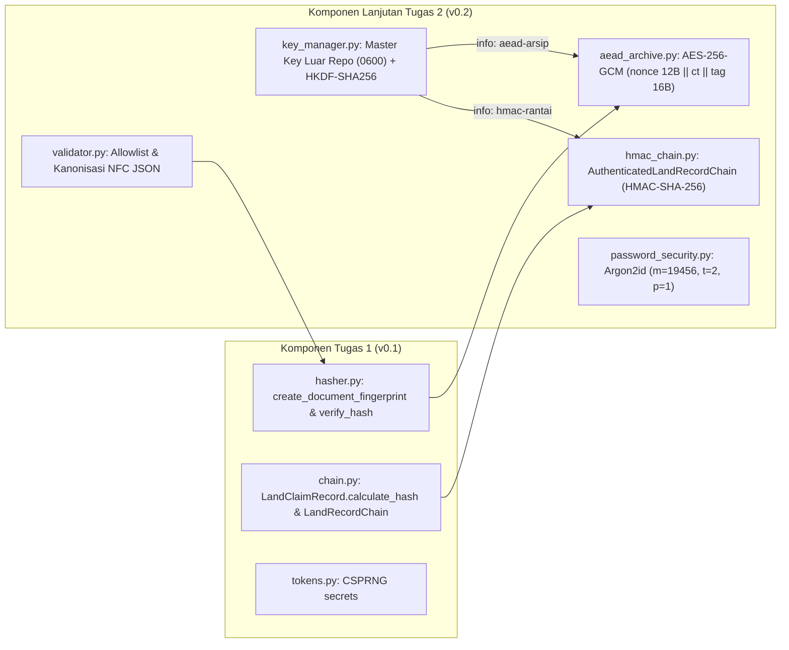

# Dokumen Keputusan Desain Kriptografi (`KEPUTUSAN.md`) — TanahKita `v0.2`

* **Produk:** **TanahKita** (Sistem Pencatatan dan Pembuktian Penguasaan Tanah Adat Papua — Kabupaten Mimika)
* **Pengembang:** Yosafat Jacobus (NIM: `105224016`)
* **Mata Kuliah:** Kriptografi (`052357` — Kelas CS5-2026) — Tugas 2
* **Penanda Rilis:** `v0.2`

---

## 1. Pemetaan Kebutuhan $\rightarrow$ Mekanisme $\rightarrow$ Alasan (Kriteria K1)

Tabel berikut memetakan setiap aset data pada produk **TanahKita** dari kebutuhan keamanannya ke mekanisme kriptografi yang dipilih beserta alasan teknis pemilihannya:

| No | Aset Data pada Produk TanahKita | Kebutuhan Keamanan Utama | Mekanisme & Pustaka yang Dipilih | Alasan Pemilihan Mekanisme & Mengapa Alternatif Lain Ditolak | Status Implementasi |
| :-: | :--- | :--- | :--- | :--- | :-: |
| **1** | **Arsip Bukti Klaim & Surat Kesepakatan Batas Adat Sensitif** *(Koordinat batu keramat, berita acara mediasi internal marga, dan manifes dokumen)* | **Kerahasiaan (*Confidentiality*)**, **Integritas (*Integrity*)**, & **Pengikatan Konteks (*Context Binding*)** | **AEAD `AES-256-GCM`** (`cryptography.hazmat.primitives.ciphers.aead.AESGCM`) dengan AAD `claim_id\|marga\|lokasi` | • Satu primitif terpadu (RFC 5116 / NIST SP 800-38D) yang menjamin kerahasiaan sekaligus mendeteksi modifikasi 1-bit pun secara *fail-closed* (`InvalidTag`). • **Mengapa bukan AES-ECB?** Deterministik; membocorkan pola blok yang sama. • **Mengapa bukan AES-CBC / AES-CTR murni?** Tidak memiliki integritas; rentan serangan *bit-flipping* (mengubah luas hektar tanpa kunci) dan *padding oracle* (Vaudenay 2002). | **Diterapkan (`v0.2`)** pada [`aead_archive.py`](src/aead_archive.py) |
| **2** | **Rantai Riwayat Status Klaim Tanah (`LandRecordChain`)** *(Kronologi pendaftaran, verifikasi tetua adat, dan penyelesaian sengketa)* | **Integritas Berantai (*Tamper-Evident*)** & **Autentikasi Asal Data (*Data Origin Authentication*)** terhadap *Insider Threat* (`RSK-01`) | **MAC `HMAC-SHA-256`** (`hmac.new` + `hashlib.sha256`) & perbandingan waktu-konstan `hmac.compare_digest` | • Rantai riwayat perlu dibaca oleh proses audit namun tidak boleh diubah atau dihitung ulang oleh admin database nakal tanpa kunci. • **Mengapa SHA-256 murni (`v0.1`) tidak cukup?** Tanpa kunci, orang dalam yang memiliki akses database (`THR-02`) dapat memodifikasi nama marga di Blok #1 lalu menghitung ulang seluruh hash rantai. • **Mengapa bukan `SHA-256(kunci \|\| pesan)`?** Konstruksi *secret-prefix* rentan terhadap *Length Extension Attack* pada fungsi hash Merkle–Damgård; konstruksi dua lapis HMAC (`ipad`/`opad`, RFC 2104) menutup celah tersebut. | **Diterapkan (`v0.2`)** pada [`hmac_chain.py`](src/hmac_chain.py) |
| **3** | **Berkas Bukti Fisik Publik (Foto Patok & Peta Batas)** | **Integritas Sidik Jari (*Document Fingerprinting*)** | **Fungsi Hash `SHA-256`** (`hashlib.sha256`) | • Menghasilkan digest deterministik 256-bit dengan ketahanan *second-preimage* ($\approx 2^{256}$) dan *collision resistance* ($\approx 2^{128}$) sebagai sidik jari dokumen yang diikat ke dalam amplop AEAD dan rantai HMAC. • **Mengapa bukan MD5 / SHA-1?** Keduanya sudah patah secara praktis terhadap tabrakan (*Wang 2004*, *SHAttered 2017*). | **Diterapkan (`v0.1` $\rightarrow$ Terintegrasi `v0.2`)** pada [`hasher.py`](src/hasher.py) |
| **4** | **Kata Sandi & PIN Akun Tetua Adat / Verifikator / Pemohon** | **Ketahanan Tebakan Offline (*Offline Cracking Resistance*)** saat basis data bocor | **Password Hashing `Argon2id`** (`cryptography.hazmat.primitives.kdf.argon2.Argon2id`, RFC 9106) + **Salt CSPRNG 16 Byte** | • Sengaja lambat dan *memory-hard* ($m = 19\,\text{MiB}, t = 2, p = 1$) untuk menahan serangan GPU/ASIC paralel. • **Mengapa bukan Enkripsi (AES)?** Kata sandi tidak perlu pernah dikembalikan ke bentuk *plaintext*; jika kunci enkripsi bocor, seluruh kata sandi terbuka. • **Mengapa bukan SHA-256 / HMAC?** Fungsi hash dan MAC dirancang sangat cepat (mikrodetik), sehingga GPU penyerang dapat menebak miliaran kandidat sandi per detik. | **Diterapkan (`v0.2`)** pada [`password_security.py`](src/password_security.py) |
| **5** | **Kunci Induk & Pemisahan Kunci Per Tujuan** | **Kerahasiaan Kunci & Isolasi Domain Kriptografi (*Key Separation*)** | **CSPRNG (`secrets.token_bytes(32)`)** di luar repo + **KDF `HKDF-SHA256` (RFC 5869)** | • Satu kunci tidak boleh dipakai langsung untuk dua primitif berbeda (AES-GCM dan HMAC) sesuai NIST SP 800-57 Bagian 5.2. • `HKDF-SHA256` menurunkan sub-kunci independen secara kriptografis melalui label konteks `info` tanpa perlu menambah berkas kunci baru. | **Diterapkan (`v0.2`)** pada [`key_manager.py`](src/key_manager.py) |

---

## 2. Perbedaan Tegas: Enkripsi (AEAD) vs Hash vs MAC vs Password Hashing

Sesuai indikator capaian K1 Rubrik R2, berikut adalah matriks pembeda teknis keempat primitif kriptografi dan alasan mengapa ketiganya tidak boleh dipertukarkan pada produk **TanahKita**:

| Aspek Pembanding | Fungsi Hash (`SHA-256`) | MAC (`HMAC-SHA-256`) | Enkripsi Terautentikasi / AEAD (`AES-256-GCM`) | Password Hashing (`Argon2id`) |
| :--- | :--- | :--- | :--- | :--- |
| **Kebutuhan Kunci** | **Tanpa kunci** | **1 Kunci rahasia simetris** (32 B) | **1 Kunci rahasia simetris** (32 B) + **Nonce unik** (12 B) | **Tanpa kunci rahasia**; memakai **Salt acak publik** (16 B) per pengguna |
| **Sifat Pembalikan (*Reversibility*)** | Satu arah (*one-way*) | Satu arah (*one-way tag*) | **Dua arah (*reversible*)** bagi pemegang kunci bila tag valid | Satu arah (*one-way*) |
| **Kecepatan Komputasi** | Sangat cepat ($\sim\mu\text{s}$) | Sangat cepat ($\sim\mu\text{s}$) | Sangat cepat ($\sim\mu\text{s}$, dipercepat AES-NI/ARMv8 Crypto) | **Sengaja lambat & boros memori** ($\sim\text{ puluhan ms}$, $19\,\text{MiB}$ RAM) |
| **Jaminan Keamanan yang Diberikan** | Integritas *hanya bila* digest pembanding disimpan di saluran tepercaya | **Integritas + Autentikasi Asal Data** (hanya pemegang kunci yang dapat membuat/memeriksa tag) | **Kerahasiaan + Integritas + Autentikasi Asal** atas *plaintext* dan konteks *AAD* | Melindungi kata sandi berentropi rendah dari tebakan massal (*brute-force* / *rainbow table*) |
| **Penerapan pada TanahKita** | Menghitung sidik jari berkas surat/foto patok (`content_sha256` di `hasher.py`) | Mengunci setiap blok riwayat tanah adat di `hmac_chain.py` agar tidak bisa dipalsukan oleh admin DB tanpa kunci | Membungkus amplop arsip klaim + manifes sidik jari di `aead_archive.py` dengan AAD `claim_id\|marga\|lokasi` | Menyimpan hash kata sandi Tetua Adat, Verifikator, dan Pemohon di `password_security.py` |

---

## 3. Spesifikasi Parameter Kriptografi & Arsitektur Integrasi Tugas 1 $\rightarrow$ Tugas 2 (Kriteria K2 & K3)

### A. Alur Integrasi Komponen Tugas 1 dan Tugas 2
Komponen Tugas 2 (`v0.2`) tidak berdiri terpisah, melainkan memanggil langsung fungsi dan struktur data Tugas 1 (`v0.1`):

1. **Pola Integrasi Data Berlapis & Kunci Mengalir:**
   - Saat mengarsipkan klaim (`encrypt_claim_archive`), masukan pengguna terlebih dahulu melewati `validate_and_normalize_claim_payload()` (validasi *allowlist*), kemudian memanggil `create_document_fingerprint()` dari **Tugas 1 (`hasher.py`)** untuk menghasilkan manifes SHA-256 dokumen. Amplop gabungan tersebut diserialisasi secara kanonis (`canonicalize_json_bytes`) lalu dienkripsi dengan **`AES-256-GCM`** menggunakan sub-kunci dari `derive_aead_key()`.
   - Saat membuka arsip (`decrypt_claim_archive`), setelah tag GCM dan AAD diverifikasi oleh `AESGCM.decrypt()`, fungsi memanggil kembali `verify_hash()` dari **Tugas 1 (`hasher.py`)** untuk memvalidasi keutuhan `manifest_hash` dan `content_sha256`. Apabila sambungan ke fungsi Tugas 1 diputus atau dirusak, pengujian `test_09_integration_break_between_tugas1_and_tugas2_detected` langsung gagal dengan `InvalidTag`.
   - Pada rantai riwayat (`AuthenticatedLandRecordChain`), penambahan blok memanggil `LandRecordChain.add_record()` dan `record.calculate_hash()` dari **Tugas 1 (`chain.py`)**, lalu mengunci blok tersebut secara berantai menggunakan `HMAC-SHA-256` (`prev_tag || "|" || block_sha256`).

### B. Tabel Parameter Teknis Kriptografi

| Komponen / Algoritma | Parameter | Nilai pada TanahKita `v0.2` | Standar Acuan & Alasan Teknis |
| :--- | :--- | :--- | :--- |
| **Kunci Induk (*Master Key*)** | Sumber & Panjang | `secrets.token_bytes(32)` (**256 bit / 32 byte**) | CSPRNG sistem operasi (`/dev/urandom`); disimpan di luar repo (`/Volumes/For Apple/.secrets/tanahkita_master.key`) dengan izin `0600`. |
| **Pemisahan Kunci (`HKDF-SHA256`)** | `salt` & `info` | • `salt`: `b"TanahKita-Mimika-Papua-HKDF-Salt-v0.2"` • `info` AEAD: `b"tanahkita:v0.2:aead-arsip-aes256gcm"` • `info` HMAC: `b"tanahkita:v0.2:hmac-rantai-sha256"` • Panjang sub-kunci: **32 byte (256 bit)** | **RFC 5869 & NIST SP 800-57 Bagian 5.2**: Mencegah pemakaian ulang satu kunci pada dua algoritma berbeda tanpa perlu mengelola banyak berkas kunci. |
| **AEAD (`AES-256-GCM`)** | • Panjang Kunci • Panjang Nonce • Panjang Tag • Format Paket • Struktur AAD | • Kunci: **256 bit (32 byte)** • Nonce: **96 bit (12 byte)** dari `os.urandom(12)` per enkripsi • Tag: **128 bit (16 byte)** • Paket: `nonce (12B) \|\| ciphertext (nB) \|\| tag (16B)` • AAD: `b"tanahkita:v0.2\|claim_id=<ID>\|marga=<Marga>\|lokasi=<Lokasi>"` | **NIST SP 800-38D & RFC 5116**: Nonce 96-bit adalah ukuran paling efisien karena langsung masuk ke counter $J_0 = \text{nonce} \parallel 0^{31}1$ tanpa perlu di-hash ulang oleh GHASH. AAD mengikat ciphertext pada identitas klaim agar paket arsip Marga Magal tidak dapat dipindahkan ke klaim Marga Beanal. |
| **MAC (`HMAC-SHA-256`)** | • Panjang Kunci • Konstruksi Pesan • Verifikasi | • Kunci: **256 bit (32 byte)** • Pesan: `bytes.fromhex(prev_tag) + b"\|" + record.calculate_hash().encode("utf-8")` • Verifikasi: `hmac.compare_digest(expected, stored)` | **RFC 2104**: Mengikat urutan kronologis blok sebelumnya (`prev_tag`) dan isi blok saat ini; `compare_digest` mencegah *timing side-channel attack*. |
| **Password Hashing (`Argon2id`)** | • Memori (`m`) • Iterasi (`t`) • Paralelisme (`p`) • Salt & Output | • `memory_cost`: **19456 KiB (19 MiB)** • `iterations`: **2** • `lanes`: **1** • Salt: **16 byte** CSPRNG; Output: **32 byte** | **RFC 9106 & OWASP Password Storage Cheat Sheet (2026)**: Profil minimum pertama OWASP untuk Argon2id; kebijakan panjang sandi minimal **15 karakter** mengikuti **NIST SP 800-63B-4 (Agustus 2025)**. |

---

## 4. Analisis Akibat Penyalahgunaan Parameter pada Produk TanahKita (Kriteria K5)

### A. Mengapa Nonce Berulang (*Nonce Reuse*) pada AES-256-GCM Berakibat Fatal bagi TanahKita?
Apabila fungsi `encrypt_bytes_aead` salah diimplementasikan sehingga memakai nonce 12-byte yang tetap atau berulang untuk dua arsip klaim tanah berbeda di bawah kunci AEAD yang sama, terjadi **dua kehancuran keamanan sekaligus**:

1. **Kehancuran Kerahasiaan Total (*Two-Time Pad Attack* pada Komponen CTR):**
   - Di balik layar, `AES-256-GCM` mengenkripsi *plaintext* menggunakan mode aliran `AES-CTR` dengan *keystream* $KS = E_K(\text{nonce} \parallel \text{counter})$.
   - Jika dua arsip klaim $P_1$ (mis. batas tanah keramat Marga Magal) dan $P_2$ (mis. risalah mediasi sengketa Marga Beanal) dienkripsi dengan pasangan $(K, \text{nonce})$ yang sama, maka keduanya di-XOR dengan *keystream* $KS$ yang identik:
     $$C_1 \oplus C_2 = (P_1 \oplus KS) \oplus (P_2 \oplus KS) = P_1 \oplus P_2$$
   - Kunci $K$ hilang sepenuhnya dari persamaan! Karena amplop JSON kanonis TanahKita memiliki struktur awalan yang terprediksi (`{"claim":{"action":"PENDAFTARAN_KLAIM","catatan_batas":...`), penyerang cukup melakukan XOR antara $C_1 \oplus C_2$ dengan bagian *known-plaintext* untuk **membaca isi koordinat keramat dan dokumen sengketa marga lain tanpa mengetahui kunci $K$**.

2. **Kehancuran Autentikasi & Pemalsuan Arsip (*Forbidden Attack* pada Polinomial GHASH — Joux 2006):**
   - Tag autentikasi GCM dihitung menggunakan fungsi evaluasi polinomial $\text{GHASH}_H(A, C)$ di atas medan hingga $\text{GF}(2^{128})$, di mana kunci sub-hash $H = E_K(0^{128})$ bersifat tetap untuk kunci $K$ yang sama, kemudian di-XOR dengan masker $S = E_K(\text{nonce} \parallel 0^{31}1)$.
   - Apabila dua paket $(C_1, T_1)$ dan $(C_2, T_2)$ memakai nonce yang sama, masker $S$ mereka sama persis. Saat penyerang menghitung $T_1 \oplus T_2$, masker $S$ saling menghilangkan dan menyisakan persamaan polinomial berderajat rendah atas variabel tunggal $H$ di $\text{GF}(2^{128})$.
   - Dengan mencari akar polinomial tersebut, penyerang **memperoleh kunci sub-hash $H$** (sebagaimana diperingatkan dalam **NIST SP 800-38D Lampiran A**). Setelah $H$ bocor, pihak mafia tanah dapat **memalsukan paket arsip klaim tanah adat beserta tag GCM yang 100% valid (`InvalidTag` tidak terpicu)** untuk koordinat batas palsu pilihannya sendiri!
   - **Cara Pencegahan di TanahKita:** Nonce wajib dibangkitkan di dalam fungsi `encrypt_bytes_aead` menggunakan `os.urandom(12)` setiap kali dipanggil (tidak pernah diterima dari parameter luar/konstanta), diuji otomatis pada `test_03_nonce_uniqueness_across_encryptions`, dan kunci induk dirotasi melalui `rotate_master_key()` jauh sebelum batas aman NIST SP 800-38D ($2^{32}$ enkripsi per kunci).

### B. Keterbatasan Saat Ini (`K2`) & Peta Jalan Menuju Tugas 3
- **Keterbatasan `K1` dari Tugas 1 Kini Tertutup:** Manipulasi riwayat klaim oleh orang dalam tanpa kunci yang pada `v0.1` lolos saat rantai SHA-256 dihitung ulang, kini **ditolak sepenuhnya oleh `HMAC-SHA-256`** (dibuktikan pada `test_08_negative_insider_threat_k1_closed_and_no_side_effects`).
- **Keterbatasan Baru `K2` pada `v0.2` (Kunci Simetris Bersama / *Shared Key*):**
  Karena `HMAC-SHA-256` menggunakan kunci simetris yang dipegang oleh server aplikasi, pihak yang memiliki akses ke kunci HMAC server masih dapat mengubah isi blok riwayat dan menandatangani ulang tag HMAC yang sah (didokumentasikan secara jujur melalui pengujian `@pytest.mark.xfail(strict=True)` pada `test_12_limitation_k2_shared_key_holder_forgery_xfail`). Dengan kata lain, MAC menjamin **integritas dan autentikasi asal**, tetapi **belum memberikan sifat nirsangkal (*non-repudiation*)**.
- **Solusi pada Tugas 3:** Menambahkan **Tanda Tangan Digital Asimetris (`Ed25519`)** di mana kunci privat dipegang eksklusif oleh Tetua Adat dan server hanya menyimpan kunci publik (`public key`), sehingga server sekalipun tidak dapat memalsukan persetujuan batas wilayah adat.
