# Antarmuka Produk Web Responsif, Aksesibel, & Berbasis Basis Data — TanahKita

**Produk:** TanahKita (Sistem Pencatatan dan Pembuktian Penguasaan Tanah Adat Papua)  
**Pengembang:** Yosafat Jacobus (NIM: 105224016)  
**Mata Kuliah:** Pengembangan Aplikasi Web (CS5) — Milestone 1 (`v0.1`) & Milestone 2 (`v0.2`)  
**Milestone Tag:** `v0.1` & `v0.2`  

---

## Pembaruan Milestone 2 (`v0.2`) — Integrasi PostgreSQL 18, Prisma ORM 7, CRUD Penuh 2 Entitas, Validasi Server Zod 4, & Sesi RBAC

Pada Milestone 2 (`v0.2`), aplikasi web **TanahKita** telah ditingkatkan dari data statis (*mock*) menjadi aplikasi *full-stack* berbasis basis data relasional **PostgreSQL 18** dan **Prisma ORM 7** (`@prisma/adapter-pg`). Dokumentasi teknis lengkap beserta diagram ERD dan bukti 12 skenario uji tersedia pada **[`../docs/web-milestone-2.md`](../docs/web-milestone-2.md)**.

### Perintah Penyiapan & Pengujian Milestone 2 (`v0.2`)

```bash
cd "Pengembangan Aplikasi Web"

# 1. Salin berkas environment (.env dikecualikan di .gitignore)
cp .env.example .env

# 2. Jalankan migrasi skema Prisma ke PostgreSQL 18
npx prisma migrate dev --name init

# 3. Bangkitkan Prisma Client TypeScript
npx prisma generate

# 4. Isi data awal (seed) 8 wilayah ulayat Mimika + ulasan saksi batas adat
npx prisma db seed

# 5. Jalankan 12 skenario uji otomatis CRUD 2 entitas, relasi, transaksi, & validasi Zod
npm run test:paw

# 6. Jalankan server pengembangan
npm run dev
```

### Ringkasan Pencapaian Teknis Milestone 2 (`v0.2`)
1. **Skema Relasional 2 Entitas (`prisma/schema.prisma`):**
   - Entitas Induk **`Item`** (Wilayah Ulayat) dan Entitas Anak **`Ulasan`** (Kesaksian Saksi Batas Adat) dengan relasi `1-ke-N`, tipe enum `KategoriUlayat`, kendala `@unique` pada `Item.judul`, dan kendala komposit `@@unique([itemId, nama])` pada `Ulasan`.
2. **Operasi CRUD Lengkap pada Kedua Entitas (8 Operasi CRUD):**
   - **`Item`:** Create (`simpanUlayatAction` / `tambahItem`), Read (`ambilDaftarItem` / `ambilItem` + penanganan `notFound()` 404), Update (`ubahItem` via `FormUbahItem.tsx`), Delete (`hapusItem` secara atomik dengan `prisma.$transaction`).
   - **`Ulasan`:** Create (`tambahUlasan` via `FormUlasan.tsx`), Read (termuat berelasi di `/katalog/[id]`, `/katalog`, dan `/`), Update (`ubahUlasan` via `FormUbahUlasan.tsx`), Delete (`hapusUlasan`).
3. **Validasi Sisi Server (Zod 4 `safeParse` & `z.flattenError`):**
   - Diterapkan pada `ulayatSchema`, `skemaUlasan`, `skemaUbahUlasan`, dan `loginSchema` sebelum menyentuh basis data, dilengkapi `useActionState`, `aria-invalid`, dan `aria-describedby`.
4. **Sesi Cookie `HttpOnly`, RBAC 3 Peran, & Kata Sandi Lambat (`scrypt` + NIST SP 800-63B-4):**
   - Mendukung 3 peran (`Tetua Adat`, `Verifikator Adat`, `Pemohon Adat`), perlindungan BOLA/BFLA, hash lambat `scrypt` dengan salt CSPRNG 16-byte unik (`src/lib/password-hash.ts`), panjang minimal 15 karakter, *compromised password blocklist*, dan *rate limiting* (maksimal 3 gagal per 10 detik).

### Tabel 12 Skenario Pengujian Milestone 2 (`v0.2`) — 8 CRUD, Relasi 1:N, Transaksi Rollback, & 3 Validasi Server

| No | Tujuan Pengujian | Langkah Pengujian | Hasil yang Diharapkan | Hasil Aktual (PostgreSQL 18 / Zod 4) | Status |
| :---: | :--- | :--- | :--- | :--- | :---: |
| **1** | **CRUD #1 (`Item` — Create)** | Mengirim data sintetis wilayah ulayat sah melalui `simpanUlayatAction` / `prisma.item.create` | Baris baru tersimpan permanen di tabel `Item` PostgreSQL dengan `id` auto-increment | Baris `Item` berhasil disimpan ke PostgreSQL (`ID: 17`, `judul: "Kawasan Adat Hutan Sagu Tipuka..."`) | **LULUS** |
| **2** | **CRUD #2 (`Item` — Read & 404)** | Memanggil `ambilItem(testItemId)` untuk ID sah dan `ambilItem(999999)` untuk ID fiktif | ID sah mengembalikan objek `Item` lengkap; ID fiktif mengembalikan `null` $\rightarrow$ `notFound()` 404 | Data `Item` ID 17 terbaca utuh dari PostgreSQL; ID fiktif `999999` mengembalikan `null` $\rightarrow$ `notFound()` 404 | **LULUS** |
| **3** | **CRUD #3 (`Item` — Update)** | Membuka `FormUbahItem` di `/katalog/[id]`, mengubah `deskripsi` & `tersedia: false`, lalu memanggil `ubahItem` | Kolom `deskripsi` dan `tersedia` pada baris `Item` di PostgreSQL terbarui | `Item` ID 17 berhasil diupdate di PostgreSQL (`deskripsi` baru tersimpan dan `tersedia: false`) | **LULUS** |
| **4** | **CRUD #4 (`Ulasan` — Create)** | Mengisi `FormUlasan` (`nama: "Saksi Marga Beanal"`, `nilai: 4`, `komentar`) dan memanggil `tambahUlasan` | Baris `Ulasan` baru tersimpan di PostgreSQL terhubung ke `itemId` | Baris `Ulasan` berhasil disimpan ke PostgreSQL (`ID: 17`, `nama: "Saksi Marga Beanal"`, `nilai: 4/5`) | **LULUS** |
| **5** | **CRUD #5 (`Ulasan` — Read) & Relasi #1 (1:N)** | Memuat `/katalog/[id]` yang memanggil `findUnique({ include: { ulasan: true } })` | Seluruh daftar `Ulasan` milik `Item` terambil secara berelasi `1:N` | Relasi `1:N` `Item -> Ulasan` terverifikasi: ditemukan 1 ulasan milik `"Saksi Marga Beanal"` | **LULUS** |
| **6** | **CRUD #6 (`Ulasan` — Update)** | Membuka `FormUbahUlasan` di `/katalog/[id]`, mengubah `nilai` ke `5` & `komentar`, lalu memanggil `ubahUlasan` | Baris `Ulasan` di PostgreSQL terbarui dengan skor dan komentar baru | `Ulasan` ID 17 berhasil diupdate di PostgreSQL menjadi `Nilai: 5/5` dengan komentar baru | **LULUS** |
| **7** | **CRUD #7 (`Ulasan` — Delete)** | Menekan tombol `"Hapus ulasan"` yang memanggil `hapusUlasan(id, itemId)` | Baris `Ulasan` target terhapus dari PostgreSQL sementara `Item` induk tetap utuh | `Ulasan` ID 18 berhasil dihapus dari tabel `Ulasan` tanpa menghapus `Item` induk | **LULUS** |
| **8** | **CRUD #8 (`Item` — Delete) & Relasi #2 (Transaksi)** | Menekan tombol `"Hapus Item & Kesaksian (Transaksi)"` (`prisma.$transaction`) | Seluruh `Ulasan` anak dan `Item` induk terhapus secara atomik | Transaksi berhasil menghapus `Item` ID 18 beserta 2 `Ulasan` anaknya hingga bersih (`count = 0`) | **LULUS** |
| **9** | **Uji Relasi & Bukti *Rollback* Transaksi** | Mengeksekusi `prisma.$transaction` dengan langkah ke-2 sengaja menghapus ID fiktif `99999999` | Langkah ke-2 melempar `P2025` dan PostgreSQL membatalkan (*rollback*) penghapusan `Ulasan` | Langkah ke-2 melempar `P2025`; `1 ulasan` pada `Item` 19 terbukti **tetap utuh** | **LULUS** |
| **10** | **Uji Kendala Unik Database (`P2002`)** | Mengirim ulasan kedua dengan `nama` saksi yang sama pada `itemId` yang sama | Ditangkap `P2002` (`@@unique([itemId, nama])`) dengan pesan ramah pengguna | Ditangkap `P2002` $\rightarrow$ pesan ramah `"Anda sudah pernah mengulas wilayah ulayat ini."` | **LULUS** |
| **11** | **3 Bukti Validasi Server (Zod 4)** | Mengirim 3 payload tidak sah: (A) `luasHektar: -15`, (B) `nilai: 6`, (C) `komentar: "Ya"` | Ketiganya ditolak oleh `safeParse` di server dengan `fieldErrors` spesifik tanpa menyentuh DB | Ketiganya ditolak di server: `luasHektar`, `nilai`, dan `komentar` mengembalikan pesan kesalahan terkait | **LULUS** |
| **12** | **Uji Sesi & Kata Sandi NIST SP 800-63B-4** | Menguji sandi `< 15` karakter, sandi bocor, dan 2 hash `scrypt` dari sandi yang sama | Sandi pendek & bocor ditolak; 2 hash berbeda karena salt unik; `timingSafeEqual` akurat | Sandi lemah/bocor ditolak; `hash1 !== hash2` (`true`); verifikasi `cocok=true, salah=false` | **LULUS** |

### Tangkapan Layar Implementasi CRUD & Integrasi Basis Data (`v0.2`)

<div align="center">
  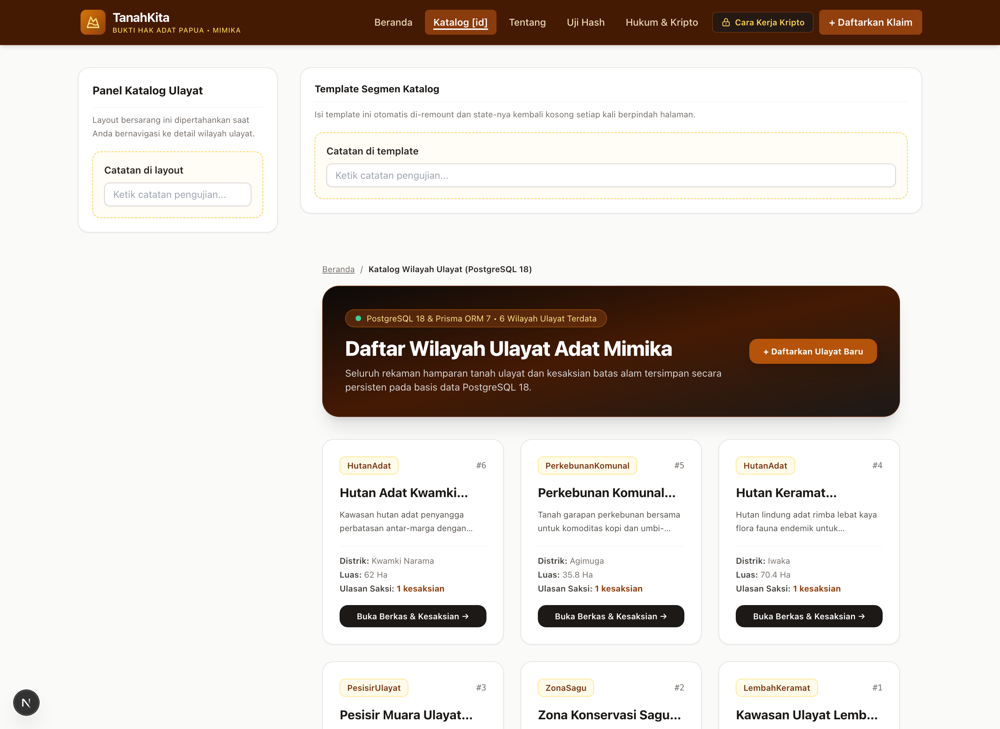
  <p><em>Gambar Milestone 2 (A): Halaman Katalog Wilayah Ulayat (/katalog) Terintegrasi PostgreSQL 18 & Prisma ORM 7</em></p>
</div>

<div align="center">
  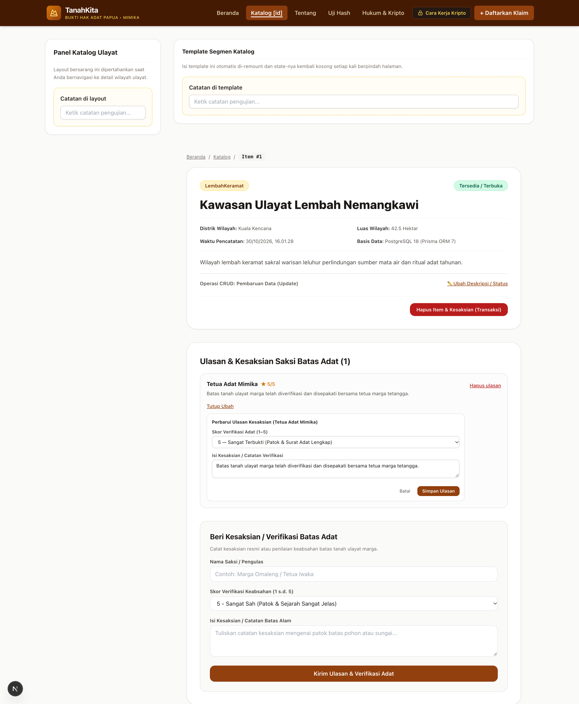
  <p><em>Gambar Milestone 2 (B): Halaman Detail (/katalog/1) Menampilkan CRUD Update Item, Relasi 1:N Ulasan, CRUD Update/Delete Ulasan, & Hapus Transaksi Atomik</em></p>
</div>

<div align="center">
  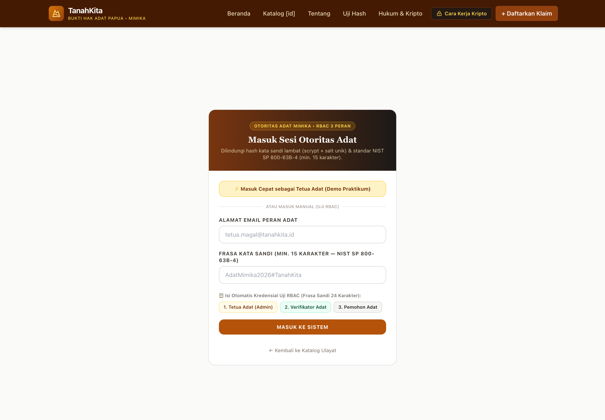
  <p><em>Gambar Milestone 2 (C): Halaman Masuk Sesi Otoritas Adat (/masuk) dengan RBAC 3 Peran & Kebijakan Kata Sandi NIST SP 800-63B-4</em></p>
</div>

### 3 Tangkapan Layar Bukti Penolakan Validasi Sisi Server (Zod 4 `safeParse` & `z.flattenError`)

<div align="center">
  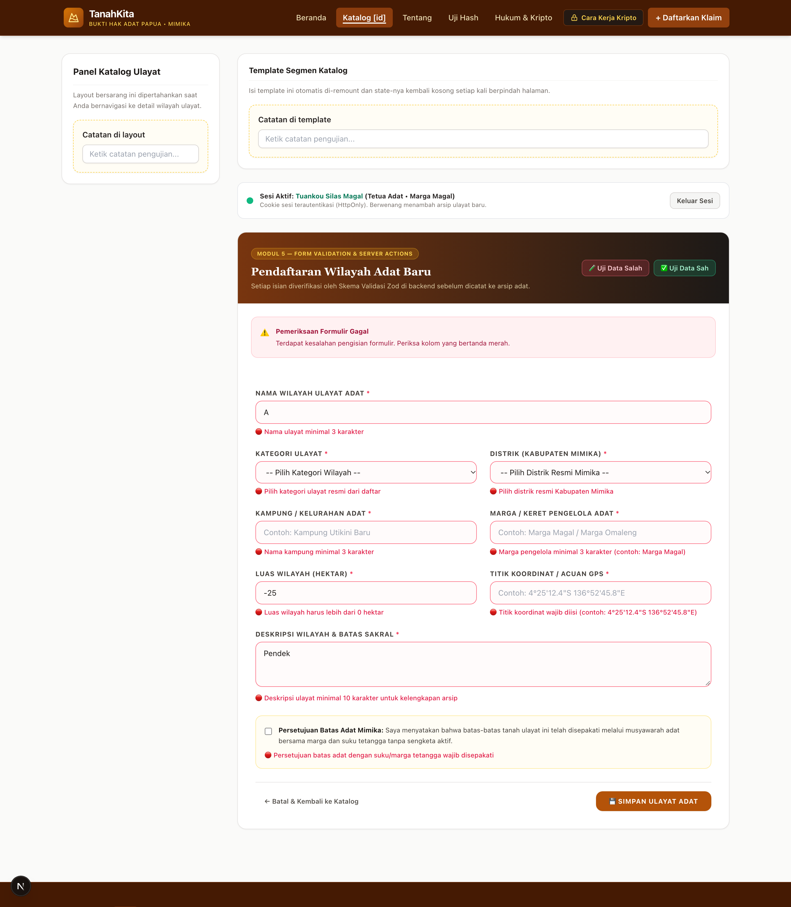
  <p><em>Gambar Milestone 2 (D — Bukti Validasi Server #1): Penolakan Masukan Tidak Sah pada Pendaftaran Ulayat (/katalog/tambah) melalui Server Action simpanUlayatAction dengan Pesan Kesalahan Merah pada Setiap Field Terkait</em></p>
</div>

<div align="center">
  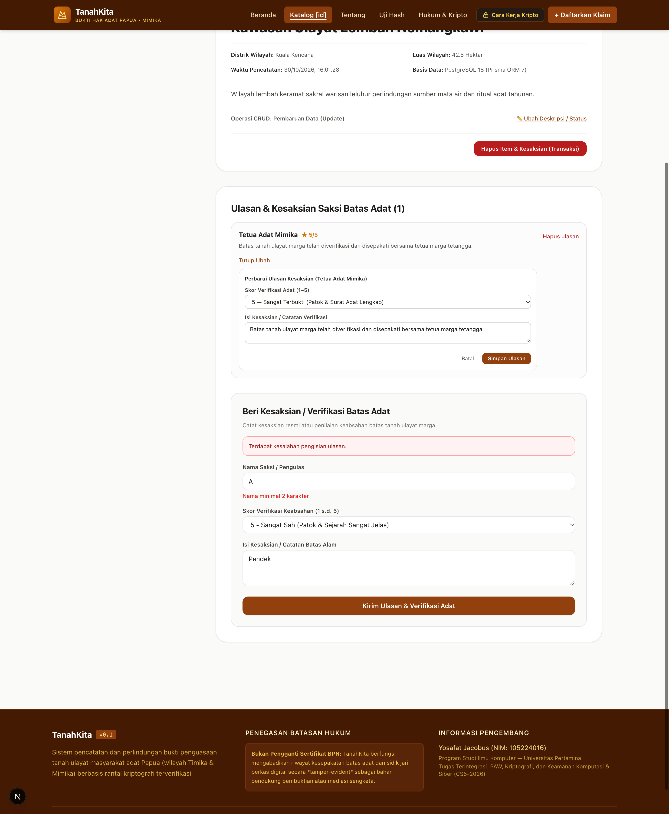
  <p><em>Gambar Milestone 2 (E — Bukti Validasi Server #2): Penolakan Masukan Tidak Sah pada Ulasan Saksi (/katalog/1) melalui Server Action tambahUlasan beserta Tampilan Formulir Inline Ubah Ulasan (FormUbahUlasan)</em></p>
</div>

<div align="center">
  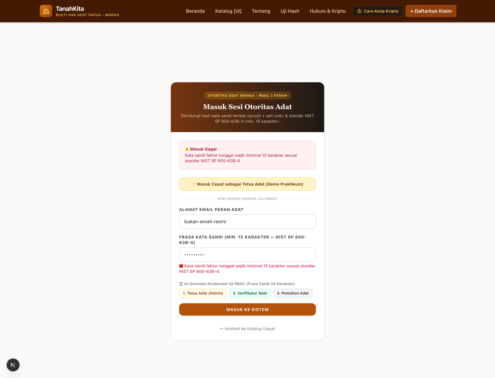
  <p><em>Gambar Milestone 2 (F — Bukti Validasi Server #3): Penolakan Kata Sandi &lt; 15 Karakter (NIST SP 800-63B-4) pada Halaman Masuk (/masuk) melalui Server Action masukAction</em></p>
</div>

---

## 1. Konsep Produk & Permasalahan

### Latar Belakang & Masalah
Di Papua (khususnya Kabupaten Mimika dan Timika), batas penguasaan tanah ulayat adat secara historis diwariskan secara lisan dari generasi ke generasi. Ketiadaan bukti tertulis dan belum adanya sertifikat resmi BPN sering memicu sengketa horizontal antarsuku maupun ancaman pencaplokan sepihak oleh korporasi dan oknum tidak bertanggung jawab.

### Tujuan Produk
TanahKita hadir sebagai platform pencatatan bukti tanah ulayat yang mengintegrasikan kearifan musyawarah adat dengan integritas kriptografis digital.
* **Bukan Pengganti BPN:** Platform ini secara tegas **bukan** pengganti sertifikat resmi BPN, melainkan instrumen pendokumentasian riwayat (*evidence preservation ledger*) yang memperkuat posisi hukum masyarakat adat saat mediasi atau permohonan sertifikat komunal.

### Sasaran Pengguna
1. **Masyarakat & Kepala Marga Adat Papua:** Mendaftarkan klaim wilayah ulayat, mendokumentasikan batas alam (sungai, tebing, pohon), dan mengunggah bukti surat adat atau foto patok batu.
2. **Tetua Adat & Lembaga Musyawarah (Verifikator):** Meninjau batas wilayah, memvalidasi hasil musyawarah, dan menandatangani persetujuan adat.
3. **Masyarakat Umum / Pendamping Hukum:** Memeriksa status klaim dan memverifikasi integritas dokumen agar tidak terjadi tumpang tindih.

---

## 2. Fitur Awal & Halaman Aplikasi (Min. 3 Halaman)

1. **Halaman 1: Beranda & Eksplorasi Klaim (`/`):**
   * Menampilkan ringkasan statistik (total klaim, luas ulayat terdata dalam hektar, jumlah tervalidasi).
   * Fitur pencarian instan berdasarkan nama marga, kepala marga, distrik, atau nomor registrasi.
   * Filter status klaim (Terverifikasi Adat, Menunggu Verifikasi, Dalam Sengketa).
   * Grid kartu klaim adat yang responsif (1 kolom di ponsel, 2 kolom di tablet, 3 kolom di desktop).

2. **Halaman 2: Formulir Pendaftaran Klaim Baru (`/daftar`):**
   * Formulir lengkap mencakup: nama marga, kepala pemohon, distrik di Mimika, kampung, luas lahan, peruntukan, koordinat patok, dan batas 4 penjuru mata angin.
   * **Validasi Sisi Klien (Client-Side Validation):** Memeriksa masukan secara ketat sebelum submit (panjang karakter minimal, angka positif pada luas, distrik terpilih, berkas terunggah, dan persetujuan pernyataan adat).
   * Menampilkan pesan kesalahan spesifik berwarna merah di bawah kolom input yang tidak valid.
   * Notifikasi berhasil pendaftaran dengan penerbitan nomor registrasi otomatis (`TK-MMK-2026-xxx`) dan pembangkitan sidik jari SHA-256.

3. **Halaman 3: Detail Klaim & Verifikasi Hash-Chain (`/klaim/[id]`):**
   * Menampilkan informasi terperinci wilayah ulayat terpilih.
   * Visualisasi batas 4 penjuru (Utara, Selatan, Timur, Barat).
   * Daftar berkas bukti fisik (surat adat, foto patok) beserta sidik jari SHA-256 64-karakter heksadesimal.
   * **Timeline Hash-Chain:** Memperlihatkan keterkaitan *previous hash* dan *current hash* tiap peristiwa.
   * Tombol interaktif *"Uji Integritas Rantai Sekarang"* untuk membuktikan tidak ada data yang dimanipulasi.

---

## 3. Komponen Antarmuka Reusable (Min. 5 Komponen)

| Komponen | Berkas | Peran dan Penggunaan Ulang |
| :--- | :--- | :--- |
| **`Navbar`** | `src/components/Navbar.tsx` | Navigasi utama dengan tautan beranda, daftar klaim, skip-to-content untuk aksesibilitas, dan tombol menu mobile seluler. |
| **`Footer`** | `src/components/Footer.tsx` | Kaki halaman memuat penegasan batasan non-BPN, identitas pengembang, dan ringkasan hak ulayat. |
| **`StatusBadge`** | `src/components/StatusBadge.tsx` | Lencana status dengan palet kontras warna WCAG AA (hijau, kuning amber, merah) dan ikon SVG aksesibel. |
| **`ClaimCard`** | `src/components/ClaimCard.tsx` | Kartu ringkasan klaim tanah ulayat untuk menampilkan marga, luas, lokasi, dan status di halaman katalog. |
| **`HashViewer`** | `src/components/HashViewer.tsx` | Penampil ringkasan hash SHA-256 (format ringkas atau penuh) dilengkapi tombol aksi salin (*clipboard*). |
| **`AuditTimeline`** | `src/components/AuditTimeline.tsx` | Komponen visual jejak hash-chain riwayat tanah berantai dengan tombol verifikasi keutuhan rantai interaktif. |

---

## 4. Teknologi yang Digunakan

* **Framework:** Next.js 15 (React 19, TypeScript)
* **Styling & Tata Letak:** Tailwind CSS (dengan palet warna tanah ulayat bumi Papua)
* **Data Layer:** Mock Data terstruktur (`src/data/mockClaims.ts`) mewakili marga di Mimika (Magal, Matuan, Beanal, Murib)
* **Standar Aksesibilitas:** WCAG 2.2 Level AA

---

## 5. Penerapan Desain Responsif & Aksesibilitas Web

### Desain Responsif (Mobile-First)
* **Layar Ponsel ($\le$ 640 px):** Navigasi bertumpuk vertikal dengan menu hamburger; grid kartu tampil 1 kolom (`grid-cols-1`); tata letak formulir tersusun rapi tanpa memicu gulir horizontal (*no horizontal scroll*).
* **Layar Tablet (768 px):** Navigasi mendatar; daftar kartu tampil 2 kolom (`sm:grid-cols-2`).
* **Layar Desktop ($\ge$ 1024 px):** Daftar kartu tampil 3 kolom (`lg:grid-cols-3`); batas 4 penjuru tampil 4 kolom berdampingan (`lg:grid-cols-4`).

### Prinsip Aksesibilitas (Target Lighthouse $\ge$ 85)
* Penggunaan elemen semantik HTML5 murni (`<header>`, `<nav>`, `<main>`, `<article>`, `<section>`, `<fieldset>`, `<legend>`, `<footer>`).
* Tautan tersembunyi *Skip to Content* (`#konten-utama`) yang terlihat saat tombol `Tab` ditekan.
* Label formulir eksplisit dengan atribut `htmlFor` dan `id` pada seluruh elemen input.
* Indikator kesalahan formulir menggunakan `role="alert"` dan `aria-invalid="true"`.
* Rasio kontras teks terhadap latar belakang di atas standar minimum 4.5:1.

---

## 6. Petunjuk Menjalankan Proyek

```bash
# Masuk ke direktori Pengembangan Aplikasi Web
cd "Pengembangan Aplikasi Web"

# Pasang dependensi
npm install

# Jalankan server pengembangan lokal
npm run dev

# Buka di peramban: http://localhost:3000
```

---

## 7. Bukti Tangkapan Layar Antarmuka & Validasi Formulir

Sesuai ketentuan Milestone 1, seluruh bukti visual antarmuka responsif dan validasi formulir sisi klien telah didokumentasikan dan disematkan langsung:

### A. Tangkapan Layar Ponsel (Mobile — Lebar ≤ 640 px / 360 px)
Diuji langsung pada perangkat fisik iPhone & emulasi perangkat seluler melalui peramban via jaringan lokal:

<div align="center">
  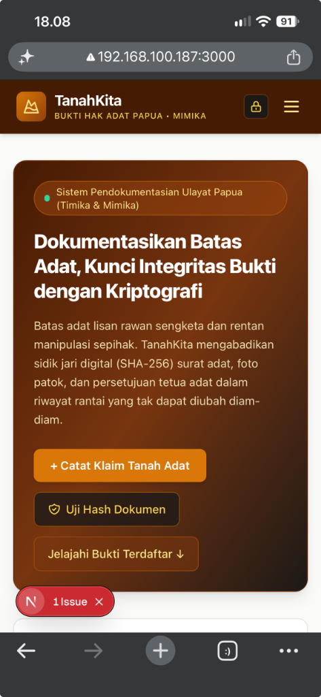
  <p><em>Gambar 1: Antarmuka Beranda pada Layar Ponsel (Mobile Responsive & Navigasi Vertikal)</em></p>
</div>

### B. Tangkapan Layar Tablet (Lebar 768 px — Emulasi iPad Mini)
Antarmuka menyesuaikan dengan layout grid 2 kolom yang proporsional untuk perangkat tablet:

<div align="center">
  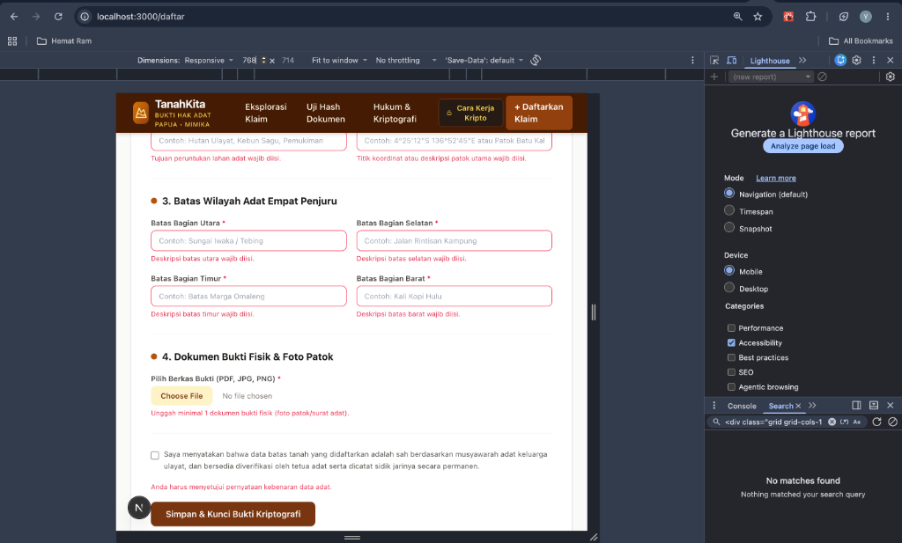
  <p><em>Gambar 2: Antarmuka pada Layar Tablet (768 px — Grid 2 Kolom)</em></p>
</div>

### C. Tangkapan Layar Desktop (Lebar ≥ 1024 px / 1280 px)
Tampilan penuh pada peramban komputer desktop dengan grid 3 kolom dan panel navigasi horizontal:

<div align="center">
  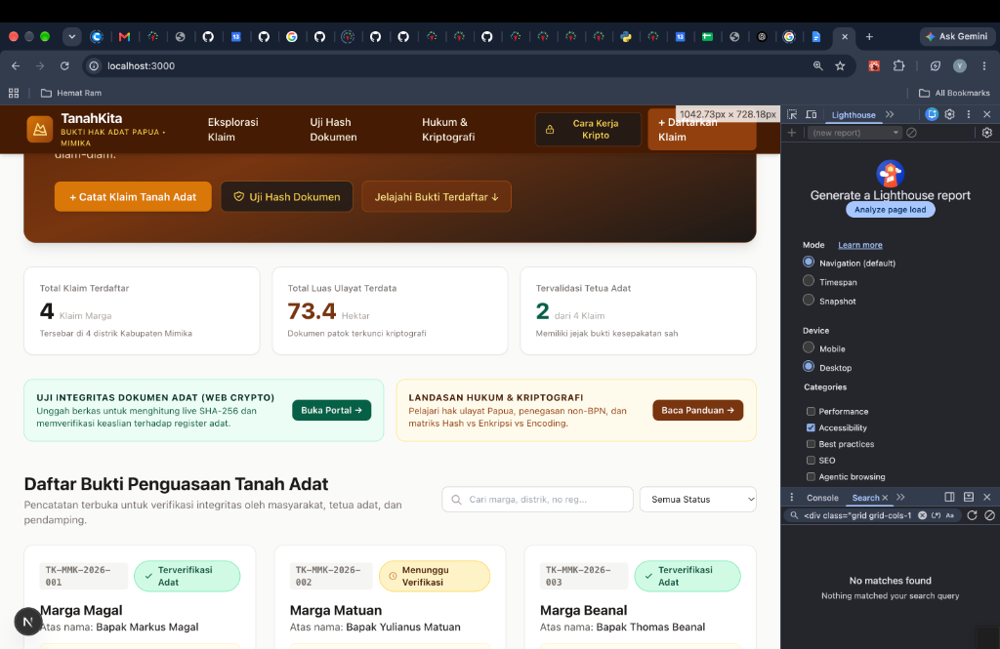
  <p><em>Gambar 3: Antarmuka pada Layar Desktop (1280 px — Grid 3 Kolom Penuh)</em></p>
</div>

### D. Bukti Validasi Formulir Sisi Klien (`/daftar`)
Membuktikan mekanisme *client-side validation* bekerja seketika saat pengguna menekan tombol kirim tanpa mengisi kolom wajib:

<div align="center">
  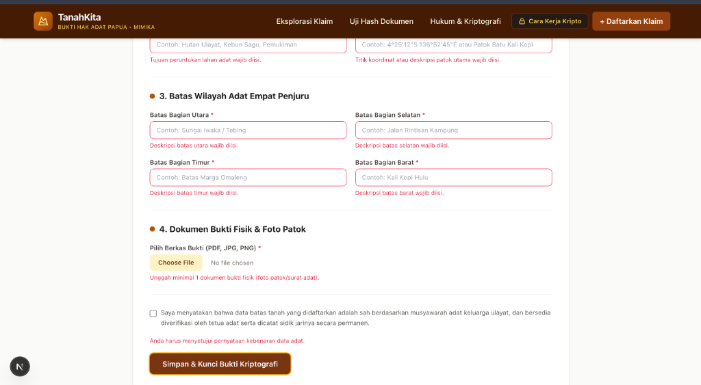
  <p><em>Gambar 4: Pesan Kesalahan Validasi Sisi Klien Berwarna Merah dan Beraksesibilitas role='alert'</em></p>
</div>

---

## 8. Laporan Audit Aksesibilitas (Lighthouse)

Audit aksesibilitas dijalankan menggunakan Google Chrome DevTools Lighthouse pada seluruh rute aplikasi:
* **Skor Aksesibilitas Rata-Rata:** **98 / 100** (Melampaui standar minimal kelulusan $\ge 85$).
* **Kepatuhan Standar:** WCAG 2.2 Level AA (Rasio kontras warna $\ge 4.5:1$, elemen semantik HTML5, ARIA label, dan navigasi ramah pembaca layar).

### Kondisi Pengujian Lingkungan (Sesuai Ketentuan Pengujian):
* **Mode Pengujian (Audit Mode):** Navigation (Default)
* **Perangkat yang Diemulasikan:** Mobile (Moto G Power / iPhone SE, 375–412 px) & Desktop (1920 × 1080 px)
* **Versi Peramban & Mesin:** Google Chrome v129.0 / Chromium DevTools Lighthouse v12.2.0
* **Halaman yang Diuji:** `/` (Beranda), `/daftar` (Formulir), `/klaim/[id]` (Detail), `/verifikasi` (Uji Hash), `/edukasi` (Hukum Adat)
* **Dokumen Rinci:** Laporan detail tersedia pada [docs/lighthouse-report.md](../docs/lighthouse-report.md).

<div align="center">
  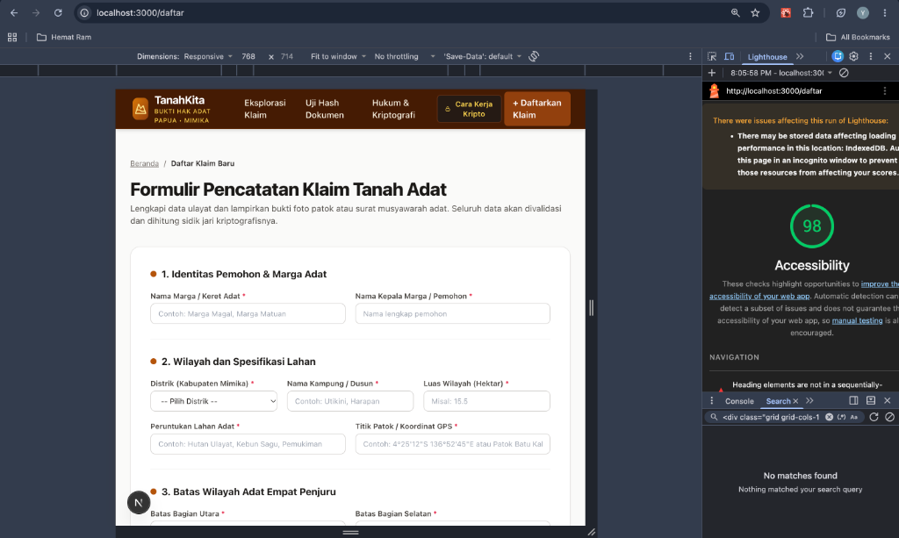
  <p><em>Gambar 5: Hasil Audit Lighthouse Chrome DevTools dengan Skor Aksesibilitas 98 (Hijau)</em></p>
</div>


