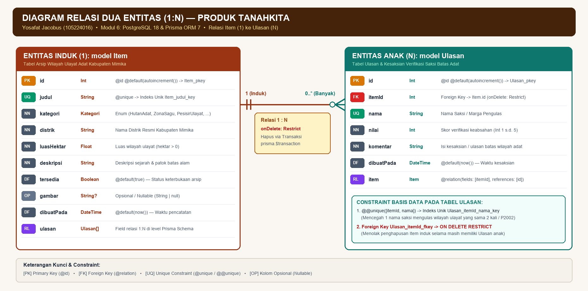
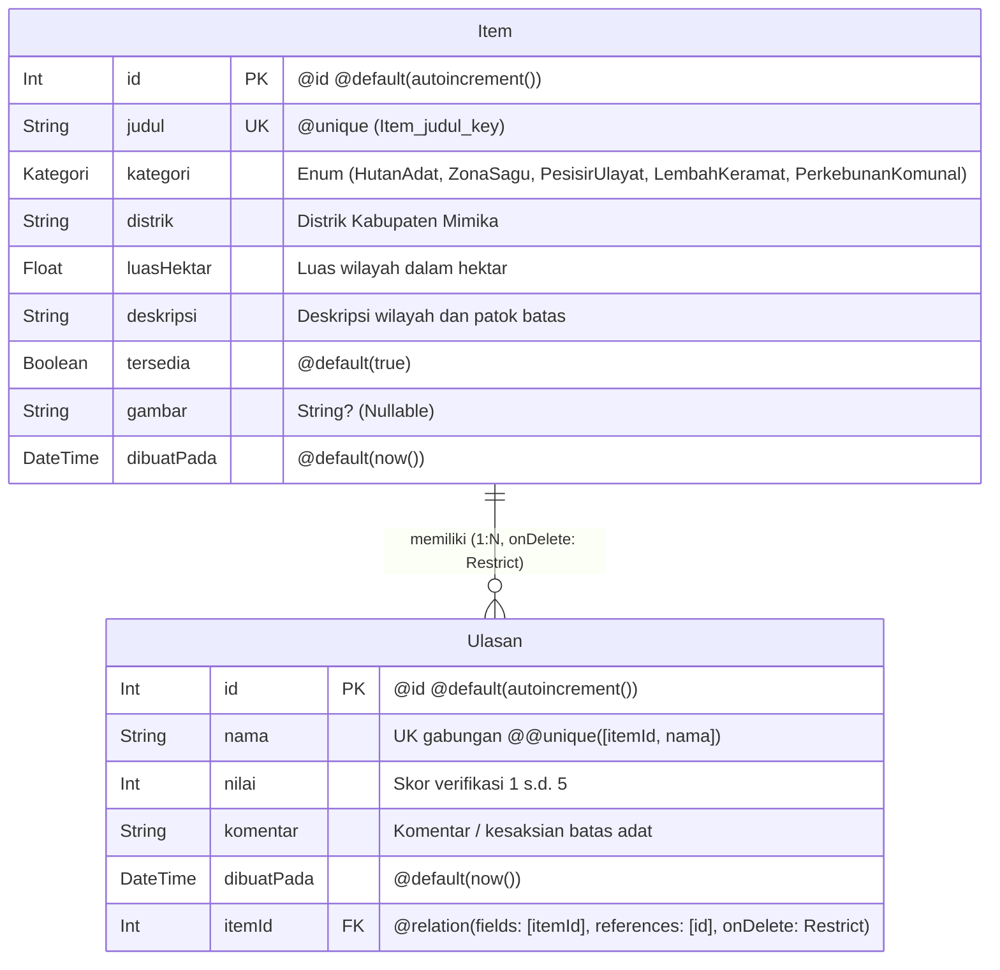

# Tugas Pendahuluan Modul 6: PostgreSQL dan Prisma ORM 7

* **Nama:** Yosafat Jacobus  
* **NIM:** 105224016  
* **Program Studi:** Ilmu Komputer, Universitas Pertamina  
* **Mata Kuliah:** Praktikum Pengembangan Aplikasi Web (052356)  
* **Produk:** **TanahKita** (Sistem Pencatatan dan Pembuktian Penguasaan Tanah Adat Papua — Kabupaten Mimika)  

---

### 1. Diagram Dua Entitas Berelasi 1:N (`Item` Wilayah Ulayat & `Ulasan` Verifikasi Adat)

Pada produk **TanahKita**, dua entitas utama yang berelasi satu-ke-banyak (**1:N**) adalah:
1. **`Item` (Arsip Wilayah Ulayat Adat)** sebagai **entitas induk (1)** yang menyimpan data pencatatan hamparan tanah ulayat marga di Kabupaten Mimika.
2. **`Ulasan` (Ulasan & Kesaksian Verifikasi Batas Adat)** sebagai **entitas anak (N)** yang menyimpan catatan verifikasi, kesaksian batas alam, dan penilaian keabsahan dari tetua adat atau saksi marga tetangga terhadap suatu wilayah ulayat. Satu wilayah ulayat (`Item`) dapat memiliki banyak catatan kesaksian/ulasan (`Ulasan`), sehingga kolom *foreign key* `itemId` diletakkan pada tabel `Ulasan`.

#### Diagram Relasi Entitas (ERD — Relasi 1:N)



```text
+------------------------------------------------------------+
|                  ENTITAS INDUK (1): Item                   |
|             (Arsip Wilayah Ulayat Adat Mimika)             |
+------------------------------------------------------------+
| [PK] id         : Int       @id @default(autoincrement())  |
| [UQ] judul      : String    @unique -> Item_judul_key      |
|      kategori   : Kategori  Enum Kategori Wilayah Ulayat   |
|      distrik    : String    Distrik di Kabupaten Mimika    |
|      luasHektar : Float     Luas wilayah ulayat (Ha > 0)   |
|      deskripsi  : String    Deskripsi & patok batas alam   |
|      tersedia   : Boolean   @default(true)                 |
| [OP] gambar     : String?   Opsional / Nullable            |
|      dibuatPada : DateTime  @default(now())                |
| [RL] ulasan     : Ulasan[]  Relasi 1:N di Prisma Schema    |
+------------------------------------------------------------+
                              ||
                              || 1 (Induk)
                              ||
                              || Relasi 1 : N
                              || onDelete: Restrict
                              || (Hapus via prisma.$transaction)
                              ||
                              0/
                             /|\ 0..* (Banyak)
+------------------------------------------------------------+
|                  ENTITAS ANAK (N): Ulasan                  |
|         (Kesaksian & Verifikasi Saksi Batas Adat)          |
+------------------------------------------------------------+
| [PK] id         : Int       @id @default(autoincrement())  |
| [FK] itemId     : Int       -> Item.id (onDelete: Restrict)|
| [UQ] nama       : String    Nama Saksi / Marga Pengulas    |
|      nilai      : Int       Skor verifikasi (Int 1 s.d. 5) |
|      komentar   : String    Isi kesaksian batas wilayah    |
|      dibuatPada : DateTime  @default(now())                |
| [RL] item       : Item      @relation(fields: [itemId]...) |
+------------------------------------------------------------+
| CONSTRAINT TABEL ULASAN:                                   |
| 1. [UQ] @@unique([itemId, nama]) -> Ulasan_itemId_nama_key |
| 2. [FK] Ulasan_itemId_fkey       -> ON DELETE RESTRICT     |
+------------------------------------------------------------+
```



#### Tabel Spesifikasi Atribut, Kunci, dan Constraint pada `prisma/schema.prisma`

| Entitas | Nama Kolom | Tipe Prisma / PostgreSQL | Jenis Kunci / Constraint | Hasil Constraint di PostgreSQL 18 |
| :--- | :--- | :--- | :--- | :--- |
| **`Item`** *(Induk - 1)* | `id` | `Int` (`SERIAL`) | **Primary Key** (`@id @default(autoincrement())`) | `Item_pkey` (`PRIMARY KEY`) |
| **`Item`** | `judul` | `String` (`TEXT`) | **Constraint Unik** (`@unique`) | Indeks unik `Item_judul_key` |
| **`Item`** | `kategori` | `Kategori` (`ENUM`) | Wajib (`NOT NULL`) | Enum `Kategori` |
| **`Item`** | `distrik` | `String` (`TEXT`) | Wajib (`NOT NULL`) | `TEXT NOT NULL` |
| **`Item`** | `luasHektar` | `Float` (`DOUBLE PRECISION`) | Wajib (`NOT NULL`) | `DOUBLE PRECISION NOT NULL` |
| **`Item`** | `deskripsi` | `String` (`TEXT`) | Wajib (`NOT NULL`) | `TEXT NOT NULL` |
| **`Item`** | `tersedia` | `Boolean` (`BOOLEAN`) | Default (`@default(true)`) | `BOOLEAN NOT NULL DEFAULT true` |
| **`Item`** | `gambar` | `String?` (`TEXT NULL`) | Opsional (`Nullable`) | Kolom tanpa `NOT NULL` (bernilai `null` bila kosong) |
| **`Item`** | `dibuatPada` | `DateTime` (`TIMESTAMP(3)`) | Default (`@default(now())`) | `TIMESTAMP(3) NOT NULL DEFAULT CURRENT_TIMESTAMP` |
| **`Ulasan`** *(Anak - N)* | `id` | `Int` (`SERIAL`) | **Primary Key** (`@id @default(autoincrement())`) | `Ulasan_pkey` (`PRIMARY KEY`) |
| **`Ulasan`** | `nama` | `String` (`TEXT`) | Bagian dari **Unik Gabungan** | Bagian dari indeks `Ulasan_itemId_nama_key` |
| **`Ulasan`** | `nilai` | `Int` (`INTEGER`) | Wajib (`1`–`5`) | `INTEGER NOT NULL` |
| **`Ulasan`** | `komentar` | `String` (`TEXT`) | Wajib (`NOT NULL`) | `TEXT NOT NULL` |
| **`Ulasan`** | `dibuatPada` | `DateTime` (`TIMESTAMP(3)`) | Default (`@default(now())`) | `TIMESTAMP(3) NOT NULL DEFAULT CURRENT_TIMESTAMP` |
| **`Ulasan`** | `itemId` | `Int` (`INTEGER`) | **Foreign Key** (`@relation(fields: [itemId], references: [id], onDelete: Restrict)`) | Constraint `Ulasan_itemId_fkey` (`ON DELETE RESTRICT`) |
| **`Ulasan`** | `[itemId, nama]` | Gabungan `(Int, String)` | **Constraint Unik Gabungan** (`@@unique([itemId, nama])`) | Indeks unik `Ulasan_itemId_nama_key` |

---

### 2. Aturan Penghapusan (`onDelete`) yang Dipilih Beserta Alasannya dari Sudut Pandang Nilai Data Produk

* **Aturan Penghapusan yang Dipilih:**  
  **`Restrict` (`onDelete: Restrict` pada `schema.prisma` / `ON DELETE RESTRICT` pada PostgreSQL).**

* **Alasan Pemilihan dari Sudut Pandang Nilai Data Produk TanahKita:**  
  1. **Perlindungan Nilai Bukti Historis & Kesaksian Adat:**  
     Dalam konteks **TanahKita**, setiap baris pada tabel `Ulasan` merepresentasikan catatan verifikasi, kesaksian tetua adat, atau pengakuan batas dari marga tetangga terhadap suatu hamparan tanah ulayat (`Item`). Data kesaksian ini memiliki nilai pembuktian historis dan sosial yang tinggi untuk mencegah sengketa lahan di Kabupaten Mimika.
  2. **Mengapa Bukan `Cascade`:**  
     Jika menggunakan `Cascade`, penghapusan satu baris wilayah ulayat (`Item`) akan secara otomatis dan diam-diam menghapus seluruh riwayat ulasan/kesaksian adat (`Ulasan`) yang terhubung dengannya sebagai efek samping tersembunyi. Apabila terjadi kesalahan klik atau bug pada fitur hapus, seluruh rekaman kesaksian marga akan musnah permanen tanpa peringatan.
  3. **Mengapa Bukan `SetNull`:**  
     Jika menggunakan `SetNull`, kolom `itemId` pada `Ulasan` harus dibuat opsional (`Int?`) dan akan dikosongkan menjadi `NULL` saat wilayah ulayat dihapus. Hal ini menghasilkan kesaksian yatim (*orphan records*) yang tidak lagi diketahui merujuk pada wilayah tanah ulayat yang mana, sehingga kehilangan makna hukum dan konteks pembuktiannya.
  4. **Keunggulan `Restrict` Bersama Transaksi Eksplisit:**  
     Dengan `onDelete: Restrict`, PostgreSQL bertindak sebagai pengaman terakhir yang **menolak penghapusan wilayah ulayat selama masih ada ulasan/kesaksian adat yang merujuk kepadanya**. Penghapusan wilayah ulayat beserta ulasannya hanya dapat dilakukan secara sadar, terencana, dan atomik melalui transaksi eksplisit (`prisma.$transaction([prisma.ulasan.deleteMany(...), prisma.item.delete(...)])`).

---

### 3. Daftar 10 Skenario Uji (8 Operasi CRUD dan 2 Relasi/Transaksi)

Berikut adalah 10 skenario pengujian terstruktur untuk memverifikasi operasi CRUD, validasi Zod, penanganan galat Prisma (`P2002`, `P2003`, `P2025`), aturan relasi `ON DELETE RESTRICT`, dan pembuktian *rollback* transaksi pada produk **TanahKita**:

| No | Kategori | Skenario Uji | Langkah Pengujian | Hasil yang Diharapkan (*Expected Result*) |
| :-: | :---: | :--- | :--- | :--- |
| **1** | **CRUD (Create)** | **Tambah wilayah ulayat (`Item`) dengan data sah** | Buka `/katalog/tambah`, isi formulir dengan data sah (`judul`: `"Hutan Keramat Kwamki Narama"`, `kategori`: `"HutanAdat"`, `distrik`: `"Kwamki Narama"`, `luasHektar`: `85.5`, `deskripsi` >= 10 karakter), lalu kirim formulir. | Baris baru tersimpan di tabel `Item` PostgreSQL, halaman `/katalog` direvalidasi (`revalidatePath`), item tampil di daftar katalog, dan data tetap ada meskipun `npm run dev` dimulai ulang. |
| **2** | **CRUD (Create)** | **Tambah wilayah ulayat dengan `judul` ganda (Pelanggaran `@unique`)** | Buka `/katalog/tambah`, isi kolom `judul` dengan nama ulayat yang sudah ada di basis data (misal `"Kawasan Ulayat Lembah Nemangkawi"`), isi kolom lain dengan sah, lalu kirim. | PostgreSQL menolak duplikasi; Server Action menangkap `PrismaClientKnownRequestError` berkode **`P2002`** dan menampilkan pesan ramah pada kolom judul: *"Judul item sudah terdaftar"* tanpa membocorkan galat mentah database. |
| **3** | **CRUD (Create)** | **Tambah wilayah ulayat dengan `judul` kosong / terlalu pendek** | Tambahkan atribut `novalidate` pada `<form>` di DevTools, isi `judul` dengan `""` atau `"ab"` (< 3 karakter), lalu kirim formulir. | Ditolak oleh validasi `skemaItem.safeParse()` (Zod 4) di Server Action **sebelum** menjalankan query Prisma; tampil pesan galat di bawah kolom judul dan tidak ada baris baru di PostgreSQL. |
| **4** | **CRUD (Update)** | **Ubah deskripsi wilayah ulayat (`Item`) yang ada** | Buka formulir ubah pada salah satu item ulayat yang terdaftar, perbarui teks `deskripsi` dengan rincian patok batas baru yang sah, lalu simpan perubahan. | `prisma.item.update({ where: { id }, data })` berhasil memperbarui baris di PostgreSQL, `revalidatePath("/katalog")` dan `revalidatePath("/katalog/[id]")` berjalan, serta deskripsi baru langsung tampil di halaman detail. |
| **5** | **CRUD (Update)** | **Ubah wilayah ulayat yang sudah dihapus / ID tidak ditemukan** | Buka halaman ubah untuk suatu item, hapus item tersebut dari tab lain / Prisma Studio, lalu kirim formulir ubah pada tab pertama. | Prisma melempar galat **`P2025`** (*record to update not found*); Server Action menangkapnya dan mengembalikan pesan aman: *"Item tidak ditemukan atau sudah dihapus."* tanpa membuat aplikasi crash. |
| **6** | **CRUD (Read)** | **Buka halaman detail dengan parameter ID tidak valid atau tidak terdaftar (`/katalog/abc` & `/katalog/99999`)** | Akses URL `/katalog/abc` (bukan bilangan bulat positif) dan `/katalog/99999` (ID tidak ada di tabel `Item`) melalui peramban. | Pemeriksaan `!Number.isInteger(id) \|\| id <= 0` serta hasil `ambilItem(id) === null` memanggil fungsi `notFound()`, menampilkan halaman **404 Not Found** yang rapi, bukan galat server 500. |
| **7** | **CRUD (Delete)** | **Hapus wilayah ulayat beserta seluruh ulasannya melalui transaksi** | Buka halaman detail item yang memiliki beberapa ulasan/kesaksian adat, lalu klik tombol **Hapus item** yang menjalankan `prisma.$transaction([deleteMany, delete])`. | Seluruh ulasan milik item tersebut dan baris item induknya terhapus secara atomik dari PostgreSQL, pengguna dialihkan (`redirect`) ke `/katalog`, dan item hilang dari daftar. |
| **8** | **CRUD (Delete & Rollback)** | **Hapus wilayah ulayat tetapi perintah kedua di dalam transaksi gagal (Bukti Rollback)** | Ubah sementara perintah kedua di dalam `prisma.$transaction` menjadi `prisma.item.delete({ where: { id: id + 100000 } })`, klik **Hapus item** pada item yang memiliki ulasan, lalu periksa jumlah ulasan di `psql`. | Perintah kedua gagal dengan `P2025` sehingga PostgreSQL melakukan **rollback** atas perintah pertama (`ulasan.deleteMany`). Jumlah ulasan pada item tersebut di tabel `Ulasan` terbukti **tetap utuh dan tidak berubah**. |
| **9** | **Relasi (1:N)** | **Tambah ulasan/kesaksian adat dengan `nilai` di luar rentang (misal `nilai: 6`)** | Pada halaman detail `/katalog/[id]`, lewatkan validasi HTML (`novalidate`), isi formulir ulasan dengan `nama: "Tetua Saksi"`, `nilai: 6` (melebihi batas `max(5)`), dan `komentar` sah, lalu kirim. | Ditolak oleh `skemaUlasan.safeParse()` (`z.coerce.number().int().min(1).max(5)`) di Server Action; tampil pesan galat pada kolom `nilai` dan tidak ada baris ulasan baru yang masuk ke tabel `Ulasan`. |
| **10** | **Relasi (1:N)** | **Tambah ulasan kedua dengan `nama` pengulas yang sama pada item yang sama** | Pada halaman detail `/katalog/[id]` yang sama, kirim ulasan baru menggunakan `nama` saksi/pengulas yang sudah pernah mengulas item tersebut sebelumnya. | Melanggar constraint unik gabungan `@@unique([itemId, nama])` (`Ulasan_itemId_nama_key`); Server Action menangkap kode **`P2002`** dan menampilkan galat pada kolom nama: *"Nama ini sudah mengulas item ini"*. |

---

### 4. Urutan Perintah Prisma 7 Setelah Skema Berubah serta Alasan `generate` dan `seed` Harus Dijalankan Eksplisit

#### A. Urutan Perintah Prisma 7 Setelah `prisma/schema.prisma` Berubah
1. **`npx prisma migrate dev --name <nama_migrasi>`**  
   Membandingkan perubahan pada `prisma/schema.prisma` dengan keadaan basis data, menghasilkan berkas migrasi SQL baru di dalam `prisma/migrations/<stempel_waktu>_<nama_migrasi>/migration.sql`, dan langsung mengeksekusi DDL SQL tersebut ke basis data PostgreSQL pengembangan.
2. **`npx prisma generate`**  
   Membaca skema terbaru dan menghasilkan ulang kode **Prisma Client bertipe TypeScript** ke dalam direktori output proyek (`generated/prisma` yang diimpor melalui `@/generated/prisma/client`).
3. **`npx prisma db seed`** *(dijalankan saat membutuhkan pengisian/pembaruan data awal)*  
   Menjalankan perintah seed (`tsx prisma/seed.ts`) yang telah didefinisikan pada berkas `prisma.config.ts` untuk mengisi data awal ke dalam tabel PostgreSQL.

#### B. Alasan `generate` dan `seed` Harus Dijalankan Secara Eksplisit pada Prisma 7
* **Perubahan Arsitektur Prisma ORM 7 (Pemisahan Tanggung Jawab Perintah):**  
  Pada versi Prisma lama (Prisma 5 dan 6), menjalankan `prisma migrate dev` secara otomatis memicu `prisma generate` dan terkadang menjalankan `seed` di balik layar. Pada **Prisma 7**, perilaku implisit tersebut **dihapus**: `migrate dev` kini murni hanya membuat dan menerapkan berkas migrasi SQL ke basis data.
* **Alasan `npx prisma generate` Wajib Eksplisit:**  
  Pada Prisma 7, generator menggunakan provider `"prisma-client"` dengan lokasi output wajib di dalam proyek (`../generated/prisma`). Apabila `npx prisma generate` tidak dijalankan secara eksplisit setelah skema berubah (atau setelah repositori baru di-*clone*), folder `generated/prisma` belum ada atau masih memuat tipe TypeScript versi lama. Akibatnya, TypeScript dan Next.js tidak mengenali model/kolom baru dan akan melempar galat kompilasi (`Module not found: Can't resolve '@/generated/prisma/client'`).
* **Alasan `npx prisma db seed` Wajib Eksplisit:**  
  Menjalankan migrasi hanya membentuk struktur tabel, indeks, dan *constraint* kosong di PostgreSQL. Karena `migrate dev` maupun `migrate reset` pada Prisma 7 tidak lagi mengeksekusi skrip seed secara otomatis, `npx prisma db seed` harus dipanggil secara eksplisit agar pengembang memiliki kendali penuh kapan data sintetis awal ingin dimasukkan ke basis data tanpa risiko menimpa data secara tidak sengaja setiap kali membuat migrasi baru.

---

### 5. Mengapa Seed dengan `upsert` Dapat Dijalankan Ulang, Sedangkan Seed dengan `create` Biasa Tidak

* **Mengapa Seed dengan `create` Biasa Gagal Saat Dijalankan Ulang (*Non-Idempotent*):**  
  Pada rancangan skema basis data kita, tabel `Item` memiliki constraint unik `@unique` pada kolom `judul` (`Item_judul_key`), sedangkan tabel `Ulasan` memiliki constraint unik gabungan `@@unique([itemId, nama])` (`Ulasan_itemId_nama_key`).  
  * Ketika `npx prisma db seed` dijalankan untuk **pertama kali**, perintah `prisma.item.create()` dan `prisma.ulasan.create()` berhasil karena tabel masih kosong.  
  * Namun, ketika `npx prisma db seed` dijalankan untuk **kedua kalinya**, perintah `create` akan berusaha menyisipkan ulang baris dengan nilai `judul` serta pasangan `(itemId, nama)` yang **sudah tercatat di dalam basis data**. PostgreSQL secara otomatis menolak operasi `INSERT` duplikat tersebut demi menjaga integritas constraint unik, sehingga Prisma melempar eksepsi **`PrismaClientKnownRequestError` berkode `P2002` (*Unique constraint failed*)** dan eksekusi seed langsung gagal/berhenti.

* **Mengapa Seed dengan `upsert` Dapat Dijalankan Ulang Berkali-kali (*Idempotent*):**  
  Metode `upsert` (*Update or Insert*) menggabungkan pencarian berdasarkan kunci unik (`where`), pembaruan (`update`), dan pembuatan baris baru (`create`) dalam satu operasi aman:
  1. Prisma terlebih dahulu memeriksa apakah baris dengan nilai unik tersebut sudah ada di PostgreSQL (misalnya `where: { judul: data.judul }` pada `Item`, dan `where: { itemId_nama: { itemId: item.id, nama: "Pengguna Uji" } }` pada `Ulasan`).
  2. **Jika baris belum ada** (seperti saat basis data baru dimigrasi), Prisma mengeksekusi blok `create: data` untuk menyisipkan data awal.
  3. **Jika baris sudah ada** (seperti saat `npx prisma db seed` dijalankan ulang untuk kedua atau ketiga kalinya), Prisma **tidak melakukan `INSERT` baru**, melainkan mengeksekusi blok `update: {}` (tidak mengubah data yang sudah ada) sehingga tidak melanggar constraint unik `P2002`.
  4. Hasilnya, skrip seed bersifat **idempoten (*idempotent*)**: aman dijalankan berulang kali kapan saja dan selalu menghasilkan jumlah baris `Item` dan `Ulasan` yang konsisten tanpa menggandakan data.

---

### Catatan Pemanfaatan AI (Sesuai Ketentuan Umum Modul 6)

* **Alat yang Digunakan:** Asisten AI Coding (Claude / Antigravity IDE) sebagai mitra diskusi (*pair-programming*).
* **Topik Diskusi / Prompt Kolaborasi:**  
  *1. "Saya sudah merancang relasi 1:N antara entitas Item (Arsip Wilayah Ulayat Adat) dan Ulasan (Kesaksian Saksi Batas Adat) beserta aturan onDelete: Restrict untuk produk TanahKita. Mari kita tinjau apakah penempatan foreign key itemId dan constraint unik gabungan @@unique([itemId, nama]) ini sudah tepat untuk Prisma ORM 7 dan PostgreSQL 18."*  
  *2. "Mari kita telaah bersama 10 skenario uji CRUD dan transaksi rollback yang saya susun agar mencakup pengujian galat P2002, P2003, dan P2025."*
* **Bagian yang Dikolaborasikan:** Peninjauan konsistensi tipe data pada diagram ERD (`Item` dan `Ulasan`) serta perapian struktur kalimat pada tabel 10 skenario uji. Sedangkan penentuan entitas domain adat Mimika, pemilihan aturan `onDelete: Restrict`, serta analisis alur perintah Prisma 7 disusun dan diputuskan langsung oleh praktikan.
* **Cara Memverifikasi:** Praktikan memeriksa kembali seluruh atribut skema (`@id`, `@unique`, `@@unique([itemId, nama])`, `onDelete: Restrict`) dan urutan perintah CLI (`npx prisma migrate dev`, `npx prisma generate`, `npx prisma db seed`) secara mandiri terhadap spesifikasi *Modul 6 Praktikum PAW 2026* (Tabel 1, Tabel 2, dan Tabel 3).
