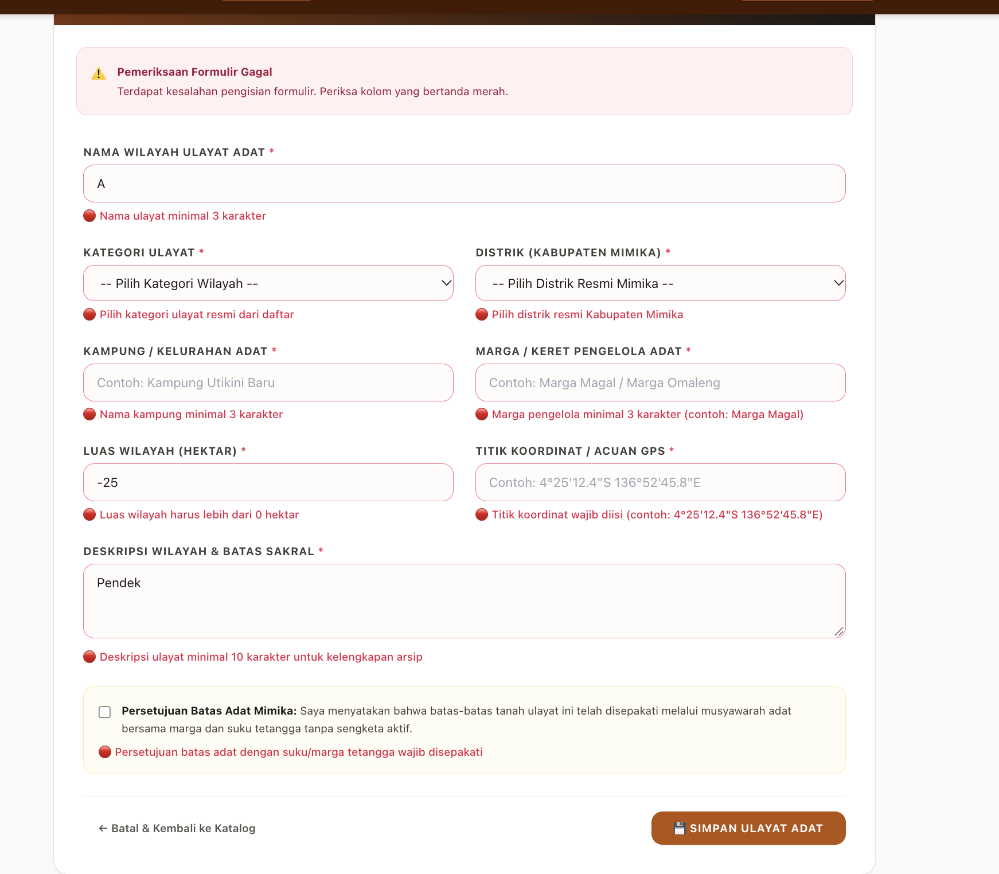
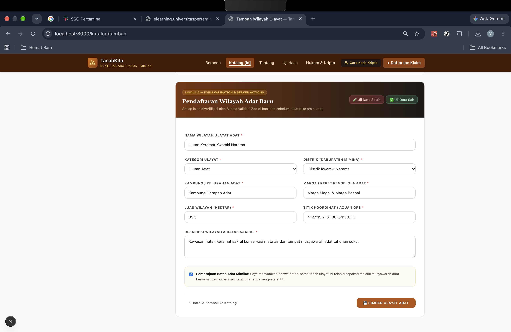
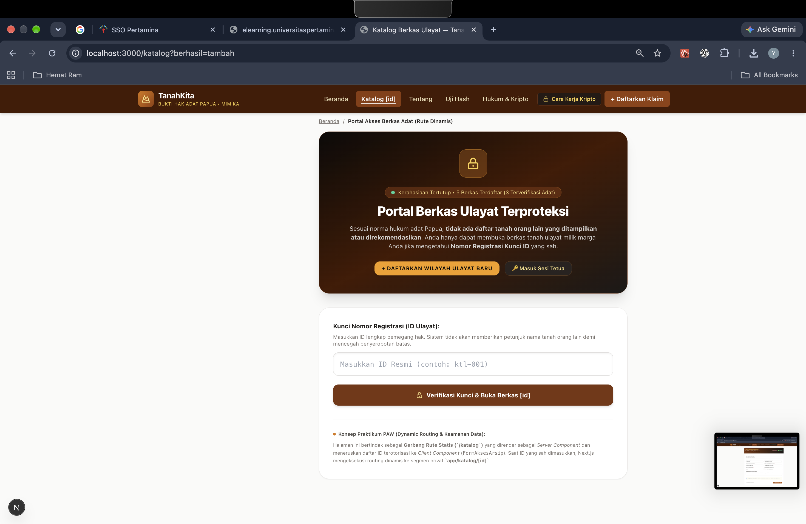
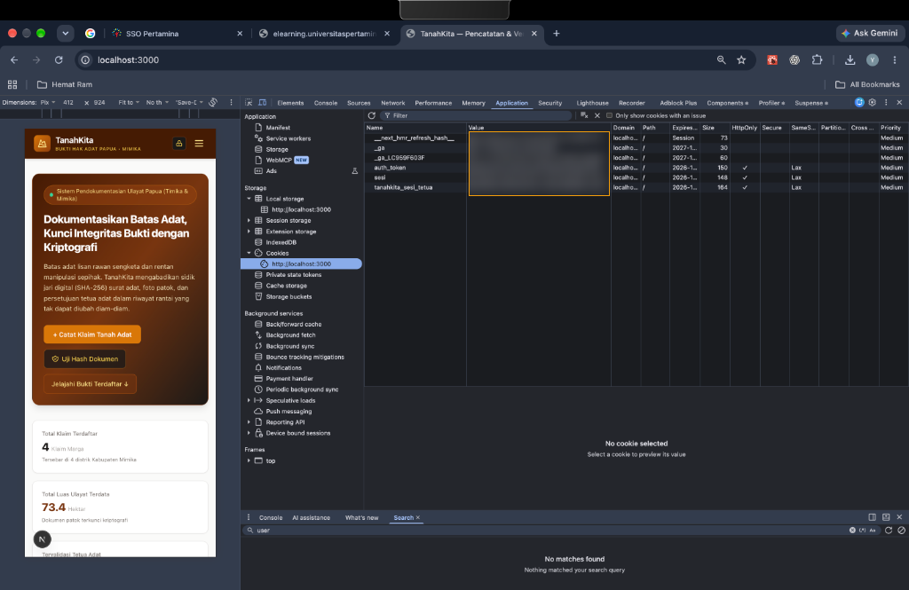
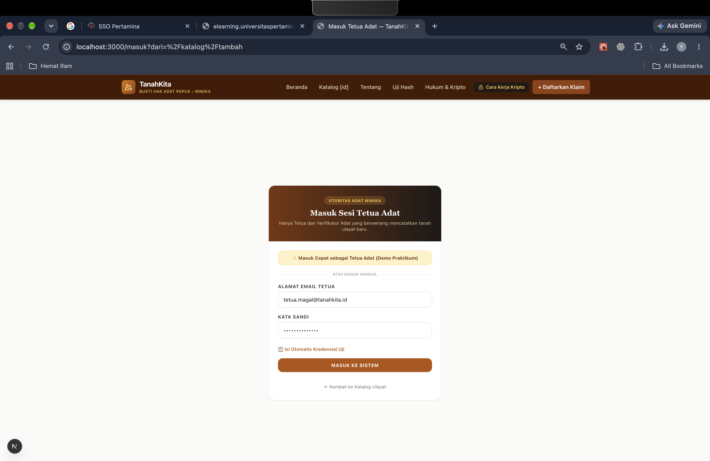
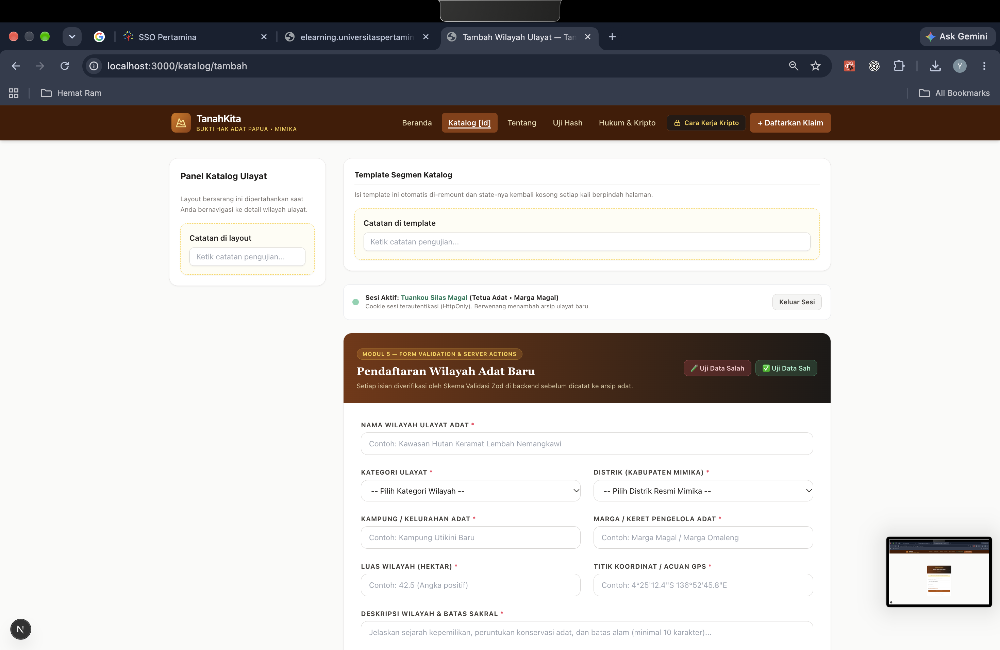

# Dokumen Teknis Modul 5 — Formulir, Validasi, Session, dan Cookie

* **Nama/NIM**   : Yosafat Jacobus / 105224016
* **Repositori** : [https://github.com/yosafatjac/tanahkita](https://github.com/yosafatjac/tanahkita)
* **Branch kerja** : `week-5` (`praktikum/modul-05`)
* **Produk**     : **TanahKita** — Sistem Pencatatan dan Pembuktian Penguasaan Tanah Adat Papua (Kabupaten Mimika)

---

## 1. Skema Validasi

Pada aplikasi **TanahKita**, seluruh aturan validasi formulir pendaftaran wilayah ulayat adat (`ulayatSchema` / `skemaItem`) dan autentikasi Tetua Adat (`loginSchema` / `skemaMasuk`) disusun secara deklaratif menggunakan **Zod 4 (`zod@4.6.7`)** di dalam direktori khusus `src/schemas/` serta diekspor ulang melalui `src/lib/skema.ts` dan `src/lib/status-form.ts`. Skema ini menjadi sumber kebenaran tunggal (*single source of truth*) untuk validasi sisi server sekaligus inferensi tipe TypeScript melalui `z.infer<typeof ulayatSchema>`.

### Tabel Kolom Formulir, Aturan Zod 4, dan Pesan Galat

| Nama Kolom | Tipe Data | Aturan Skema Zod 4 | Pesan Galat Spesifik (*Custom Error*) |
| :--- | :--- | :--- | :--- |
| **`nama`** | `string` | `z.string({ error: "..." }).trim().min(3).max(100)` | `"Nama ulayat wajib diisi"`, `"Nama ulayat minimal 3 karakter"`, `"Nama ulayat maksimal 100 karakter"` |
| **`kategori`** | `enum` | `z.enum(["Hutan Adat", "Zona Sagu", "Pesisir Ulayat", "Lembah Keramat", "Perkebunan Komunal"], { error: "..." })` | `"Pilih kategori ulayat resmi dari daftar"` |
| **`distrik`** | `enum` | `z.enum(["Kuala Kencana", "Kwamki Narama", "Tembagapura", "Agimuga", "Mimika Baru", "Mimika Timur", "Iwaka"], { error: "..." })` | `"Pilih distrik resmi Kabupaten Mimika"` |
| **`kampung`** | `string` | `z.string({ error: "..." }).trim().min(3).max(80)` | `"Nama kampung wajib diisi"`, `"Nama kampung minimal 3 karakter"`, `"Nama kampung maksimal 80 karakter"` |
| **`margaPengelola`** | `string` | `z.string({ error: "..." }).trim().min(3).max(80)` | `"Marga pengelola wajib diisi"`, `"Marga pengelola minimal 3 karakter (contoh: Marga Magal)"` |
| **`luasHektar`** | `number` | `z.coerce.number({ error: "..." }).positive().max(100000)` | `"Luas wilayah harus berupa angka valid"`, `"Luas wilayah harus lebih dari 0 hektar"`, `"Luas wilayah maksimal 100.000 hektar"` |
| **`titikKoordinat`** | `string` | `z.string({ error: "..." }).trim().min(5)` | `"Titik koordinat wajib diisi (contoh: 4°25'12.4\"S 136°52'45.8\"E)"` |
| **`deskripsi`** | `string` | `z.string({ error: "..." }).trim().min(10).max(1000)` | `"Deskripsi ulayat wajib diisi"`, `"Deskripsi ulayat minimal 10 karakter untuk kelengkapan arsip"`, `"Deskripsi ulayat maksimal 1.000 karakter"` |
| **`persetujuanBatasAdat`** | `boolean` | `z.stringbool().default(false).refine(val => val === true, { error: "..." })` | `"Persetujuan batas adat dengan suku/marga tetangga wajib disepakati"` |
| **`email`** *(Masuk)* | `string` | `z.email("Format email tidak sah (contoh: tetua@tanahkita.id)")` | `"Format email tidak sah (contoh: tetua@tanahkita.id)"` |
| **`kataSandi`** *(Masuk)* | `string` | `z.string({ error: "..." }).min(8)` | `"Kata sandi wajib diisi"`, `"Kata sandi minimal 8 karakter"` |

### Penerapan API Baru Zod 4
Sesuai spesifikasi Modul 5, implementasi skema menggunakan API modern **Zod 4**:
1. **`z.flattenError(validasi.error).fieldErrors`** untuk mengekstrak galat per kolom (menggantikan metode usang `error.flatten()`).
2. **`z.email("...")`** sebagai fungsi format tingkat atas pada skema autentikasi (menggantikan `z.string().email()`).
3. **`{ error: "..." }`** atau parameter string langsung untuk pesan kustom (menggantikan `required_error` dan `invalid_type_error`).
4. **`z.stringbool().default(false)`** untuk mengonversi nilai `"on"`/`"true"` dari kotak centang `FormData` menjadi `boolean`.

### Aturan Semantik yang Diperiksa di Server Action dan Alasannya
* **Aturan Semantik:** Pemeriksaan keunikan nama wilayah ulayat melalui fungsi `cekNamaDuplikat(validasi.data.nama)` di dalam `simpanUlayatAction` (`src/app/katalog/actions.ts`). Bila nama ulayat sudah tercatat di `MOCK_KATALOG`, aksi mengembalikan galat spesifik pada kolom `nama`: `"Nama ulayat ini sudah terdaftar dalam sistem adat Mimika."`.
* **Alasan:** Skema Zod hanya memeriksa **bentuk sintaksis** masukan secara terisolasi (tipe data, panjang karakter, pilihan enum) tanpa akses ke penyimpanan data. Apakah suatu nama wilayah adat sudah pernah diklaim atau didaftarkan oleh marga lain bergantung pada keadaan data yang tersimpan di server (*stateful business rule*), sehingga wajib diperiksa di dalam Server Action setelah `safeParse` berhasil dan sebelum mutasi dijalankan.

---

## 2. Alur Server Action

Server Action `simpanUlayatAction` pada `src/app/katalog/actions.ts` diawali direktif `"use server"` dan mengikuti **6 urutan pemeriksaan baku**:

```text
[Permintaan POST FormData]
       │
       ▼
1. Pemeriksaan Sesi: await bacaSesi()
   └── Bila gagal/null ──► return { success: false, message: "Silakan masuk terlebih dahulu...", fields }
       │
       ▼
2. Validasi Bentuk: ulayatSchema.safeParse(rawFields)
   └── Bila !validasi.success ──► return { fieldErrors: z.flattenError(validasi.error).fieldErrors, fields }
       │
       ▼
3. Validasi Semantik: cekNamaDuplikat(validasi.data.nama)
   └── Bila sudah ada ──► return { fieldErrors: { nama: ["Nama ulayat ini sudah terdaftar..."] }, fields }
       │
       ▼
4. Mutasi Data (di dalam try-catch): tambahKatalogItem(validasi.data)
   └── Bila throw exception ──► console.error(...) di server & return pesan umum tanpa stack trace
       │
       ▼
5. Revalidasi Cache: revalidatePath("/katalog")
       │
       ▼
6. Pengalihan (di luar blok try): redirect("/katalog?berhasil=tambah")
```

* **Mengapa `redirect()` Diletakkan di Luar Blok `try`:**  
  Fungsi `redirect()` di Next.js bekerja dengan cara melempar exception internal khusus (`NEXT_REDIRECT`). Apabila `redirect()` diletakkan di dalam blok `try`, blok `catch (error)` akan menangkap exception tersebut dan menganggap penyimpanan gagal, sehingga pengalihan halaman batal terjadi.
* **Penanganan Galat Tak Terduga:**  
  Galat yang diharapkan (sesi kosong, validasi gagal, nama duplikat) dikembalikan sebagai nilai objek `FormActionState`, sedangkan exception tak terduga saat mutasi dicatat ke log server menggunakan `console.error("simpanUlayatAction gagal:", error)` dan pengguna hanya menerima pesan umum tanpa membocorkan *stack trace* atau detail internal server.

### Pembagian Peran Berkas

| Jenis Berkas | Berkas pada Repositori | Tanggung Jawab Arsitektural |
| :--- | :--- | :--- |
| **Server Component** | `src/app/katalog/tambah/page.tsx`, `src/app/masuk/page.tsx` | Membaca status sesi di server (`await bacaSesi()`), menampilkan identitas pengguna aktif (`sesi.email` & `sesi.nama`), dan merender komponen formulir. |
| **Client Component (`"use client"`)** | `src/components/FormTambahUlayat.tsx`, `src/components/FormMasuk.tsx` | Mengelola state formulir reaktif dengan `useActionState(simpanUlayatAction, initialState)`, menampilkan indikator `isPending`, merender pesan galat per kolom dengan atribut `aria-invalid` dan `aria-describedby`, serta menjaga isian pengguna agar tidak hilang saat validasi gagal. |
| **Berkas Server Action (`"use server"`)** | `src/app/katalog/actions.ts`, `src/app/masuk/actions.ts` | Endpoint POST terproteksi di server yang menjalankan verifikasi sesi, validasi Zod 4, pemeriksaan semantik, mutasi data, modifikasi cookie (`buatSesi`/`hapusSesi`), `revalidatePath`, dan `redirect`. |
| **Modul Khusus Server (`server-only`)** | `src/lib/sesi.ts`, `src/data/mockKatalog.ts` | Mengelola penyimpanan sesi `Map` pada `globalThis` dan data arsip ulayat; gagal dikompilasi apabila tidak sengaja terimpor ke Client Component. |

---

## 3. Bukti Uji Validasi

### Tabel 8 Kasus Uji Penolakan dan Penerimaan

Pengujian dilakukan pada `/katalog/tambah`, termasuk minimal **4 kasus dengan validasi klien dilewati** (menambahkan atribut `novalidate` pada elemen `<form>` melalui panel *Elements* DevTools dan memanipulasi nilai opsi DOM) untuk membuktikan bahwa penolakan benar-benar dilakukan oleh skema Zod 4 dan logika semantik di sisi server:

| No | Kasus Uji | Masukan yang Dikirim | Validasi Klien Dilewati (`novalidate`)? | Hasil yang Diharapkan | Hasil Nyata di Antarmuka (*Actual*) | Status |
| :-: | :--- | :--- | :-: | :--- | :--- | :-: |
| **1** | **Seluruh Kolom Kosong** | Semua kolom dikosongkan | **Ya (`novalidate`)** | Server menolak seluruh kolom wajib dan mengembalikan `fieldErrors` lengkap | Tampil galat merah di setiap kolom wajib (`"Nama ulayat wajib diisi"`, `"Pilih kategori ulayat resmi dari daftar"`, dll.) | **Lulus** |
| **2** | **Nama Terlalu Pendek (< 3 karakter)** | `nama: "A"` | **Ya (`novalidate`)** | Ditolak oleh `.min(3)` pada `ulayatSchema` | Tampil galat di bawah kolom nama: `"🔴 Nama ulayat minimal 3 karakter"` | **Lulus** |
| **3** | **Luas Wilayah Bernilai Negatif** | `luasHektar: "-25"` | **Ya (`novalidate`)** | Ditolak oleh `.positive()` pada `z.coerce.number()` | Tampil galat di bawah kolom luas: `"🔴 Luas wilayah harus lebih dari 0 hektar"` | **Lulus** |
| **4** | **Luas Wilayah Bukan Angka** | `luasHektar: "banyak"` | **Ya (`novalidate`)** | `z.coerce.number()` menghasilkan `NaN` dan ditolak | Tampil galat di bawah kolom luas: `"🔴 Luas wilayah harus berupa angka valid"` | **Lulus** |
| **5** | **Distrik Tidak Valid (Di Luar Enum)** | `distrik: "Jakarta"` (ubah `value` di DOM) | **Ya (Inspect DOM)** | Ditolak oleh `z.enum(DISTRIK_MIMIKA)` | Tampil galat di bawah kolom distrik: `"🔴 Pilih distrik resmi Kabupaten Mimika"` | **Lulus** |
| **6** | **Deskripsi Terlalu Pendek (< 10 karakter)** | `deskripsi: "Pendek"` | **Ya (`novalidate`)** | Ditolak oleh `.min(10)` pada `ulayatSchema` | Tampil galat di bawah kolom deskripsi: `"🔴 Deskripsi ulayat minimal 10 karakter untuk kelengkapan arsip"` | **Lulus** |
| **7** | **Kotak Centang Batas Adat Tidak Dicentang** | `persetujuanBatasAdat` tidak dicentang (`false`) | Tidak | Ditolak oleh `z.stringbool().default(false).refine(v => v === true)` | Tampil galat di bawah kotak centang: `"🔴 Persetujuan batas adat dengan suku/marga tetangga wajib disepakati"` | **Lulus** |
| **8** | **Nama Ulayat Duplikat (Aturan Semantik)** | `nama: "Kawasan Ulayat Lembah Nemangkawi"` | Tidak | Lolos `safeParse`, namun ditolak oleh `cekNamaDuplikat()` di Server Action | Tampil galat pada kolom nama: `"🔴 Nama ulayat ini sudah terdaftar dalam sistem adat Mimika."` dan kolom lain tetap terisi | **Lulus** |
| **9** | **Masukan Sah & Lengkap (*Happy Path*)** | `nama: "Hutan Keramat Kwamki Narama"`, `kategori: "Hutan Adat"`, `distrik: "Kwamki Narama"`, `luasHektar: "85.5"`, centang aktif | Tidak | Data tersimpan di `MOCK_KATALOG`, `revalidatePath("/katalog")`, dan `redirect` | Peramban dialihkan ke `/katalog?berhasil=tambah` dan jumlah arsip terdaftar bertambah | **Lulus** |

### Tangkapan Layar Galat Per Kolom
Berikut adalah tangkapan layar saat formulir dikirim dengan masukan tidak sah (`nama: "A"`, kategori & distrik kosong, `luasHektar: "-25"`, `deskripsi: "Pendek"`, dan kotak centang tidak dicentang). Seluruh pesan galat dari `z.flattenError(validasi.error).fieldErrors` tampil tepat di bawah kolom masing-masing dengan atribut `aria-invalid="true"` dan `aria-describedby`:



### Tangkapan Layar Pengisian Sah dan Keberhasilan Penyimpanan
Berikut adalah tampilan saat formulir diisi dengan data sah masyarakat adat Mimika, diikuti hasil pengalihan setelah Server Action berhasil menyimpan data:





---

## 4. Session dan Cookie

Pengelolaan sesi diimplementasikan pada `src/lib/sesi.ts` (dilindungi `import "server-only"`) menggunakan pengenal acak `crypto.randomUUID()` dan penyimpanan `Map` di memori server (`globalThis.sesiTiruan`). Akun demo dikonfigurasi melalui `.env.local` (`DEMO_EMAIL` dan `DEMO_KATA_SANDI`) serta contoh struktur tanpa nilai rahasia pada `.env.example`.

### Tabel Atribut Cookie Session dan Alasan Pemilihannya

| Atribut | Nilai Konfigurasi | Fungsi dan Ancaman Keamanan yang Dikurangi |
| :--- | :--- | :--- |
| **`HttpOnly`** | `httpOnly: true` | Mencegah cookie sesi dibaca melalui `document.cookie` oleh kode JavaScript di peramban, sehingga memitigasi pencurian token sesi akibat serangan **Cross-Site Scripting (XSS)**. |
| **`Secure`** | `process.env.NODE_ENV === "production"` | Memastikan cookie hanya dikirim melalui koneksi terenkripsi HTTPS di lingkungan produksi (mencegah penyadapan **Man-in-the-Middle / الشبكة sniffing**), dengan tetap mengizinkan pengujian `http://localhost` saat pengembangan. |
| **`SameSite`** | `sameSite: "lax"` | Menahan pengiriman cookie pada permintaan lintas situs (*cross-site subrequests* seperti `POST`/form dari domain penyerang), tetapi tetap mengizinkan navigasi tingkat atas (*top-level GET*), sehingga memitigasi serangan **Cross-Site Request Forgery (CSRF)**. |
| **`Path`** | `path: "/"` | Memberlakukan cookie sesi pada seluruh rute aplikasi (`/katalog`, `/katalog/tambah`, `/masuk`) agar status autentikasi konsisten. |
| **`Max-Age`** | `maxAge: 28800` (8 jam) | Membatasi masa berlaku cookie sesi selama 8 jam (28.800 detik) sesuai spesifikasi modul, sehingga mempersempit jendela waktu eksploitasi apabila pengenal sesi bocor. |

### Pemeriksaan Header `Set-Cookie`, Panel Application, dan `document.cookie`
1. **Header `Set-Cookie` pada Panel Network (Nilai Disamarkan):**  
   Saat permintaan `POST` ke `/masuk` berhasil, server mengirimkan header respons HTTP berikut:
   ```http
   Set-Cookie: sesi=[DISAMARKAN-UUID-4]; Path=/; Max-Age=28800; HttpOnly; SameSite=lax
   ```
   *(Atribut `Secure` tidak disertakan secara otomatis karena server berjalan pada mode `development` di `http://localhost:3000`).*
2. **Pemeriksaan `document.cookie` pada Console DevTools:**  
   Saat diketik `document.cookie` pada tab *Console*, keluaran tidak memuat cookie `sesi` maupun `tanahkita_sesi_tetua` karena keduanya dilindungi oleh flag `HttpOnly: true`.
3. **Tangkapan Layar Panel Application > Cookies (Nilai Cookie Disamarkan):**  
   Pada tangkapan layar di bawah ini, terlihat baris cookie `sesi` dan `tanahkita_sesi_tetua` memiliki tanda centang `✓` pada kolom **HttpOnly**, nilai **SameSite: Lax**, serta **Path: /**, dengan kolom **Value telah disamarkan (sensor blur)**:



### Tangkapan Layar Halaman Masuk & Sesi Aktif pada `/katalog/tambah`





### Hasil Uji Penolakan Session (Cookie Palsu, Logout, dan Cookie Lama)

| Skenario Uji | Langkah Pengujian | Hasil Nyata yang Teramati | Penjelasan Teknis |
| :--- | :--- | :--- | :--- |
| **1. Uji Cookie Palsu** | Masuk sebagai Tetua Adat, buka `/katalog/tambah`, ubah nilai cookie `sesi` di panel *Application* menjadi `palsu-12345`, lalu kirim formulir dengan data sah. | `proxy.ts` meloloskan permintaan awal karena kunci cookie `sesi` ada, namun saat formulir dikirim, `bacaSesi()` di dalam `simpanUlayatAction` mengembalikan `null`. Formulir menampilkan pesan: *"Silakan masuk terlebih dahulu sebagai Tetua/Verifikator Adat untuk mendaftarkan ulayat."* dan item **tidak tersimpan**. | Membuktikan bahwa `proxy.ts` hanya memeriksa keberadaan cookie, sedangkan Server Action melakukan verifikasi otoritatif terhadap `Map` sesi di server. |
| **2. Uji Logout (Keluar)** | Klik tombol **Keluar Sesi** pada halaman `/katalog/tambah`. | Fungsi `hapusSesi()` menghapus entri sesi dari `globalThis.sesiTiruan` di server sekaligus menghapus cookie `sesi` di peramban (`cookieStore.delete("sesi")`), lalu mengalihkan pengguna keluar dari halaman form. | Cookie `sesi` hilang dari panel *Application > Cookies*. |
| **3. Uji Cookie Lama Setelah Logout** | Salin nilai cookie `sesi` saat masih login, klik **Keluar Sesi**, lalu tambahkan kembali cookie `sesi` dengan nilai lama tersebut melalui panel *Application* dan buka `/katalog/tambah` atau kirim aksi. | Sesi tetap ditolak (`bacaSesi()` mengembalikan `null`) karena pengenal sesi lama sudah dihapus dari `Map` penyimpanan server saat logout. | Membuktikan keunggulan **session di server (*stateful*)** yang dapat dicabut seketika saat logout dibanding token tanpa status (*stateless*) yang tetap berlaku hingga kedaluwarsa. |

---

## 5. Keputusan Teknis

### 1. Alasan Pemisahan Validasi Bentuk dan Validasi Semantik
Validasi bentuk (*syntactic validation*) melalui skema Zod di `src/schemas/ulayat.schema.ts` bertugas menyaring tipe data, panjang string, rentang angka positif, dan kecocokan enum secara cepat di memori tanpa perlu menyentuh lapisan penyimpanan data. Apabila format masukan sudah cacat (misalnya luas wilayah berupa teks `"banyak"` atau nama hanya 1 huruf), permintaan langsung dihentikan sebelum membebani kueri data. Sebaliknya, validasi semantik (`cekNamaDuplikat`) bergantung pada isi data yang sudah tersimpan di server. Memisahkan keduanya membuat skema Zod tetap murni (*stateless*), dapat dipakai ulang pada aksi lain (seperti ubah item di modul berikutnya), dan menjaga arsitektur sesuai prinsip *separation of concerns*.

### 2. Pilihan Atribut Cookie Session
Kombinasi `httpOnly: true`, `secure: process.env.NODE_ENV === "production"`, `sameSite: "lax"`, `path: "/"`, dan `maxAge: 28800` dipilih karena memberikan keseimbangan keamanan berlapis (*defense in depth*) dan kegunaan:
* `HttpOnly` menutup celah pencurian sesi lewat injeksi skrip XSS.
* `SameSite=Lax` mencegah pengiriman cookie otomatis pada pengiriman formulir lintas situs (CSRF), namun tidak memutus sesi ketika Tetua Adat membuka tautan internal dari halaman eksternal.
* `Max-Age=28800` (8 jam) sesuai durasi jam kerja satu hari operasional pencatatan adat, sehingga sesi tidak bertahan selamanya bila perangkat ditinggalkan.

### 3. Alasan Pola Session di Server Dibanding Token di Cookie
Pada modul ini dipilih pola **session di server (*server-side session store* menggunakan `Map` pada `globalThis`)** di mana cookie peramban hanya menyimpan pengenal acak `crypto.randomUUID()` tanpa muatan data sensitif. Keunggulan utamanya adalah **kemampuan pencabutan sesi instan (*immediate revocation*)**: ketika Tetua Adat menekan tombol *Keluar*, server menghapus ID sesi dari `Map` sehingga salinan cookie lama langsung tidak berguna. Sebaliknya, pada pola token di cookie (*stateless signed token*), server tidak menyimpan daftar sesi aktif sehingga token yang telah dicuri tetap sah dipakai hingga waktu `exp`-nya habis.

### 4. Batas Peran `proxy.ts` Dibanding Pemeriksaan di Server Action
Berkas `src/proxy.ts` (yang dijalankan sebelum rute `/katalog/tambah` dirender) hanya melakukan **pemeriksaan optimistik**, yaitu mengecek apakah header permintaan membawa kunci cookie `sesi` (`request.cookies.has("sesi")`). Tujuannya adalah pengalaman pengguna yang cepat agar pengunjung belum login langsung dialihkan ke `/masuk`.  
Namun, `proxy.ts` **bukan pengganti pemeriksaan sesi di Server Action** karena:
1. `proxy.ts` hanya memeriksa *keberadaan* cookie, bukan keabsahan ID sesi di dalam penyimpanan server (sehingga cookie palsu tetap lolos `proxy.ts`).
2. Server Action memiliki endpoint `POST` terenkripsi yang dapat dipanggil langsung menggunakan `curl` atau skrip luar, dan perubahan konfigurasi `matcher` pada `proxy.ts` dapat secara tidak sengaja membuka celah rute. Oleh sebab itu, pemanggilan `await bacaSesi()` di baris pertama `simpanUlayatAction` tetap wajib sebagai gerbang otorisasi sesungguhnya.

---

## 6. Kendala dan Penyelesaian

1. **Perubahan Sintaks API Zod 3 ke Zod 4 (`flattenError` & `stringbool`):**  
   *Kendala:* Dokumentasi lama di internet masih menggunakan `error.flatten().fieldErrors`, `z.string().email()`, dan `required_error`, yang telah ditandai usang (*deprecated*) pada Zod 4.  
   *Penyelesaian:* Memperbarui seluruh kode skema dan aksi menggunakan API asli Zod 4, yaitu `z.flattenError(validasi.error).fieldErrors`, fungsi tingkat atas `z.email("...")`, parameter `{ error: "..." }`, serta `z.stringbool().default(false)` untuk menangani nilai `"on"` dari checkbox HTML.
2. **Ketidaksinkronan Opsi `<select>` Kategori pada Tombol Uji Cepat:**  
   *Kendala:* Saat menguji pengisian cepat, nilai kategori sempat diisi `"Wilayah Keramat"` yang tidak terdaftar dalam tuple `KATEGORI_ULAYAT`, menyebabkan elemen `<select>` kembali ke opsi kosong dan ditolak oleh `z.enum`.  
   *Penyelesaian:* Menyelaraskan nilai kategori dengan konstanta resmi `KATEGORI_ULAYAT` (`"Hutan Adat"`), serta memasang atribut `value`/`defaultValue` yang terikat dengan pengembalian state aksi agar pilihan dropdown tidak ter-reset oleh React 19 saat terjadi galat.
3. **Sesi di Memori Hilang Saat *Fast Refresh* Pengembangan:**  
   *Kendala:* Ketika berkas kode disimpan ulang saat `npm run dev`, *Fast Refresh* Next.js memuat ulang modul sehingga instans `new Map()` biasa ter-reset dan pengguna tiba-tiba dianggap belum login.  
   *Penyelesaian:* Menyimpan referensi `Map` sesi pada objek global Node.js (`globalThis.sesiTiruan ??= new Map()`) di `src/lib/sesi.ts` sehingga sesi tetap bertahan selama proses server berjalan.
4. **Kompatibilitas Konvensi `proxy.ts` pada Runtime Next.js 15.5:**  
   *Kendala:* Modul memperkenalkan konvensi berkas `proxy.ts` (Next.js 16), sementara proyek berjalan pada Next.js 15.5.27 yang memindai `src/middleware.ts` dan mengharuskan objek `config` dideklarasikan secara statis.  
   *Penyelesaian:* Menempatkan fungsi utama `proxy(request)` beserta `config` di `src/proxy.ts` sesuai panduan modul, lalu memanggilnya dari `src/middleware.ts` dengan deklarasi `export const config = { matcher: ["/katalog/tambah"] }` secara langsung agar bebas dari peringatan kompilasi Next.js.

---

## 7. Catatan Pemanfaatan AI

Pemanfaatan kecerdasan artifisial pada pengerjaan modul ini dilakukan sebagai **mitra diskusi (*pair-programming*) dan referensi sintaks**, sedangkan perancangan arsitektur folder (`src/schemas/`), penentuan aturan domain tanah adat Mimika, serta pengujian dan penelusuran bug dilakukan secara mandiri:

| Komponen Pencatatan | Keterangan Rinci |
| :--- | :--- |
| **Alat AI yang Digunakan** | Google Antigravity IDE (Asisten Diskusi Kode Berbasis Gemini) |
| **Perintah (*Prompt*) Utama Diskusi** | 1. *"Bagaimana perubahan sintaks dari Zod 3 (`error.flatten()`, `z.string().email()`) ke API baru Zod 4 (`z.flattenError`, `z.stringbool`, `z.email`) untuk validasi FormData di Server Action?"*<br>2. *"Diskusikan struktur pemisahan folder khusus `src/schemas/` agar skema validasi form tidak menggunakan percabangan `if-else` manual dan tetap selaras dengan tipe `KatalogItem`."*<br>3. *"Bagaimana cara mempertahankan instans `Map` session di memori server menggunakan `globalThis` agar tidak ter-reset saat Fast Refresh di Next.js?"* |
| **Bagian yang Digunakan & Kontribusi Mandiri Mahasiswa** | • **Kontribusi Mandiri Mahasiswa:** Merancang pemisahan arsitektur folder khusus `src/schemas/`, menentukan 9 atribut domain ulayat Kabupaten Mimika (7 distrik resmi, 5 kategori ulayat, patok batas adat), menemukan dan memperbaiki bug ketidakcocokan nilai opsi `<select>` kategori (`"Wilayah Keramat"` vs `"Hutan Adat"`), serta mengeksekusi seluruh skenario pengujian di DevTools.<br>• **Bagian Referensi dari AI:** Pola penulisan `z.stringbool().default(false)` pada Zod 4, pemasangan atribut aksesibilitas ARIA (`aria-invalid`, `aria-describedby`, `role="alert"`) pada komponen `FormTambahUlayat.tsx`, serta perapian format tabel Markdown. |
| **Cara Memverifikasi Kebenaran Hasil** | 1. Menjalankan pemeriksaan tipe statis TypeScript secara mandiri: `npx tsc --noEmit` (memastikan 0 galat dan tipe `z.infer` selaras dengan `KatalogItem`).<br>2. Menjalankan linter kode: `npm run lint` (`✔ No ESLint warnings or errors`).<br>3. Menguji langsung seluruh skenario di Google Chrome DevTools: memasang atribut `novalidate` pada elemen `<form>` di panel *Elements* untuk menguji ketahanan validasi server, memeriksa centang `HttpOnly` dan `SameSite=Lax` di panel *Application > Cookies*, serta menguji penolakan cookie palsu dan cookie lama setelah logout. |

