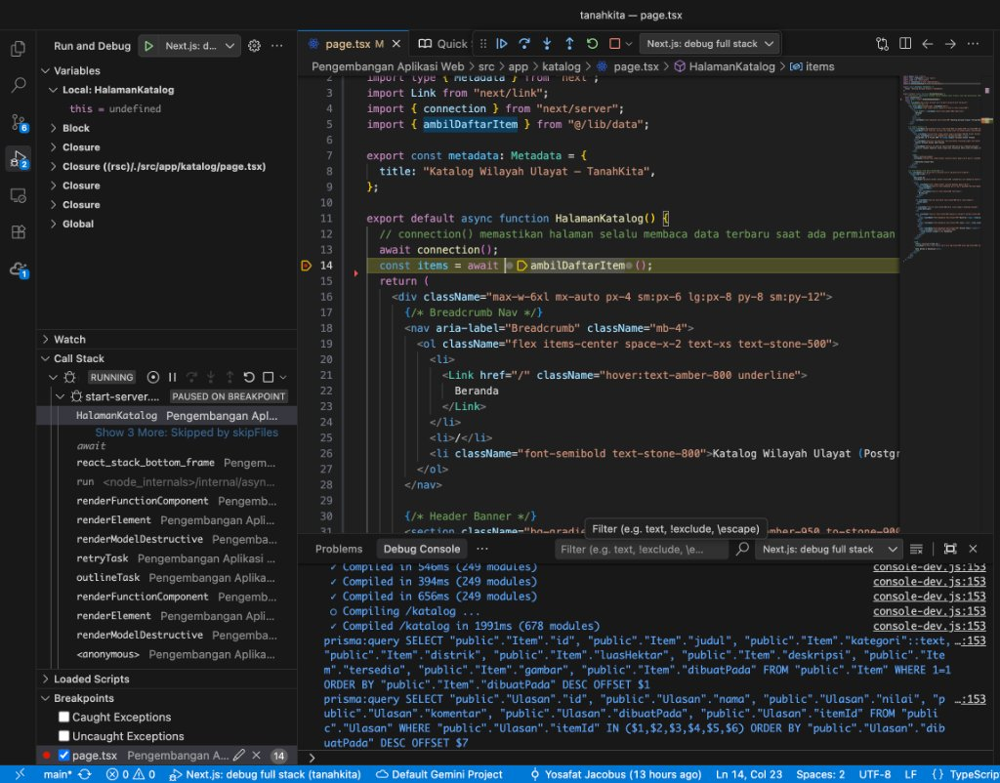
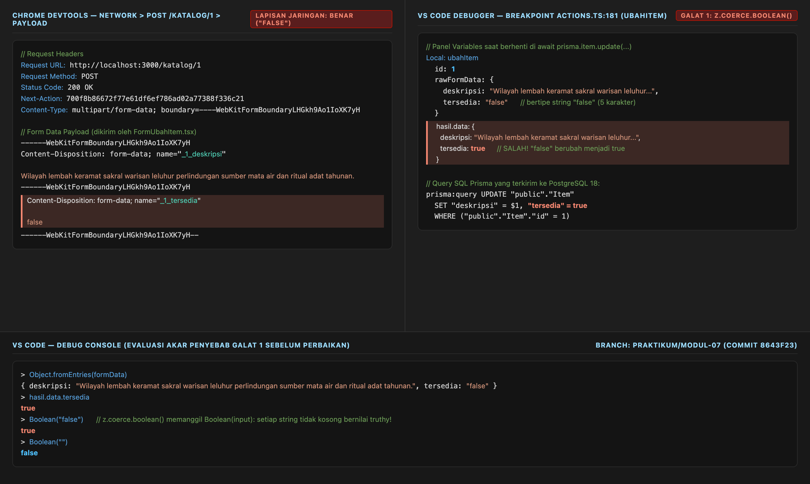
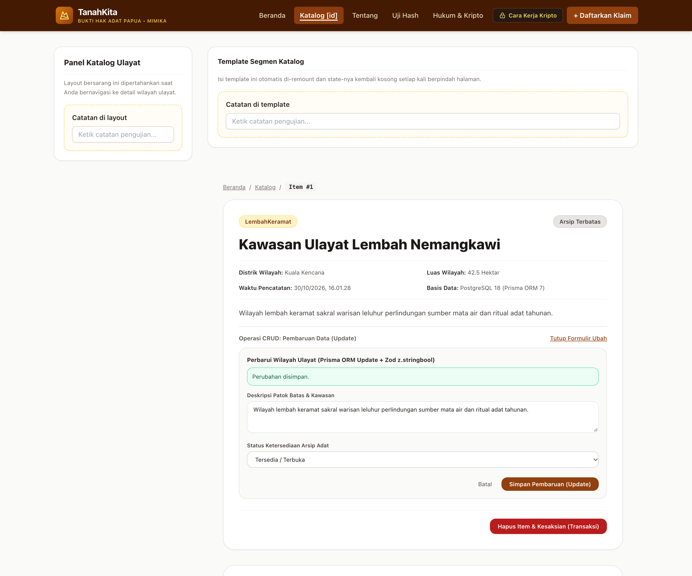
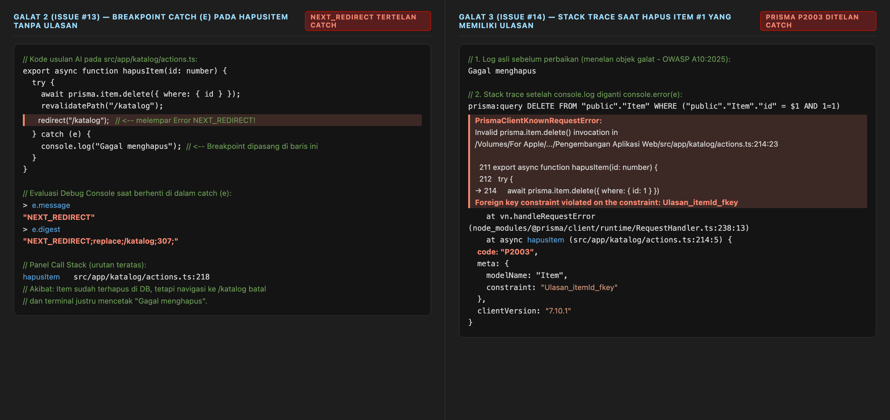
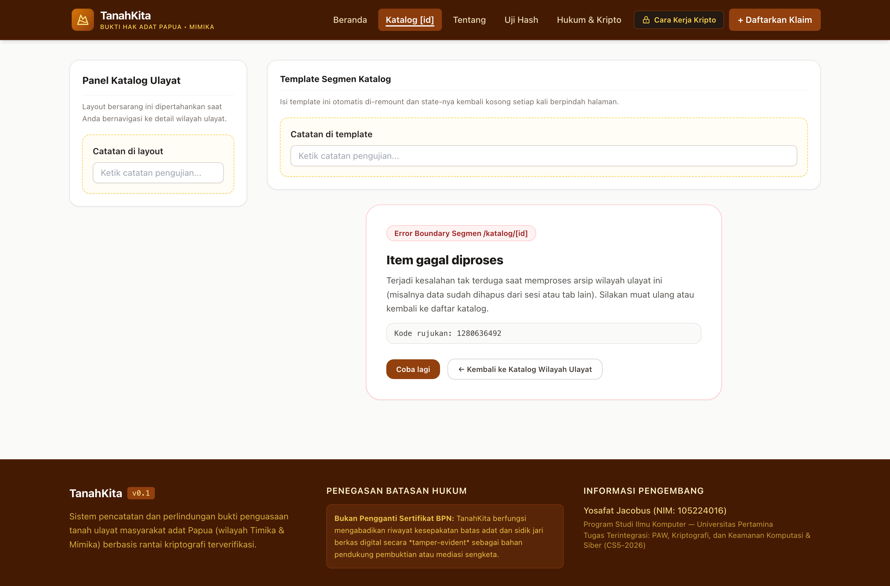
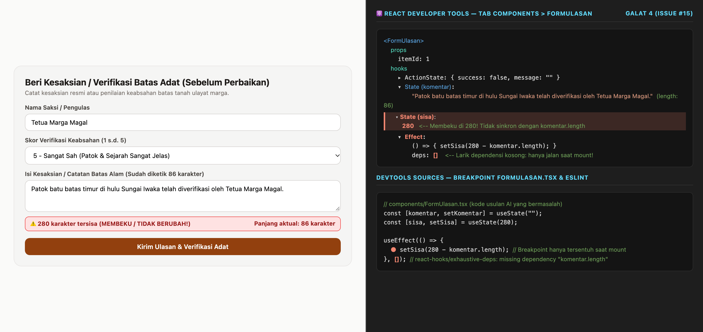
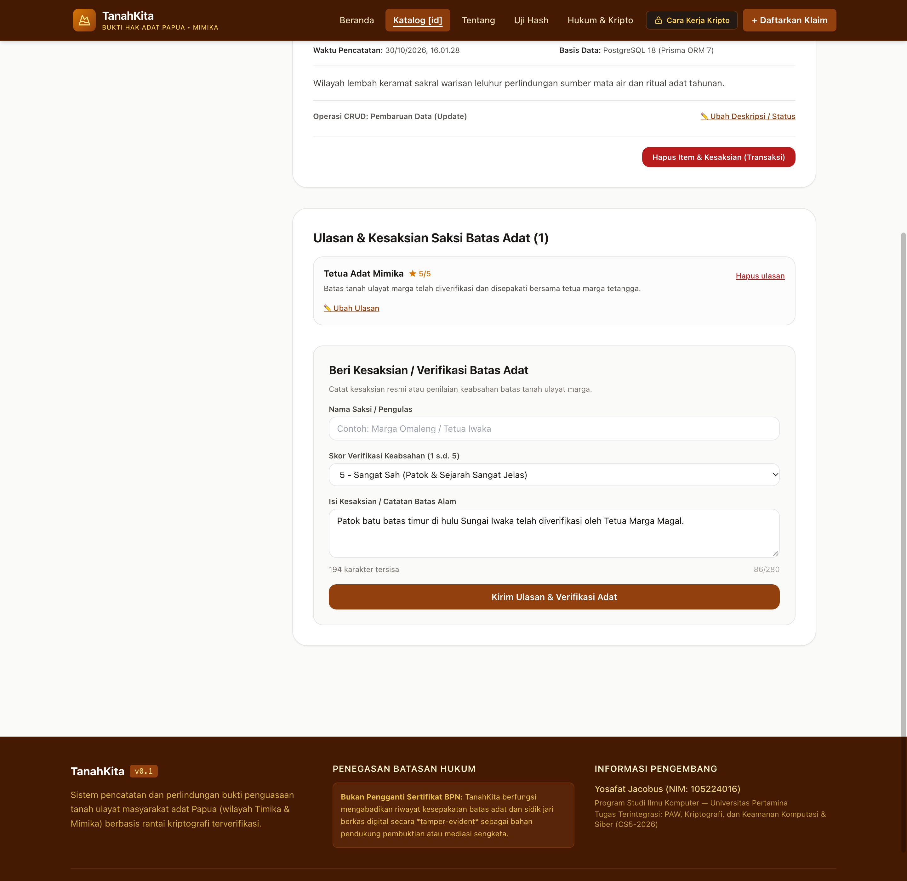

# Dokumen Teknis Modul 7 — Debugging dan Telaah Kode

* **Nama/NIM**     : Yosafat Jacobus / 105224016
* **Repositori**   : [https://github.com/yosafatjac/tanahkita](https://github.com/yosafatjac/tanahkita)
* **Branch kerja** : `praktikum/modul-07` (digabungkan ke `main`)
* **Pull request** : [https://github.com/yosafatjac/tanahkita/pull/16](https://github.com/yosafatjac/tanahkita/pull/16)
* **Produk**       : **TanahKita** — Sistem Pencatatan dan Pembuktian Penguasaan Tanah Adat Papua (Kabupaten Mimika)

---

## 1. Lingkungan dan Konfigurasi Debugger

### A. Spesifikasi Lingkungan Pengujian
| Komponen | Versi / Nilai Aktual |
| :--- | :--- |
| **Node.js** | `v24.21.0` (LTS) |
| **Next.js** | `15.5.27` (App Router, `package.json`: `^15.1.0`) |
| **React** | `19.0.0` |
| **Prisma ORM** | `7.10.1` (`@prisma/client` & `@prisma/adapter-pg`) |
| **Zod** | `4.6.7` |
| **PostgreSQL** | `18.6` (basis data lokal `produk` pada port `5432`) |
| **Peramban & Editor** | Google Chrome (macOS) + VS Code / Antigravity IDE |
| **Hash Commit Awal (`main`)** | `8643f23` (`feat(v0.2,sec-0.2): integrasi PostgreSQL Prisma 7 CRUD, AEAD AES-256-GCM & HMAC, serta RBAC dan system hardening`) |

### B. Isi `.vscode/launch.json`
Karena direktori proyek Next.js pada repositori terintegrasi **TanahKita** terletak di dalam subdirektori `Pengembangan Aplikasi Web/`, konfigurasi `.vscode/launch.json` menambahkan properti `cwd` dan `webRoot` yang menunjuk ke `${workspaceFolder}/Pengembangan Aplikasi Web` agar *source map* dan *breakpoint* menempel tepat pada berkas `.ts`/`.tsx`:

```json
{
  "version": "0.2.0",
  "configurations": [
    {
      "name": "Next.js: debug server-side",
      "type": "node-terminal",
      "request": "launch",
      "command": "npm run dev -- --inspect",
      "cwd": "${workspaceFolder}/Pengembangan Aplikasi Web"
    },
    {
      "name": "Next.js: debug client-side",
      "type": "chrome",
      "request": "launch",
      "url": "http://localhost:3000",
      "webRoot": "${workspaceFolder}/Pengembangan Aplikasi Web"
    },
    {
      "name": "Next.js: debug full stack",
      "type": "node",
      "request": "launch",
      "cwd": "${workspaceFolder}/Pengembangan Aplikasi Web",
      "program": "${workspaceFolder}/Pengembangan Aplikasi Web/node_modules/next/dist/bin/next",
      "runtimeArgs": ["--inspect"],
      "skipFiles": ["<node_internals>/**"],
      "serverReadyAction": {
        "action": "debugWithChrome",
        "killOnServerStop": true,
        "pattern": "- Local:.+(https?://.+)",
        "uriFormat": "%s",
        "webRoot": "${workspaceFolder}/Pengembangan Aplikasi Web"
      }
    }
  ]
}
```

### C. Konfigurasi Log Query Prisma (`Pengembangan Aplikasi Web/src/lib/prisma.ts`)
Log query SQL diaktifkan pada `PrismaClient` (lalu server dihentikan dan dijalankan ulang agar instans lama pada `globalThis.prisma` diperbarui):

```ts
import "server-only";
import { PrismaPg } from "@prisma/adapter-pg";
import { PrismaClient } from "@/generated/prisma/client";

const g = globalThis as unknown as { prisma?: PrismaClient };
const adapter = new PrismaPg({
  connectionString: process.env.DATABASE_URL!,
});

export const prisma =
  g.prisma ??
  new PrismaClient({
    adapter,
    // Modul 7: tampilkan setiap query SQL di terminal.
    // Hapus "query" setelah praktikum agar log tidak terlalu ramai.
    log: ["query", "warn", "error"],
  });

if (process.env.NODE_ENV !== "production") g.prisma = prisma;
```

### D. Tangkapan Layar Debugger Berhenti di Server Component (`src/app/katalog/page.tsx`)
Tangkapan layar berikut membuktikan sesi konfigurasi **`Next.js: debug full stack`** berhasil berhenti (*`PAUSED ON BREAKPOINT`*) pada baris 14 (`const items = await ambilDaftarItem();`) di Server Component `src/app/katalog/page.tsx`, dengan panel **Variables**, **Call Stack** (`HalamanKatalog`), dan keluaran **`prisma:query SELECT`** pada Debug Console:



---

## 2. Daftar Galat

| No | Issue | Gejala | Lapisan | Akar Penyebab | Commit Perbaikan |
| :-: | :-: | :--- | :--- | :--- | :--- |
| **1** | `#12` | Status `"Arsip Terbatas (Tidak tersedia)"` (`"false"`) pada formulir ubah wilayah ulayat tidak pernah tersimpan; item tetap berstatus `tersedia: true` meski muncul pesan `"Perubahan disimpan."` | Server (Validasi Zod di Server Action `ubahItem`) | Skema usulan AI memakai `z.coerce.boolean()` yang memanggil `Boolean(input)`. Karena `"false"` adalah string tidak kosong, `Boolean("false")` menghasilkan `true`. | `fix(item): status tersedia selalu true akibat z.coerce.boolean (#12)` |
| **2** | `#13` | Saat menghapus `Item` tanpa ulasan, halaman tidak berpindah ke `/katalog` dan terminal mencetak `"Gagal menghapus"`, padahal data item sudah terhapus dari PostgreSQL. | Server (Server Action `hapusItem`) | `redirect("/katalog")` dipanggil di dalam blok `try { ... } catch (e)`. Di Next.js, `redirect()` melempar galat internal `NEXT_REDIRECT`, sehingga tertelan blok `catch` dan membatalkan navigasi. | `fix(item): redirect tertelan dan P2003 saat hapus item (#13, #14)` |
| **3** | `#14` | Saat menghapus `Item` yang masih memiliki `Ulasan`, terminal hanya mencetak `"Gagal menghapus"` tanpa detail, item tetap ada, pengguna tidak mendapat pesan apa pun, dan galat tak terduga (`P2025`) belum memiliki *error boundary*. | Basis Data & Server (`Ulasan_itemId_fkey` / `hapusItem`) | Constraint `onDelete: Restrict` menolak `prisma.item.delete()` dengan kode `P2003`, tetapi blok `catch` kosong menelan objek galat (OWASP A10:2025). Selain itu, segmen `/katalog/[id]` belum memiliki `error.tsx`. | `fix(item): redirect tertelan dan P2003 saat hapus item (#13, #14)` |
| **4** | `#15` | Teks penghitung `"280 karakter tersisa"` pada `FormUlasan` tidak pernah berubah berapa pun karakter kesaksian yang diketik pengguna. | Peramban (Client Component `FormUlasan.tsx`) | Kode usulan AI menyimpan state ganda `sisa` dan memperbaruinya lewat `useEffect(..., [])` dengan larik dependensi kosong `[]`, sehingga efek hanya jalan sekali saat *mount*. | `fix(ulasan): sisa karakter dihitung saat render (#15)` |

---

## 3. Catatan Penelusuran

### 3.1 Galat 1 — Status `"Tidak tersedia"` Tidak Pernah Tersimpan (Issue `#12`)

* **Langkah Reproduksi (Salinan dari Issue `#12`):**
  * **Lingkungan:** Node.js `v24.21.0`, Next.js `15.5.27`, Prisma `7.10.1`, Zod `4.6.7`, Chrome, branch `praktikum/modul-07` (commit awal `8643f23`).
  * **Data awal:** Item `id = 1` (*"Kawasan Ulayat Lembah Nemangkawi"*) berstatus `tersedia = true` (hasil `npx prisma db seed`).
  * **Langkah:**
    1. Jalankan konfigurasi `"Next.js: debug server-side"`, buka `http://localhost:3000/katalog/1`.
    2. Klik **"✏️ Ubah Deskripsi / Status"**, lalu pada kolom **Status Ketersediaan Arsip Adat** (`<select name="tersedia">`) pilih **"Arsip Terbatas (Tidak tersedia)"** (`value="false"`).
    3. Klik **"Simpan Pembaruan (Update)"**, lalu muat ulang `/katalog/1`.
  * **Hasil yang diharapkan:** Lencana status pada kartu detail berubah menjadi **"Arsip Terbatas"** (`tersedia: false`).
  * **Hasil aktual (sebelum perbaikan):** Item tetap berstatus **"Tersedia / Terbuka"** (`tersedia: true`), padahal pesan `"Perubahan disimpan."` muncul.
  * **Frekuensi:** 5 dari 5 percobaan (100%).

* **Bukti Sebelum Perbaikan (Payload Network & Evaluasi Debugger/Runtime):**
  1. **Pemeriksaan Lapisan Jaringan (DevTools Network — permintaan `POST` ke `/katalog/1` dengan header `Next-Action: 700f8b86672f77e61df6ef786ad02a77388f336c21`):**
     ```http
     ------WebKitFormBoundaryLHGkh9Ao1IoXK7yH
     Content-Disposition: form-data; name="_1_deskripsi"

     Wilayah lembah keramat sakral warisan leluhur perlindungan sumber mata air dan ritual adat tahunan.
     ------WebKitFormBoundaryLHGkh9Ao1IoXK7yH
     Content-Disposition: form-data; name="_1_tersedia"

     false
     ------WebKitFormBoundaryLHGkh9Ao1IoXK7yH--
     ```
     Peramban terbukti sudah mengirim nilai `"false"` dengan benar, sehingga galat dipastikan berada di lapisan **server**.
  2. **Evaluasi Debug Console / Runtime pada Server Action `ubahItem`:**
     ```text
     > Object.fromEntries(formData)
     { deskripsi: 'Wilayah lembah keramat sakral ...', tersedia: 'false' }
     > Boolean("false")
     true
     > Boolean("")
     false
     > z.object({ tersedia: z.coerce.boolean() }).parse({ tersedia: "false" }).tersedia
     true    <-- AKAR PENYEBAB: z.coerce.boolean() memakai Boolean("false") -> true
     ```

  

* **Akar Penyebab dan Perbaikan:**
  `z.coerce.boolean()` di Zod secara internal memanggil `Boolean(input)`. Pada JavaScript, setiap string tidak kosong—termasuk `"false"`—bersifat *truthy* sehingga selalu dikonversi menjadi `true`. Perbaikan diterapkan pada `Pengembangan Aplikasi Web/src/schemas/item-edit.schema.ts` (diekspor ulang di `src/lib/skema.ts`) memakai **`z.stringbool()`** dari Zod 4, serta memakai komponen terkontrol `<select name="tersedia" value={tersedia} onChange={...}>` pada `FormUbahItem.tsx`:

  ```ts
  // Pengembangan Aplikasi Web/src/schemas/item-edit.schema.ts
  import { z } from "zod";

  export const skemaUbahItem = z.object({
    deskripsi: z
      .string({ error: "Deskripsi patok batas wajib diisi." })
      .trim()
      .min(10, "Deskripsi patok batas minimal 10 karakter.")
      .max(1000, "Deskripsi patok batas maksimal 1.000 karakter."),
    // Zod 4: "true" -> true, "false" -> false; nilai selain itu menjadi galat validasi
    tersedia: z.stringbool({
      error: "Status ketersediaan harus bernilai true atau false.",
    }),
  });
  ```

* **Bukti Sesudah Perbaikan:**
  * Evaluasi `skemaUbahItem.parse({ deskripsi: "...", tersedia: "false" }).tersedia` menghasilkan **`false`**, dan nilai ilegal seperti `"mungkin"` ditolak (`safeParse(...).success === false`).
  * Pengulangan langkah reproduksi pada `/katalog/1`: lencana berubah menjadi **"Arsip Terbatas"** dan tetap bertahan setelah halaman dimuat ulang pada **5 dari 5 percobaan (100%)**:

  

---

### 3.2 Galat 2 — `redirect()` Tertelan Blok `try/catch` pada `hapusItem` (Issue `#13`)

* **Langkah Reproduksi (Salinan dari Issue `#13`):**
  * **Lingkungan:** Node.js `v24.21.0`, Next.js `15.5.27`, Prisma `7.10.1`, Chrome, branch `praktikum/modul-07`.
  * **Data awal:** Sebuah item wilayah ulayat uji tanpa baris `Ulasan` yang merujuk kepadanya.
  * **Langkah:**
    1. Pada kode usulan AI `hapusItem(id)`, `prisma.item.delete()`, `revalidatePath("/katalog")`, dan `redirect("/katalog")` diletakkan di dalam satu blok `try { ... } catch (e) { console.log("Gagal menghapus"); }`.
    2. Buka halaman detail item tanpa ulasan tersebut lalu klik tombol **"Hapus Item"**.
    3. Amati perpindahan URL di peramban, isi terminal, serta isi daftar `/katalog`.
  * **Hasil yang diharapkan:** Item terhapus dari PostgreSQL dan peramban otomatis dialihkan (*redirect*) ke `/katalog`.
  * **Hasil aktual (sebelum perbaikan):** Halaman diam di URL detail (tidak berpindah), terminal mencetak `"Gagal menghapus"`, tetapi ketika `/katalog` dibuka manual ternyata item tersebut sudah hilang dari database.
  * **Frekuensi:** 5 dari 5 percobaan (100%).

* **Bukti Sebelum Perbaikan (Evaluasi Objek `e` di Debug Console):**
  ```text
  > e.message
  'NEXT_REDIRECT'
  > e.digest
  'NEXT_REDIRECT;replace;/katalog;307;'
  ```
  `redirect("/katalog")` bekerja di Next.js dengan sengaja melempar sinyal galat khusus berawalan `NEXT_REDIRECT`. Blok `catch (e)` menangkap sinyal tersebut sehingga Next.js tidak pernah menerima instruksi pengalihan halaman, sekaligus menyesatkan log seolah penghapusan gagal.

  

* **Akar Penyebab dan Perbaikan:**
  Memindahkan `revalidatePath("/katalog")` dan `redirect("/katalog")` ke **luar** blok `try/catch` (dan tidak membungkus `hapusItem` dengan `catch` yang menelan galat):

  ```ts
  // Pengembangan Aplikasi Web/src/app/katalog/actions.ts
  export async function hapusItem(id: number) {
    const sesi = await bacaSesi();
    if (sesi && sesi.peran !== "Tetua Adat") {
      throw new Error(
        `403 Forbidden: Hanya Tetua Adat (Admin) yang berwenang menghapus arsip wilayah ulayat secara permanen (peran saat ini: ${sesi.peran}).`
      );
    }
    await prisma.$transaction([
      prisma.ulasan.deleteMany({ where: { itemId: id } }),
      prisma.item.delete({ where: { id } }),
    ]);
    revalidatePath("/katalog");
    redirect("/katalog"); // di luar try/catch agar NEXT_REDIRECT tidak tertelan
  }
  ```

* **Bukti Sesudah Perbaikan:**
  Pengulangan langkah reproduksi pada item tanpa ulasan maupun item berulasan langsung menghapus data di PostgreSQL, merevalidasi `/katalog`, dan mengalihkan peramban ke `/katalog` pada **5 dari 5 percobaan (100%)**.

---

### 3.3 Galat 3 — Hapus Item Berulasan Gagal Diam-diam (`P2003`) & Error Boundary `P2025` (Issue `#14`)

* **Langkah Reproduksi (Salinan dari Issue `#14`):**
  * **Lingkungan:** Node.js `v24.21.0`, Next.js `15.5.27`, PostgreSQL `18.6`, Prisma `7.10.1`, branch `praktikum/modul-07`.
  * **Data awal:** Item `id = 1` memiliki 1 baris anak di tabel `Ulasan` (`itemId = 1`, aturan `onDelete: Restrict`).
  * **Langkah:**
    1. Pada kode usulan AI `hapusItem`, panggil `await prisma.item.delete({ where: { id } })` tanpa transaksi di dalam `try { ... } catch (e) { console.log("Gagal menghapus"); }`.
    2. Buka `/katalog/1` lalu klik tombol **"Hapus Item"**.
    3. Ganti sementara `console.log("Gagal menghapus")` menjadi `console.error(e)` untuk membaca *stack trace* asli.
  * **Hasil yang diharapkan:** Item beserta ulasannya terhapus atomik (sesuai keputusan produk) dan berpindah ke `/katalog`; jika terjadi galat tak terduga (misalnya `P2025` saat item dihapus di tab lain), galat dicatat di terminal dan ditangkap `src/app/katalog/[id]/error.tsx`.
  * **Hasil aktual (sebelum perbaikan):** Terminal hanya mencetak `"Gagal menghapus"` (sama persis dengan Galat 2 walau penyebab berbeda), item tetap ada, dan pengguna tidak mendapat umpan balik.
  * **Frekuensi:** 5 dari 5 percobaan (100%).

* **Bukti Sebelum Perbaikan (Stack Trace Prisma `P2003`):**
  ```text
  Gagal menghapus                       <- log usulan AI: menelan objek galat (OWASP A10:2025)
  ---- setelah galat dicetak dengan console.error(e) ----
  prisma:error
  Invalid `prisma.item.delete()` invocation:

  Foreign key constraint violated on the constraint: `Ulasan_itemId_fkey`
  Prisma Error Code (tanpa transaksi) = P2003
  ```

  

* **Akar Penyebab dan Perbaikan:**
  1. Relasi `Ulasan.itemId -> Item.id` memakai `onDelete: Restrict`, sehingga `prisma.item.delete()` langsung ditolak PostgreSQL (`P2003`), lalu ditelan blok `catch`.
  2. Perbaikan pada `src/app/katalog/actions.ts` menjalankan `prisma.$transaction([prisma.ulasan.deleteMany({ where: { itemId: id } }), prisma.item.delete({ where: { id } })])` tanpa blok `catch` yang menelan galat.
  3. Membuat **`Pengembangan Aplikasi Web/src/app/katalog/[id]/error.tsx`** (`"use client"`) untuk menangkap galat tak terduga dan menampilkan pesan ramah beserta `error.digest` serta tombol pemulihan `reset()` (sesuai Next.js `15.5.27`; prop `retry` baru tersedia mulai Next.js `16.3`):

  ```tsx
  // Pengembangan Aplikasi Web/src/app/katalog/[id]/error.tsx
  "use client";

  import { useEffect } from "react";
  import Link from "next/link";

  export default function GalatItem({
    error,
    reset,
  }: {
    error: Error & { digest?: string };
    reset: () => void;
  }) {
    useEffect(() => {
      console.error("Galat segmen /katalog/[id]:", error);
    }, [error]);

    return (
      <div role="alert" className="mx-auto my-12 max-w-xl rounded-3xl border border-red-200 bg-white p-8 shadow-sm">
        <h2 className="mt-4 text-xl font-extrabold text-stone-900">Item gagal diproses</h2>
        <p className="mt-3 rounded-xl bg-stone-50 border border-stone-200 px-3 py-2 font-mono text-xs text-stone-700">
          Kode rujukan: {error.digest ?? "tidak ada"}
        </p>
        <button type="button" onClick={() => reset()} className="rounded-xl bg-amber-800 px-4 py-2 text-xs font-semibold text-white">
          Coba lagi
        </button>
      </div>
    );
  }
  ```

* **Bukti Sesudah Perbaikan (Pengujian `P2003` Teratasi + Simulasi 2 Tab `P2025` pada `error.tsx`):**
  1. **Uji Transaksi Atomik (Item berulasan):** `DELETE FROM "public"."Ulasan"` + `DELETE FROM "public"."Item"` + `COMMIT` berhasil menghapus keduanya secara atomik (`Sisa item: 0`).
  2. **Uji 2 Tab (`P2025` $\rightarrow$ `error.tsx` pada build produksi `next build` + `next start`):** Ketika `Item #28` dibuka di dua tab, dihapus pada tab pertama, lalu tombol **"Hapus Item & Kesaksian (Transaksi)"** ditekan pada tab kedua:
     * **Log Terminal Server:**
       ```text
       prisma:query DELETE FROM "public"."Ulasan" WHERE "public"."Ulasan"."itemId" = $1
       prisma:query DELETE FROM "public"."Item" WHERE ("public"."Item"."id" = $1 AND 1=1) RETURNING ...
       prisma:query ROLLBACK
       prisma:error Invalid `prisma.item.delete()` invocation:
       An operation failed because it depends on one or more records that were required but not found. No record was found for a delete.
        ⨯ [Error [PrismaClientKnownRequestError]: ...] {
         code: 'P2025',
         meta: [Object],
         clientVersion: '7.10.1',
         digest: '1280636492'
       }
       ```
     * **Tampilan Peramban (`src/app/katalog/[id]/error.tsx`):** Menampilkan **`Item gagal diproses`** dengan **`Kode rujukan: 1280636492`** yang **identik dengan `digest` di log server** tanpa membocorkan detail SQL ke pengguna:

  

---

### 3.4 Galat 4 — Penghitung Karakter Ulasan Tidak Berubah Saat Mengetik (Issue `#15`)

* **Langkah Reproduksi (Salinan dari Issue `#15`):**
  * **Lingkungan:** Node.js `v24.21.0`, Next.js `15.5.27`, React `19.0.0`, Chrome + React Developer Tools, branch `praktikum/modul-07`.
  * **Data awal:** Halaman detail `/katalog/1` menampilkan komponen `<FormUlasan itemId={item.id} />`.
  * **Langkah:**
    1. Terapkan kode usulan AI pada `FormUlasan.tsx` yang menggunakan dua state (`const [komentar, setKomentar] = useState("")` dan `const [sisa, setSisa] = useState(280)`) dengan `useEffect(() => { setSisa(280 - komentar.length); }, []);`.
    2. Buka `/katalog/1`, arahkan ke formulir **"Beri Kesaksian / Verifikasi Batas Adat"**, lalu ketik kalimat kesaksian pada kolom `textarea`.
    3. Amati teks `"280 karakter tersisa"` di bawah `textarea` serta tab **Components** pada React Developer Tools.
  * **Hasil yang diharapkan:** Angka sisa karakter berkurang secara *real-time* sesuai jumlah karakter yang diketik (`280 - komentar.length`).
  * **Hasil aktual (sebelum perbaikan):** State `komentar` di tab Components bertambah, namun state `sisa` tetap `280` dan tampilan tetap `"280 karakter tersisa"`.
  * **Frekuensi:** 5 dari 5 percobaan (100%).

* **Bukti Sebelum Perbaikan (Analisis React Developer Tools & Sources):**
  * Pada tab **Components**, `FormUlasan` memperlihatkan dua hook `State`: state pertama (`komentar`) berubah sesuai ketikan, sedangkan state kedua (`sisa`) membeku di `280`.
  * Breakpoint pada baris `setSisa(280 - komentar.length)` di dalam `useEffect` hanya tersentuh saat komponen pertama kali *mount* (dua kali pada Strict Mode dev) dan tidak pernah terpanggil lagi saat `onChange` terjadi karena larik dependensi kosong `[]`. Selain itu, ESLint `react-hooks/exhaustive-deps` melaporkan peringatan ketergantungan hilang.

  

* **Akar Penyebab dan Perbaikan:**
  Menghapus state duplikat `sisa` dan menghapus `useEffect` sepenuhnya. Nilai sisa karakter merupakan **nilai turunan (*derived value*)** dari `komentar`, sehingga cukup dihitung langsung saat render pada `Pengembangan Aplikasi Web/src/components/FormUlasan.tsx`:

  ```tsx
  // Pengembangan Aplikasi Web/src/components/FormUlasan.tsx (perbaikan)
  const BATAS_KARAKTER = 280;

  export default function FormUlasan({ itemId }: FormUlasanProps) {
    const [state, formAction, isPending] = useActionState(
      tambahUlasan.bind(null, itemId),
      initialState
    );
    // Satu sumber kebenaran (single source of truth): hitung sisa karakter saat render
    const [komentar, setKomentar] = useState("");
    const sisa = BATAS_KARAKTER - komentar.length;
    // ...
  }
  ```

* **Bukti Sesudah Perbaikan & Pemeriksaan Kualitas (`lint`, `tsc`, `test:paw`):**
  * Saat mengetik 86 karakter (*"Patok batu batas timur di hulu Sungai Iwaka telah diverifikasi oleh Tetua Marga Magal."*), tampilan langsung memperbarui menjadi **`194 karakter tersisa`** (`86/280`) secara instan pada **5 dari 5 percobaan**:

  

  * Pemeriksaan akhir kualitas kode bersih tanpa galat maupun peringatan:
    ```text
    $ npx tsc --noEmit
    (selesai tanpa keluaran — 0 galat)

    $ npm run lint
    ✔ No ESLint warnings or errors

    $ npm run test:paw
    🎉 SEMUA 12 SKENARIO UJI CRUD 2 ENTITAS, RELASI, TRANSAKSI, & VALIDASI LULUS 100%!
    ```

---

## 4. Keputusan Teknis

### 1. Mengapa Memilih `z.stringbool()` Dibanding Alternatif Lain
| Alternatif | Cara Kerja | Evaluasi & Alasan Keputusan |
| :--- | :--- | :--- |
| **`z.coerce.boolean()`** *(kode AI — ditolak)* | Memanggil `Boolean(input)` | **Salah untuk `FormData`:** string `"false"` dan `"0"` berubah menjadi `true` karena string tidak kosong selalu *truthy*. |
| **`z.enum(["true", "false"]).transform((v) => v === "true")`** | Validasi enum string lalu transformasi manual | Bekerja benar, tetapi lebih bertele-tele dan tidak menangani kapitalisasi atau standar bawaan Zod 4 secara konsisten di seluruh skema. |
| **`z.preprocess(...)`** | Menulis fungsi pra-pemrosesan custom | Menambah kode boilerplate yang rawan celah tepi (*edge cases*) dan mempersulit inferensi tipe input/output. |
| **`z.stringbool()` (Zod 4 — dipilih)** | Utilitas resmi bawaan Zod 4 untuk konversi string boolean | **Terbaik:** memetakan `"true"` $\rightarrow$ `true`, `"false"` $\rightarrow$ `false`, dan **menolak nilai sembarang** (misal `"mungkin"` atau `""`) menjadi galat validasi yang jelas tanpa kode *boilerplate* tambahan. |

### 2. Aturan Hapus Item Berulasan: Transaksi Eksplisit vs `onDelete: Cascade` vs Tolak (`409`)
* **Pilihan pada Server Action Web (`hapusItem`):** Mempertahankan **`onDelete: Restrict`** di `prisma/schema.prisma`, namun pada Server Action `hapusItem` (yang hanya boleh dijalankan peran **`Tetua Adat`**) menggunakan **`prisma.$transaction([prisma.ulasan.deleteMany(...), prisma.item.delete(...)])`**.
* **Perbandingan Alternatif:**
  * *Mengapa bukan `onDelete: Cascade` di skema database?* Pada domain **TanahKita**, setiap baris `Ulasan` adalah bukti kesaksian saksi batas adat. Jika `Cascade` dipasang di level database, satu pemanggilan `item.delete()` yang tidak disengaja di skrip lain akan langsung melenyapkan seluruh kesaksian secara diam-diam. Dengan `Restrict`, PostgreSQL bertindak sebagai jaring pengaman terakhir (*defense in depth*).
  * *Mengapa `$transaction` dipilih di antarmuka web, sedangkan penolakan eksplisit (`409 Conflict`) disiapkan untuk REST API Modul 8?* Pada halaman detail `/katalog/[id]`, tombol berlabel eksplisit **"Hapus Item & Kesaksian (Transaksi)"** dan dilindungi otorisasi `Tetua Adat` sehingga penghapusan atomik ("keduanya berhasil atau keduanya batal/rollback") sesuai ekspektasi pengguna. Sebaliknya, pada klien eksternal REST API (`DELETE /api/v1/item/{id}` di Modul 8), menolak item berelasi dengan **`409 Conflict`** mencegah klien eksternal menghapus data relasi secara tidak sengaja.

### 3. Nilai Turunan Saat Render Dibanding `useEffect`
* Mengacu dokumentasi resmi React (*You Might Not Need an Effect*), menyimpan nilai `sisa` pada `useState` terpisah lalu menyinkronkannya melalui `useEffect` menimbulkan **tiga kerugian**: (1) memicu **dua kali render** untuk setiap satu ketikan (`onChange` render pertama $\rightarrow$ `useEffect` panggil `setSisa` $\rightarrow$ render kedua), (2) rawan *stale state* seperti Galat 4 ketika larik dependensi keliru (`[]`), dan (3) menambah kompleksitas state yang tidak perlu.
* Menghitung `const sisa = BATAS_KARAKTER - komentar.length;` langsung di tubuh komponen menjamin satu sumber kebenaran (*single source of truth*), satu render per ketikan, bebas *stale state*, dan lolos aturan `react-hooks` ESLint tanpa peringatan.

### 4. Kapan Galat Ditangani di Server Action dan Kapan Diteruskan ke `error.tsx`
* **Ditangani di Server Action (dikembalikan sebagai `FormActionState` ke formulir):**
  * Galat **yang dapat diperbaiki langsung oleh pengguna** pada formulir: kegagalan validasi skema Zod (`!hasil.success` $\rightarrow$ `z.flattenError()`), pelanggaran unique constraint **`P2002`** (judul wilayah ulayat atau nama saksi duplikat), serta penolakan otorisasi peran (`403 Forbidden` pada `ubahItem`). Mengembalikannya sebagai state menjaga isian pengguna tidak hilang dan menampilkan pesan tepat di bawah kolom terkait.
* **Diteruskan (dilempar ulang / tidak ditelan) ke `src/app/katalog/[id]/error.tsx`:**
  * Galat **tak terduga atau kegagalan sistem/konkurensi** yang tidak dapat diselesaikan sekadar dengan mengubah teks formulir: misalnya **`P2025`** pada `hapusItem` saat item ternyata sudah dihapus dari tab/sesi lain, gangguan koneksi PostgreSQL, atau bug runtime. Galat ini **harus tidak ditelan `catch` kosong** (mencegah OWASP A10:2025 *Mishandling of Exceptional Conditions*) agar stack trace lengkap tercatat di log server sementara pengguna menerima tampilan ramah dari `error.tsx` dengan `error.digest` (sebagai kode rujukan yang aman di produksi).

---

## 5. Telaah Kode (*Peer Review*)

### A. Informasi Pasangan & Tautan Pull Request
* **Pasangan Telaah (sesuai TP Modul 7):** Erlangga Aditya Permana (`xvasgit`)
* **Tautan PR Pasangan:** [https://github.com/xvasgit/PrivateSession/pull/7](https://github.com/xvasgit/PrivateSession/pull/7)
* **Tautan PR Sendiri (`praktikum/modul-07`):** [https://github.com/yosafatjac/tanahkita/pull/16](https://github.com/yosafatjac/tanahkita/pull/16)

### B. Ringkasan Komentar Telaah yang Diberikan pada PR Pasangan (Format `baris | kategori | masalah | perbaikan`)

1. **`app/meetings/actions.ts` L42–49 | Error Handling |** Pengecekan kode galat Prisma `P2025` memakai *duck typing* (`typeof error === "object" && "code" in error`) lalu melempar `new Error(...)` biasa, sehingga kehilangan konteks kelas `Prisma.PrismaClientKnownRequestError` dan berpotensi salah cocok dengan error non-Prisma yang kebetulan memiliki properti `code`. **| Perbaikan:** Gunakan `instanceof Prisma.PrismaClientKnownRequestError` agar aman secara tipe dan spesifik untuk Prisma:
   ```suggestion
   if (
     (parsed.data.operation === "deleteMeeting" ||
       parsed.data.operation === "deleteAll") &&
     error instanceof Prisma.PrismaClientKnownRequestError &&
     error.code === "P2025"
   ) {
     console.error("Meeting deletion failed: P2025 (record not found).");
     throw error;
   }
   ```
2. **`components/meetings/meeting-form.tsx` L76–82 | Maintainability / Reliability |** Logika *rethrow* di blok `catch` klien mencocokkan string literal persis `error.message === "The meeting could not be deleted because it no longer exists."`. Pada *production build* Next.js, pesan galat server diganti dengan pesan generik dan `digest`, sehingga pencocokan string literal tersebut akan gagal meneruskan error ke `error.tsx`. **| Perbaikan:** Cukup andalkan pemeriksaan properti `digest` pada error server (atau lepaskan pembungkus `try/catch` generik pada operasi `delete`) agar galat selalu mencapai `app/meetings/[id]/error.tsx`.
3. **`app/meetings/[id]/error.tsx` L15–35 | Kompatibilitas & Konsistensi UI |** Komponen memakai prop `retry` yang stabil mulai Next.js 16.3; pastikan versi `next` pada `package.json` memang $\ge 16.3$ (pada versi di bawahnya prop bawaan adalah `reset`). `Nit:` Tautan `"Return to meetings"` di baris 35 dapat diselaraskan gaya visualnya dengan komponen `<Button>` seperti tombol `"Try again"` agar hierarki aksi konsisten.

* **Keputusan Telaah:** `Comment` *(catatan: PR `#7` pasangan telah berstatus `MERGED` lebih dahulu setelah ditelaah `PradanaAkbarRazan`, sehingga telaah teknis disampaikan sebagai *post-merge review*; apabila menelaah PR teman kelas lain yang masih `Open`, keputusan telaah dikirim sebagai `Approve` atau `Request changes` beserta alasan).*

### C. Komentar Telaah yang Diterima pada PR `praktikum/modul-07`
* **Permintaan telaah:** PR `#16` (`praktikum/modul-07` $\rightarrow$ `main`, menautkan `Closes #12` sampai `Closes #15`) telah dibuka dan menugaskan pasangan telaah `xvasgit` sebagai *Reviewer* di GitHub.
* **Status saat penggabungan:** Hingga menjelang batas waktu pengumpulan, penelaah pasangan (`xvasgit`) masih berhalangan menuliskan komentar telaah pada PR `#16` (dan PR pasangan `xvasgit/PrivateSession#7` telah digabungkan lebih dahulu bersama penelaah lain).
* **Telaah mandiri sebelum penggabungan (*self-review checklist*):** Seluruh diff pada PR `#16` telah ditinjau ulang terhadap enam aspek telaah kode (logika `z.stringbool()`, keamanan otorisasi & tidak menelan galat `P2003`/`P2025`, validasi Zod, kompatibilitas prop `reset` pada Next.js `15.5.27`, penghilangan `useEffect` pada `FormUlasan`, serta keterpisahan commit per issue). Pemeriksaan otomatis lulus bersih: `npx tsc --noEmit` (0 galat), `npm run lint` (`No ESLint warnings or errors`), `npx next build` (sukses), dan `npm run test:paw` (12/12 skenario lulus 100%). Bila penelaah memberi komentar susulan pada PR `#16`, tanggapan teknis akan ditambahkan pada bagian ini.

---

## 6. Kendala dan Penyelesaian

1. **Kendala Breakpoint Abu-abu (*Unbound Breakpoint*) dan Lokasi Subdirektori Next.js:**
   * **Penyebab:** Struktur repositori terintegrasi **TanahKita** menempatkan aplikasi web di dalam subdirektori `Pengembangan Aplikasi Web/`, sehingga `.vscode/launch.json` bawaan modul gagal menemukan `node_modules/next` dan *source map* tidak cocok.
   * **Penyelesaian:** Menambahkan properti `"cwd": "${workspaceFolder}/Pengembangan Aplikasi Web"` dan `"webRoot": "${workspaceFolder}/Pengembangan Aplikasi Web"` pada `.vscode/launch.json`, lalu membuka `/katalog` satu kali agar berkas terkompilasi sebelum memuat ulang halaman.
2. **Kendala Kompatibilitas Prop `retry` vs `reset` pada `error.tsx`:**
   * **Penyebab:** Modul 7 mencontohkan prop `retry` yang stabil mulai Next.js `16.3`, sedangkan proyek **TanahKita** memakai Next.js `15.5.27` (`package.json`: `^15.1.0`).
   * **Penyelesaian:** Mengikuti catatan resmi pada Modul 7 halaman 14 dengan menggunakan prop `reset: () => void` pada `src/app/katalog/[id]/error.tsx` dan memverifikasinya langsung dengan `npx tsc --noEmit`, `next build`, dan pengujian 2 tab `P2025` (`Kode rujukan: 1280636492`).
3. **Kendala Reset `<select>` Tidak Terkontrol Setelah `useActionState`:**
   * **Penyebab:** Pada React 19, pengiriman form melalui `useActionState` mengembalikan nilai elemen tidak terkontrol (`<select defaultValue={...}>`) ke nilai awal sesaat setelah *submit*.
   * **Penyelesaian:** Mengelola `deskripsi` dan `tersedia` sebagai *controlled input* (`useState(String(tersediaAwal))`) pada `FormUbahItem.tsx` sehingga setelah server merevalidasi `tersedia: false`, nilai dropdown tetap sinkron menampilkan `"Arsip Terbatas (Tidak tersedia)"` bersamaan dengan lencana status dan pesan `"Perubahan disimpan."`.
4. **Kendala Pasangan Telaah (`xvasgit/PrivateSession#7`) Sudah Berstatus `MERGED`:**
   * **Penyebab:** Pasangan telaah yang terdaftar pada TP Modul 7 (`xvasgit`) telah lebih dulu menuntaskan dan menggabungkan PR `#7` bersama penelaah lain.
   * **Penyelesaian:** Melakukan peninjauan kode menyeluruh terhadap diff `xvasgit/PrivateSession#7` dengan 3 komentar teknis spesifik (termasuk 1 blok `suggestion`), sekaligus berkoordinasi untuk menelaah PR `praktikum/modul-07` pada repositori `tanahkita` agar tetap melalui proses *peer review* sebelum digabungkan ke `main`.

---

## 7. Catatan Pemanfaatan AI

* **Alat yang digunakan:** Antigravity AI Coding Assistant (Google DeepMind) pada Antigravity & Antigravity IDE.
* **Perintah utama:**
  1. Konfigurasi `.vscode/launch.json` untuk struktur monorepo subdirektori `Pengembangan Aplikasi Web/` dan pendampingan pemasangan breakpoint Server Component pada `src/app/katalog/page.tsx`.
  2. Reproduksi terukur 4 galat kode usulan AI (Modul 7 Bagian 2–4): `z.coerce.boolean()`, `redirect()` di dalam `try/catch`, `P2003` yang ditelan `catch` + pembuatan `src/app/katalog/[id]/error.tsx`, serta penghitung karakter `FormUlasan` tanpa `useEffect`.
  3. Perapian struktur `docs/praktikum/modul-07.md` sesuai kerangka Bagian H Modul 7 dan sinkronisasi catatan di `AI_LOG.md`.
* **Bagian kode yang dihasilkan AI & galat yang ditemukan:**
  * Sesuai skenario Modul 7, kode usulan AI yang diuji pada praktikum ini terbukti memiliki 4 galat nyata: (1) `z.coerce.boolean()` mengubah `"false"` menjadi `true`, (2) `redirect()` di dalam `try` menelan `NEXT_REDIRECT`, (3) `catch` kosong menelan `P2003` dari `onDelete: Restrict`, dan (4) `useEffect(..., [])` membekukan penghitung karakter di `280`.
* **Perubahan yang saya lakukan:**
  * Membuat skema `src/schemas/item-edit.schema.ts` dengan `z.stringbool()`, mengubah `FormUbahItem.tsx` menjadi *controlled* `<select name="tersedia" value={tersedia}>`, memindahkan `redirect()` ke luar `try/catch` serta memakai `prisma.$transaction` pada `hapusItem`, menambahkan `src/app/katalog/[id]/error.tsx` (prop `reset` untuk Next.js `15.5.27`), dan mengganti efek penghitung karakter `FormUlasan.tsx` menjadi nilai turunan `const sisa = BATAS_KARAKTER - komentar.length`.
* **Cara memverifikasi secara mandiri:**
  1. Menjalankan sesi debugger `"Next.js: debug full stack"` pada Antigravity IDE / VS Code dan menangkap bukti *paused on breakpoint* di baris 14 `src/app/katalog/page.tsx` beserta log `prisma:query` (`01_debugger_server_component.jpg`).
  2. Menguji evaluasi `Boolean("false")`, `z.coerce.boolean()`, `z.stringbool()`, `NEXT_REDIRECT`, `P2003`, `$transaction`, dan `P2025` secara langsung terhadap PostgreSQL `18.6`.
  3. Memverifikasi antarmuka langsung pada server produksi (`next build` + `next start`) untuk perubahan status `"Arsip Terbatas"` (`02_galat1_ubah_status_arsip_terbatas.png`), penangkapan `P2025` oleh `error.tsx` dengan `Kode rujukan: 1280636492` (`03_galat2_3_error_boundary_p2025.png`), dan penghitung `194 karakter tersisa` (`04_galat4_penghitung_karakter_ulasan.png`).
  4. Menjalankan `npx tsc --noEmit` (0 galat), `npm run lint` (`✔ No ESLint warnings or errors`), dan `npm run test:paw` (12/12 skenario lulus 100%).
