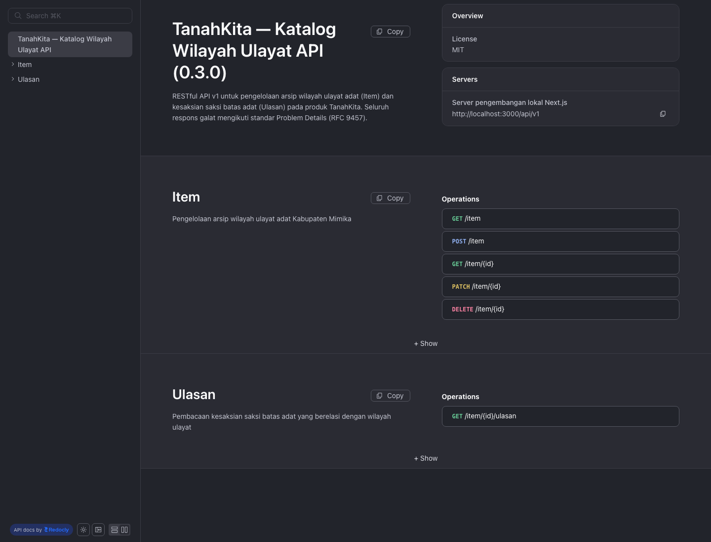

# Dokumen Teknis Modul 8 — RESTful API dengan Route Handlers

* **Nama/NIM**     : Yosafat Jacobus / 105224016
* **Repositori**   : [https://github.com/yosafatjac/tanahkita](https://github.com/yosafatjac/tanahkita)
* **Branch kerja** : `praktikum/modul-08` (digabungkan ke `main`)
* **Produk**       : **TanahKita** — Sistem Pencatatan dan Pembuktian Penguasaan Tanah Adat Papua (Kabupaten Mimika)

---

## 1. Daftar Endpoint

Berdasarkan entitas induk **`Item`** (arsip wilayah ulayat adat) dan entitas berelasi 1:N **`Ulasan`** (kesaksian saksi batas adat) pada `prisma/schema.prisma`, berikut adalah **6 operasi endpoint** di bawah `/api/v1` yang melayani kebutuhan pada [docs/kebutuhan.md](../kebutuhan.md):

| No | Metode | Path di Bawah `/api/v1` | ID Kebutuhan (`docs/kebutuhan.md`) | Ringkasan Operasi | Kode Status yang Mungkin |
| :-: | :-: | :--- | :-: | :--- | :--- |
| **1** | `GET` | `/api/v1/item` | **`K-01`** | Mengambil daftar wilayah ulayat terpaginasi (`halaman`, `batas <= 50`) dengan filter opsional `kategori` dalam satu transaksi bersama `count`. | `200`, `400`, `405` |
| **2** | `POST` | `/api/v1/item` | **`K-02`** | Mendaftarkan arsip wilayah ulayat baru dan mengembalikan objek baru disertai header `Location: /api/v1/item/{id}`. | `201`, `400`, `405`, `409`, `422` |
| **3** | `GET` | `/api/v1/item/{id}` | **`K-03`** | Mengambil detail satu arsip wilayah ulayat berdasarkan `id` bilangan bulat positif. | `200`, `400`, `404`, `405` |
| **4** | `PATCH` | `/api/v1/item/{id}` | **`K-04`** | Memperbarui sebagian atribut wilayah ulayat (minimal satu field dikirim). | `200`, `400`, `404`, `405`, `409`, `422` |
| **5** | `DELETE` | `/api/v1/item/{id}` | **`K-05`** | Menghapus satu arsip wilayah ulayat apabila belum memiliki baris anak `Ulasan` (`onDelete: Restrict`). | `204`, `400`, `404`, `405`, `409` |
| **6** | `GET` | `/api/v1/item/{id}/ulasan` | **`K-06`** | Mengambil daftar kesaksian saksi batas adat (`Ulasan`) milik wilayah ulayat `{id}` diurutkan dari yang terbaru. | `200`, `400`, `404`, `405` |

*(Catatan: Metode yang tidak diekspor seperti `PUT /api/v1/item/1` otomatis dijawab `405 Method Not Allowed` oleh Next.js Route Handler, sedangkan `OPTIONS` otomatis dijawab `204 No Content` disertai header `Allow`.)*

---

## 2. Implementasi Route Handler dan Validasi

### A. Struktur Direktori API & Helper
Karena aplikasi Next.js berada di subdirektori `Pengembangan Aplikasi Web/`, seluruh Route Handler ditempatkan pada `src/app/api/v1/` terpisah dari berkas `page.tsx`:

```text
Pengembangan Aplikasi Web/src/
├── app/api/v1/
│   └── item/
│       ├── route.ts               # GET (koleksi + paginasi + filter) & POST (201 + Location)
│       └── [id]/
│           ├── route.ts           # GET (detail), PATCH (parsial), DELETE (cek relasi 409 / 204)
│           └── ulasan/
│               └── route.ts       # GET (daftar ulasan berelasi 1:N milik item {id})
└── lib/
    ├── skema.ts                   # Skema Zod bersama (formulir Modul 5–7 & REST API Modul 8)
    └── api/
        └── problem.ts             # Helper RFC 9457: problem(), galatValidasi(), bacaJson(), bacaId()
```

### B. Isi Helper `src/lib/api/problem.ts`
```ts
import { z } from "zod";
import { skemaId } from "@/lib/skema";

export function problem(
  status: number,
  title: string,
  extra: Record<string, unknown> = {},
) {
  return Response.json(
    { type: "about:blank", title, status, ...extra },
    { status, headers: { "Content-Type": "application/problem+json" } },
  );
}

export function galatValidasi(error: z.ZodError) {
  const { formErrors, fieldErrors } = z.flattenError(error);
  return problem(422, "Unprocessable Content", {
    detail: formErrors[0] ?? "Data tidak lolos validasi.",
    errors: fieldErrors,
  });
}

export async function bacaJson(request: Request) {
  try {
    return { ok: true as const, data: (await request.json()) as unknown };
  } catch {
    const res = problem(400, "Bad Request", {
      detail: "Body harus JSON yang valid.",
    });
    return { ok: false as const, res };
  }
}

export async function bacaId(params: Promise<{ id: string }>) {
  const hasil = skemaId.safeParse((await params).id);
  return hasil.success ? hasil.data : null;
}
```

### C. Skema Zod 4 yang Dipakai (`src/lib/skema.ts`)
1. **`KATEGORI` & `skemaItemDasar`:** Memvalidasi `judul` (`3..80` karakter), `kategori` (`z.enum(["HutanAdat", "ZonaSagu", "PesisirUlayat", "LembahKeramat", "PerkebunanKomunal"])`), `distrik` (`3..80` karakter), `luasHektar` (`> 0` s.d. `100000`), dan `deskripsi` (`3..500` karakter) tanpa `.default()` agar aman diturunkan menjadi `.partial()`.
2. **`skemaItemBaru` (`POST` body):** Memperluas `skemaItemDasar` dengan nilai bawaan untuk `distrik` (`"Kuala Kencana"`), `luasHektar` (`10`), dan `tersedia` (`z.boolean().default(true)`).
3. **`skemaItemUbah` (`PATCH` body):** Memperluas `skemaItemDasar` dengan `tersedia: z.boolean()`, menerapkan `.partial()`, lalu `.refine((o) => Object.values(o).some((v) => v !== undefined))` sehingga body kosong `{}` ditolak `422`.
4. **`skemaKueriItem` (`GET` query):** `halaman` (`int >= 1`, default `1`), `batas` (`int 1..50`, default `10`), dan `kategori` opsional.
5. **`skemaId` (`path` parameter `{id}`):** `z.coerce.number().int().positive()` (menolak `abc`, `0`, `-3`, `1.5` sebelum menyentuh Prisma).

### D. Aturan Pemetaan Hasil ke Kode Status HTTP
* **`400 Bad Request`:** Sintaks atau bentuk parameter permintaan rusak — yaitu `request.json()` melempar `SyntaxError` (ditangkap `bacaJson()`), parameter path `id` bukan bilangan bulat positif (`bacaId() === null`), atau parameter kueri tidak sah (`batas=500` melebihi batas 50).
* **`404 Not Found`:** Parameter `id` sah sebagai bilangan bulat positif, namun rekaman `Item` tidak ditemukan di PostgreSQL (`findUnique` mengembalikan `null`, atau `update`/`delete` melempar `PrismaClientKnownRequestError` berkode `P2025`).
* **`409 Conflict`:** Permintaan sah secara sintaks dan semantik, tetapi bertabrakan dengan keadaan data saat ini di basis data — yaitu menghapus `Item` yang masih dirujuk oleh baris `Ulasan` (`prisma.ulasan.count({ where: { itemId: id } }) > 0` pada relasi `onDelete: Restrict`), atau menyimpan/mengubah `judul` wilayah ulayat yang melanggar `@unique` (`P2002`).
* **`422 Unprocessable Content`:** Body berhasil diurai sebagai JSON valid, namun isinya melanggar aturan skema domain Zod (`!hasil.success`, misalnya `judul` kurang dari 3 karakter, `kategori` tidak dikenal, atau `PATCH` mengirim objek kosong `{}`).

---

## 3. Format Galat Problem Details (RFC 9457)

Seluruh contoh di bawah ini merupakan **keluaran aktual** dari server pengembangan lokal (`curl -i`):

### A. Kasus `400 Bad Request` (Body Bukan JSON Valid)
```http
HTTP/1.1 400 Bad Request
content-type: application/problem+json

{
  "type": "about:blank",
  "title": "Bad Request",
  "status": 400,
  "detail": "Body harus JSON yang valid."
}
```

### B. Kasus `404 Not Found` (`id` Tidak Ditemukan)
```http
HTTP/1.1 404 Not Found
content-type: application/problem+json

{
  "type": "about:blank",
  "title": "Not Found",
  "status": 404,
  "detail": "Item 99999 tidak ditemukan."
}
```

### C. Kasus `409 Conflict` (`DELETE` pada Item yang Masih Memiliki Ulasan)
```http
HTTP/1.1 409 Conflict
content-type: application/problem+json

{
  "type": "about:blank",
  "title": "Conflict",
  "status": 409,
  "detail": "Item 1 masih memiliki 1 ulasan."
}
```

### D. Kasus `422 Unprocessable Content` (JSON Valid, Gagal Validasi Zod)
```http
HTTP/1.1 422 Unprocessable Entity
content-type: application/problem+json

{
  "type": "about:blank",
  "title": "Unprocessable Content",
  "status": 422,
  "detail": "Data tidak lolos validasi.",
  "errors": {
    "judul": ["Judul minimal 3 karakter"],
    "kategori": ["Kategori tidak dikenal"],
    "deskripsi": ["Deskripsi minimal 3 karakter"]
  }
}
```

---

## 4. Spesifikasi OpenAPI

* **Berkas Spesifikasi OpenAPI 3.1.0:** [docs/api/openapi.yaml](../api/openapi.yaml)
* **Konfigurasi Linter Redocly:** [redocly.yaml](../../redocly.yaml)
* **Dokumentasi HTML Statis Redoc:** [docs/api/index.html](../api/index.html)

### A. Keluaran `npx @redocly/cli lint` dan `build-docs`
```text
$ npx @redocly/cli lint docs/api/openapi.yaml
validating docs/api/openapi.yaml...
docs/api/openapi.yaml: validated in 17ms

Woohoo! Your API description is valid. 🎉

$ npx @redocly/cli build-docs docs/api/openapi.yaml -o docs/api/index.html
Found redocly.yaml and using 'openapi' options
Prerendering docs
🎉 bundled successfully in: docs/api/index.html (297 KiB) [⏱ 99ms].
```



### B. Penyelarasan Selisih antara Spesifikasi Awal dan Kode Aktual
1. **Kolom Wajib `distrik` & `luasHektar` di `prisma/schema.prisma`:** Contoh dasar modul hanya mencantumkan 3 field (`judul`, `kategori`, `deskripsi`), sedangkan tabel `Item` produk **TanahKita** mewajibkan `distrik` dan `luasHektar` tanpa `@default` di level PostgreSQL. Keduanya ditambahkan baik ke `skemaItemDasar`/`skemaItemBaru` maupun `components.schemas.ItemBaru` & `ItemUbah` di `openapi.yaml` dengan batasan identik (`minLength: 3, maxLength: 80` dan `exclusiveMinimum: 0, maximum: 100000`).
2. **Respons `409 Conflict` pada `POST` dan `PATCH`:** Karena kolom `Item.judul` bersifat `@unique`, baik handler kode (`P2002`) maupun blok `responses` pada `POST /item` dan `PATCH /item/{id}` di `openapi.yaml` diselaraskan agar sama-sama mencantumkan status `"409"`.
3. **Tipe Nullable OpenAPI 3.1 (`gambar`):** Kolom opsional `gambar: String?` di Prisma dikembalikan sebagai `null` pada JSON; pada OpenAPI `3.1.0` didefinisikan memakai `type: [string, "null"]` (bukan sintaks lama OpenAPI 3.0 `nullable: true`).
4. **Batas Karakter `Ulasan.komentar`:** Disamakan persis `maxLength: 280` mengikuti konstanta `BATAS_KARAKTER_ULASAN = 280` hasil perbaikan Modul 7.

---

## 5. Hasil Pengujian Manual

### A. Tabel 16 Kasus Uji Manual (`curl -i`)
* **Persentase Kasus Lulus:** **16 dari 16 skenario lulus (`100%`)** — melampaui target minimal `90%`.

| No | Permintaan (`Metode` + `Path` + `Body` Ringkas) | Status Harapan | Status Aktual | Lulus / Gagal |
| :-: | :--- | :-: | :-: | :-: |
| **1** | `GET /api/v1/item?batas=2` | `200` | `200` | **Lulus** |
| **2** | `GET /api/v1/item?batas=500` *(melebihi batas 50)* | `400` | `400` | **Lulus** |
| **3** | `GET /api/v1/item/1` *(ID seed valid)* | `200` | `200` | **Lulus** |
| **4** | `GET /api/v1/item/abc` *(ID bukan bilangan bulat)* | `400` | `400` | **Lulus** |
| **5** | `GET /api/v1/item/99999` *(ID tidak ditemukan)* | `404` | `404` | **Lulus** |
| **6** | `POST /api/v1/item` `{"judul":"Zona Sagu Uji REST","kategori":"ZonaSagu","distrik":"Iwaka","luasHektar":15.2,"deskripsi":"Pengujian manual REST API Modul 8"}` | `201` *(+ `Location`)* | `201` (`Location: /api/v1/item/30`) | **Lulus** |
| **7** | `POST /api/v1/item` `'{"judul":'` *(JSON terpotong/rusak)* | `400` | `400` | **Lulus** |
| **8** | `POST /api/v1/item` `{"judul":"ab","kategori":"transportasi","deskripsi":""}` | `422` | `422` | **Lulus** |
| **9** | `PATCH /api/v1/item/30` `{"tersedia":false}` *(parsial valid)* | `200` | `200` | **Lulus** |
| **10** | `PATCH /api/v1/item/30` `{}` *(body objek kosong)* | `422` | `422` | **Lulus** |
| **11** | `DELETE /api/v1/item/30` *(item baru tanpa relasi ulasan)* | `204` | `204` | **Lulus** |
| **12** | `DELETE /api/v1/item/30` *(diulang kedua kali pada ID yang sama)* | `404` | `404` | **Lulus** |
| **13** | `DELETE /api/v1/item/1` *(item seed masih punya 1 ulasan)* | `409` | `409` | **Lulus** |
| **14** | `GET /api/v1/item/1/ulasan` *(daftar ulasan berelasi)* | `200` | `200` | **Lulus** |
| **15** | `PUT /api/v1/item/1` *(metode tidak diekspor)* | `405` | `405` | **Lulus** |
| **16** | `POST /api/v1/item` dengan `judul` duplikat seed (`"Kawasan Ulayat Lembah Nemangkawi"`) | `409` | `409` | **Lulus** |

### B. Verifikasi Koleksi Bruno & Asersi Otomatis (`docs/api/bruno/`)
Koleksi Bruno disimpan sebagai berkas teks `.bru` di [docs/api/bruno/](../api/bruno/) dengan asersi kode status dan `content-type`, lalu dieksekusi langsung terhadap server lokal menggunakan Bruno CLI (`npx @usebruno/cli run`):

```text
01-daftar-item-200 (200 OK) - 116 ms
   ✓ res.status: eq 200
   ✓ res.body.meta.batas: eq 2
02-daftar-item-batas-500-400 (400 Bad Request) - 12 ms
   ✓ res.status: eq 400
   ✓ res.headers['content-type']: contains application/problem+json
03-buat-item-201 (201 Created) - 13 ms
   ✓ res.status: eq 201
   ✓ res.headers.location: isDefined
04-buat-item-invalid-422 (422 Unprocessable Entity) - 6 ms
   ✓ res.status: eq 422
   ✓ res.headers['content-type']: contains application/problem+json
05-detail-item-99999-404 (404 Not Found) - 15 ms
   ✓ res.status: eq 404
   ✓ res.headers['content-type']: contains application/problem+json
06-patch-kosong-422 (422 Unprocessable Entity) - 17 ms
   ✓ res.status: eq 422
   ✓ res.headers['content-type']: contains application/problem+json
07-delete-item-berelasi-409 (409 Conflict) - 16 ms
   ✓ res.status: eq 409
   ✓ res.headers['content-type']: contains application/problem+json
08-daftar-ulasan-item-200 (200 OK) - 12 ms
   ✓ res.status: eq 200
   ✓ res.body.data: isDefined

📊 Execution Summary: Status ✓ PASS | Requests: 8 (8 Passed) | Assertions: 16/16 | Duration: 810 ms
```

---

## 6. Keputusan Teknis dan Kendala

### 1. Pemilihan `400 Bad Request` vs `422 Unprocessable Content` (RFC 9110 & RFC 9457)
Mengacu **RFC 9110 Bagian 15.5.1** dan **15.5.21**, kedua kode sama-sama menandai kesalahan dari klien (`4xx`), namun berada pada **lapisan kegagalan yang berbeda**:
* **`400 Bad Request`** digunakan saat server gagal mengurai atau memproses *bentuk/sintaks* permintaan: payload body bukan JSON yang sah (`SyntaxError` pada `request.json()`), segmen path `{id}` bukan bilangan bulat positif (`abc`, `0`, `-3`, `1.5`), atau parameter kueri URL melanggar kontrak transport (`batas=500`).
* **`422 Unprocessable Content`** digunakan ketika sintaks `Content-Type: application/json` sudah benar dan struktur JSON berhasil diurai server, tetapi **semantik/aturan bisnis nilai field** gagal melewati skema domain Zod (`judul` terlalu pendek, enum `kategori` tidak dikenal, atau body `PATCH {}` tidak menyertakan satu pun atribut perubahan). Pemisahan ini memudahkan klien API membedakan bug serialisasi request (`400`) dari kesalahan input pengguna yang dapat dipetakan per kolom melalui objek ekstensi `errors` pada **RFC 9457**.

### 2. Pemilihan `409 Conflict` pada `DELETE` Item Berelasi (RFC 9110 Bagian 15.5.10)
Pada domain **TanahKita**, setiap baris `Ulasan` merepresentasikan kesaksian saksi batas adat atas suatu wilayah ulayat (`Item`), sehingga skema database menerapkan `onDelete: Restrict`.
* Jika `DELETE /api/v1/item/{id}` langsung memanggil `prisma.item.delete()` tanpa memeriksa jumlah relasi, pelanggaran foreign key (`P2003`) akan memicu `500 Internal Server Error` yang keliru menyalahkan server.
* Sebaliknya, mengubah skema menjadi `onDelete: Cascade` berisiko melenyapkan bukti kesaksian saksi secara diam-diam saat klien eksternal memanggil `DELETE`.
* Sesuai **RFC 9110 Bagian 15.5.10**, kondisi ketika permintaan tidak dapat diselesaikan karena bertentangan dengan keadaan resource saat ini paling tepat dijawab **`409 Conflict`** (`"Item 1 masih memiliki 1 ulasan."`), sehingga klien tahu persis ia harus menghapus atau memindahkan data relasi terlebih dahulu.

### 3. Batas Maksimum Paginasi (`batas <= 50`) dan Struktur Path `/api/v1`
* **Batas Paginasi `50` + Transaksi Baca:** Sesuai pencegahan **OWASP API Security Top 10 2023 (`API4:2023 Unrestricted Resource Consumption`)**, membatasi `batas` maksimum `50` di `skemaKueriItem` mencegah satu permintaan nakal seperti `?batas=1000000` menguras memori Node.js dan koneksi PostgreSQL. Eksekusi `findMany` dan `count` dibungkus dalam satu `prisma.$transaction([...])` agar angka `meta.total` selalu konsisten dengan potongan `data` yang dikembalikan.
* **Struktur Path Kata Benda & Versi Kontrak (`/api/v1`):** Seluruh URI menggunakan kata benda sumber daya tanpa kata kerja (`/api/v1/item`, `/api/v1/item/{id}`, `/api/v1/item/{id}/ulasan`), sedangkan kata kerja diwakili oleh metode HTTP (`GET`, `POST`, `PATCH`, `DELETE`) sesuai prinsip REST. Prefiks `/v1` menjaga kompatibilitas kontrak apabila di masa depan terjadi perubahan skema yang memutus kompatibilitas (*breaking change* $\rightarrow$ `/api/v2`).

### 4. Kendala Teknis dan Penyelesaian
* **Kendala Jebakan `.default()` pada `.partial()` di Zod 4:** Apabila nilai `.default("Kuala Kencana")` dan `.default(10)` diletakkan langsung di dalam `skemaItemDasar`, maka turunan `skemaItemUbah = skemaItemDasar.partial()` akan otomatis mengisi `distrik` dan `luasHektar` setiap kali `PATCH` dipanggil—mengakibatkan payload kosong `{}` lolos validasi (bukan `422`) sekaligus menimpa `distrik` dan `luasHektar` asli item di database!
* **Penyelesaian:** Menjaga `skemaItemDasar` murni tanpa `.default()`, lalu hanya menyuntikkan `.default(...)` secara spesifik pada `skemaItemBaru` (`POST`), sementara `skemaItemUbah` (`PATCH`) memakai `.refine((o) => Object.values(o).some((v) => v !== undefined))`. Diverifikasi dengan kasus uji #9 dan #10: `PATCH {"tersedia":false}` hanya mengubah `tersedia`, dan `PATCH {}` tepat ditolak `422`.

---

## 7. Catatan Pemanfaatan AI

* **Alat yang digunakan:** Antigravity AI Coding Assistant (Google DeepMind) pada Antigravity IDE.
* **Perintah utama (mengikuti tahapan `Panduan_Mengajar_Modul_8_REST_API_Revisi.docx`):**
  1. *Prompt 0:* Inspeksi *read-only* struktur monorepo `Pengembangan Aplikasi Web/`, `prisma/schema.prisma`, `docs/kebutuhan.md`, serta pemetaan 6 operasi `/api/v1`.
  2. *Step 2:* Penambahan `KATEGORI`, `skemaItemDasar`, `skemaItemBaru`, `skemaItemUbah`, `skemaKueriItem`, `skemaId` di `src/lib/skema.ts` serta pembuatan helper RFC 9457 di `src/lib/api/problem.ts`.
  3. *Step 3 & Step 4:* Implementasi Route Handlers `src/app/api/v1/item/route.ts`, `src/app/api/v1/item/[id]/route.ts`, dan `src/app/api/v1/item/[id]/ulasan/route.ts`.
  4. *Step 5 & Step 6:* Penyusunan kontrak `docs/api/openapi.yaml` (OpenAPI 3.1.0), `redocly.yaml`, koleksi asersi Bruno `docs/api/bruno/`, dan perapian `docs/praktikum/modul-08.md`.
* **Bagian yang digunakan dan disesuaikan:**
  * Kerangka helper `problem.ts`, Route Handlers, dan spesifikasi `openapi.yaml` disesuaikan penuh dengan skema aktual **TanahKita** (5 nilai enum `Kategori`, kolom wajib `distrik` & `luasHektar`, pemisahan `.default()` dari `skemaItemDasar` agar `PATCH {}` tidak bocor, serta pemetaan `P2002` ke `409 Conflict`).
* **Cara memverifikasi secara mandiri:**
  1. Menjalankan `npx tsc --noEmit` (`0` galat tipe) dan `npm run lint` (`✔ No ESLint warnings or errors`).
  2. Menjalankan `npx @redocly/cli lint docs/api/openapi.yaml` (`Woohoo! Your API description is valid. 🎉`) serta membangun pratinjau `docs/api/index.html`.
  3. Mengeksekusi langsung **16 skenario `curl -i`** terhadap PostgreSQL 18 lokal (`16/16` lulus `100%`, mencakup kode `200`, `201` + `Location`, `204`, `400`, `404`, `405`, `409`, dan `422`).
  4. Mengeksekusi koleksi asersi Bruno (`npx @usebruno/cli run` pada `docs/api/bruno/`) dengan hasil **`8/8 Requests Passed` dan `16/16 Assertions Passed`**.
