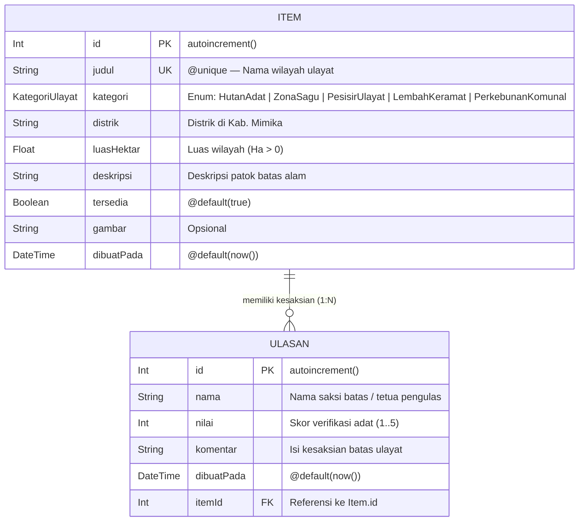

# Laporan Milestone 2 (`v0.2`) — Pengembangan Aplikasi Web (PAW)
## Aplikasi Web Berbasis Basis Data Relasional, CRUD Penuh 2 Entitas, Validasi Server, & Sesi RBAC

- **Nama Mahasiswa:** Yosafat Jacobus
- **NIM:** 105224016
- **Produk Terintegrasi:** **TanahKita** (Sistem Pencatatan dan Pembuktian Penguasaan Tanah Adat Papua)
- **Tag Rilis:** `v0.2`
- **Tumpukan Teknologi:** Next.js 15 (App Router, Server Components & Server Actions), TypeScript 5, Prisma ORM 7 (`@prisma/adapter-pg`), PostgreSQL 18, Zod 4

---

## 1. Perintah Penyiapan & Verifikasi Cepat (Urutan Eksplisit)

Jalankan perintah berikut dari direktori `Pengembangan Aplikasi Web/`:

```bash
cd "Pengembangan Aplikasi Web"

# 1. Salin konfigurasi lingkungan contoh (.env tidak pernah dilacak Git)
cp .env.example .env

# 2. Jalankan migrasi skema Prisma ke PostgreSQL 18
npx prisma migrate dev --name init

# 3. Bangkitkan Prisma Client TypeScript (ke src/generated/prisma)
npx prisma generate

# 4. Isi data awal (seed) 8 wilayah ulayat Mimika + ulasan saksi batas adat
npx prisma db seed

# 5. Jalankan 12 skenario uji otomatis CRUD 2 entitas, relasi, transaksi, & validasi Zod
npm run test:paw

# 6. Jalankan server pengembangan Next.js
npm run dev
```

---

## 2. Desain Basis Data Relasional & Diagram ERD (`prisma/schema.prisma`)

Basis data PostgreSQL 18 memuat **2 entitas utama yang saling berelasi `1-ke-N` (One-to-Many)** dengan tipe enum domain `KategoriUlayat`, kendala keunikan tunggal (`@unique`), serta kendala keunikan gabungan (`@@unique([itemId, nama])`):



### Penjelasan Kendala Integritas (Database Constraints)
1. **`Item.judul` (`@unique`):** Mencegah pendaftaran wilayah ulayat bernama sama secara ganda di tingkat PostgreSQL (memicu kode galat `P2002` yang ditangkap dan diterjemahkan ke pesan bahasa Indonesia yang ramah).
2. **`Ulasan` (`@@unique([itemId, nama])`):** Mencegah satu saksi batas memberikan dua ulasan duplikat pada wilayah ulayat (`itemId`) yang sama.
3. **Kunci Asing (`itemId -> Item.id`) & Penghapusan Atomik (`prisma.$transaction`):** Memastikan tidak ada ulasan yatim (*orphan records*); penghapusan `Item` induk wajib menghapus seluruh `Ulasan` anak di dalam satu transaksi database atomik.

---

## 3. Matriks Operasi CRUD Lengkap pada Kedua Entitas (8 Operasi CRUD + Relasi)

Seluruh halaman utama membaca dan memutasi data nyata di PostgreSQL 18 melalui modul berpelindung `import "server-only"` (`src/lib/prisma.ts` dan `src/lib/data.ts`) serta **Server Actions** (`"use server"`):

| Entitas | Operasi | Fungsi Server Action / Data | Berkas Implementasi | Rute Antarmuka & Revalidasi |
| :--- | :--- | :--- | :--- | :--- |
| **Entitas 1: `Item`** (Wilayah Ulayat) | **Create (C)** | `simpanUlayatAction` & `tambahItem` | `src/app/katalog/actions.ts` | `/katalog/tambah` $\rightarrow$ `revalidatePath('/katalog')` |
| **Entitas 1: `Item`** (Wilayah Ulayat) | **Read (R)** | `ambilDaftarItem` & `ambilItem(id)` | `src/lib/data.ts`, `src/components/RingkasanArsip.tsx` | `/`, `/katalog`, `/katalog/[id]` (404 via `notFound()`) |
| **Entitas 1: `Item`** (Wilayah Ulayat) | **Update (U)** | `ubahItem(id, ...)` | `src/app/katalog/actions.ts`, `src/components/FormUbahItem.tsx` | `/katalog/[id]` $\rightarrow$ `revalidatePath('/katalog/[id]')` |
| **Entitas 1: `Item`** (Wilayah Ulayat) | **Delete (D)** | `hapusItem(id)` (`prisma.$transaction`) | `src/app/katalog/actions.ts` | `/katalog/[id]` $\rightarrow$ `redirect('/katalog')` |
| **Entitas 2: `Ulasan`** (Kesaksian Saksi) | **Create (C)** | `tambahUlasan(itemId, ...)` | `src/app/katalog/ulasan-actions.ts`, `src/components/FormUlasan.tsx` | `/katalog/[id]` $\rightarrow$ `revalidatePath('/katalog/[id]')` |
| **Entitas 2: `Ulasan`** (Kesaksian Saksi) | **Read (R)** | `ambilItem(id)` (`include / select: { ulasan }`) | `src/lib/data.ts`, `src/app/katalog/[id]/page.tsx` | `/katalog/[id]` & kartu jumlah ulasan di `/` dan `/katalog` |
| **Entitas 2: `Ulasan`** (Kesaksian Saksi) | **Update (U)** | `ubahUlasan(id, itemId, ...)` | `src/app/katalog/ulasan-actions.ts`, `src/components/FormUbahUlasan.tsx` | `/katalog/[id]` (inline edit skor & komentar) |
| **Entitas 2: `Ulasan`** (Kesaksian Saksi) | **Delete (D)** | `hapusUlasan(id, itemId)` | `src/app/katalog/ulasan-actions.ts` | `/katalog/[id]` $\rightarrow$ `revalidatePath('/katalog/[id]')` |

---

## 4. Validasi Sisi Server dengan Zod 4 (3 Skenario Penolakan Input Tidak Valid)

Setiap Server Action memvalidasi masukan menggunakan **`safeParse`** dan **`z.flattenError(hasil.error).fieldErrors`** di sisi server **sebelum** menyentuh Prisma/PostgreSQL. Antarmuka menggunakan `useActionState`, atribut aksesibilitas `aria-invalid`, dan `aria-describedby` untuk menampilkan pesan kesalahan per kolom:

1. **Skenario Penolakan Server 1 (`ulayatSchema` pada `simpanUlayatAction`):**
   - **Input Uji:** `nama: "Abc"` (< 5 karakter), `luasHektar: -15` ($\le 0$), `deskripsi: "Terlalu pendek"` (< 20 karakter).
   - **Hasil Server Action:** Ditolak oleh Zod sebelum query DB; mengembalikan `fieldErrors.nama`, `fieldErrors.luasHektar: ["Luas wilayah harus lebih dari 0 hektar"]`, dan `fieldErrors.deskripsi`.
2. **Skenario Penolakan Server 2 (`skemaUlasan` pada `tambahUlasan`):**
   - **Input Uji:** `nama: "Saksi Lapangan"`, `nilai: 6` (di luar rentang bulat $1..5$), `komentar: "Komentar uji validasi cukup panjang"`.
   - **Hasil Server Action:** Ditolak oleh Zod; mengembalikan `fieldErrors.nilai: ["Nilai maksimal 5"]`.
3. **Skenario Penolakan Server 3 (`skemaUbahUlasan` pada `ubahUlasan`):**
   - **Input Uji:** `nilai: 4`, `komentar: "Ya"` (< 5 karakter).
   - **Hasil Server Action:** Ditolak oleh Zod; mengembalikan `fieldErrors.komentar: ["Komentar minimal 5 karakter"]`.

---

## 5. Manajemen Sesi Cookie `HttpOnly`, RBAC 3 Peran, & Keamanan Kata Sandi

- **Sesi Server & Cookie (`src/lib/sesi.ts`):** Menggunakan `cookies()` asinkron Next.js 15 dengan atribut `httpOnly: true`, `sameSite: "lax"`, `secure: process.env.NODE_ENV === "production"`, `path: "/"`, dan `maxAge: 28800` (8 jam).
- **RBAC 3 Peran & Pencegahan BOLA/BFLA:**
  1. `Tetua Adat` (Admin): Wewenang penuh C-R-U-D pada `Item` dan `Ulasan`, termasuk penghapusan transaksi atomik.
  2. `Verifikator Adat`: Dapat menambah dan memperbarui `Item` serta `Ulasan`, tetapi ditolak (`403 Forbidden`) bila mencoba menghapus arsip `Item` permanen.
  3. `Pemohon Adat`: Dapat mendaftarkan klaim baru dan menambah/mengubah/menghapus `Ulasan` miliknya sendiri, tetapi ditolak (`403 Forbidden`) bila mencoba mengubah status `Item` atau mengubah/menghapus `Ulasan` milik pengguna lain.
- **Hash Kata Sandi Lambat & NIST SP 800-63B-4 (`src/lib/password-hash.ts`):** Menggunakan `crypto.scryptSync` ($N=16384, r=8, p=1$) dengan salt CSPRNG 16-byte unik per akun dan `crypto.timingSafeEqual`, kebijakan panjang minimal 15 karakter, pemeriksaan daftar sandi bocor (*compromised blocklist*), serta *rate limiter* (maksimal 3 gagal per 10 detik $\rightarrow$ `429 Too Many Requests`).

---

## 6. Tabel 12 Skenario Pengujian Otomatis (`scripts/uji-crud-modul6.ts`)

Sesuai ketentuan pengujian Milestone 2 PAW (minimal 10 skenario terdiri atas 8 skenario CRUD dan 2 skenario relasi data, dengan mencantumkan **Tujuan**, **Langkah Pengujian**, **Hasil yang Diharapkan**, **Hasil Aktual**, serta **Status Lulus/Gagal**), seluruh 12 skenario diuji menggunakan data sintetis pada PostgreSQL 18 melalui perintah `npm run test:paw`:

| No | Tujuan Pengujian | Langkah Pengujian | Hasil yang Diharapkan | Hasil Aktual (PostgreSQL 18 / Zod 4) | Status |
| :---: | :--- | :--- | :--- | :--- | :---: |
| **1** | **CRUD #1 (`Item` — Create):** Menguji penambahan wilayah ulayat baru ke PostgreSQL | Mengirim data sintetis wilayah ulayat sah (`judul`, `kategori: "ZonaSagu"`, `distrik: "Mimika Timur"`, `luasHektar: 120.5`, `deskripsi`) melalui `simpanUlayatAction` / `prisma.item.create` | Baris baru tersimpan permanen di tabel `Item` PostgreSQL dengan `id` auto-increment dan tampil di `/katalog` | Baris `Item` berhasil disimpan ke PostgreSQL (`ID: 17`, `judul: "Kawasan Adat Hutan Sagu Tipuka..."`) | **LULUS** |
| **2** | **CRUD #2 (`Item` — Read & 404):** Menguji pembacaan daftar/detail `Item` dan penanganan ID tidak valid | Memanggil `ambilItem(testItemId)` untuk ID sah dan `ambilItem(999999)` untuk ID fiktif pada `/katalog/[id]` | ID sah mengembalikan objek `Item` lengkap beserta relasi `ulasan`; ID fiktif mengembalikan `null` dan memicu halaman `404 Not Found` (`notFound()`) | Data `Item` ID 17 terbaca utuh dari PostgreSQL; ID fiktif `999999` mengembalikan `null` $\rightarrow$ `notFound()` 404 | **LULUS** |
| **3** | **CRUD #3 (`Item` — Update):** Menguji pembaruan deskripsi patok dan status `tersedia` pada `Item` | Membuka `FormUbahItem` di `/katalog/[id]`, mengubah `deskripsi` dan `tersedia: false`, lalu mengeksekusi `ubahItem` | Kolom `deskripsi` dan `tersedia` pada baris `Item` di PostgreSQL terbarui dan tetap bertahan saat halaman dimuat ulang | `Item` ID 17 berhasil diupdate di PostgreSQL (`deskripsi` baru tersimpan dan `tersedia: false`) | **LULUS** |
| **4** | **CRUD #4 (`Ulasan` — Create):** Menguji penambahan kesaksian saksi batas adat pada `Item` | Mengisi `FormUlasan` (`nama: "Saksi Marga Beanal"`, `nilai: 4`, `komentar`) pada `/katalog/[id]` dan memanggil `tambahUlasan` | Baris `Ulasan` baru tersimpan di PostgreSQL dengan kunci asing `itemId` merujuk ke `Item` induk | Baris `Ulasan` berhasil disimpan ke PostgreSQL (`ID: 17`, `nama: "Saksi Marga Beanal"`, `nilai: 4/5`) | **LULUS** |
| **5** | **CRUD #5 (`Ulasan` — Read) & Relasi #1 (1-ke-N):** Menguji pembacaan relasi `Item` beserta seluruh `Ulasan` anaknya | Memuat halaman `/katalog/[id]` yang memanggil `prisma.item.findUnique({ where: { id }, include: { ulasan: true } })` | Seluruh daftar `Ulasan` milik `Item` tersebut terambil secara berelasi `1:N` diurutkan dari yang terbaru | Relasi `1:N` `Item -> Ulasan` terverifikasi: ditemukan 1 ulasan milik `"Saksi Marga Beanal"` pada `Item` ID 17 | **LULUS** |
| **6** | **CRUD #6 (`Ulasan` — Update):** Menguji pembaruan skor `nilai` dan isi `komentar` pada entitas ke-2 (`Ulasan`) | Membuka `FormUbahUlasan` pada kartu ulasan di `/katalog/[id]`, mengubah `nilai` menjadi `5` dan memperbarui `komentar`, lalu memanggil `ubahUlasan` | Baris `Ulasan` di PostgreSQL terbarui dengan skor dan komentar baru serta halaman `/katalog/[id]` direvalidasi | `Ulasan` ID 17 berhasil diupdate di PostgreSQL menjadi `Nilai: 5/5` dengan komentar verifikasi baru | **LULUS** |
| **7** | **CRUD #7 (`Ulasan` — Delete):** Menguji penghapusan satu ulasan anak secara individual | Menekan tombol `"Hapus ulasan"` pada satu item ulasan yang memanggil Server Action `hapusUlasan(id, itemId)` | Baris `Ulasan` target terhapus dari PostgreSQL sementara baris `Item` induk tetap ada dan utuh | `Ulasan` ID 18 berhasil dihapus dari tabel `Ulasan` tanpa menghapus `Item` induk | **LULUS** |
| **8** | **CRUD #8 (`Item` — Delete) & Relasi #2 (Transaksi Atomik):** Menguji penghapusan `Item` induk beserta seluruh ulasan anaknya | Menekan tombol `"Hapus Item & Kesaksian (Transaksi)"` yang mengeksekusi `prisma.$transaction([deleteMany(ulasan), delete(item)])` | Seluruh baris `Ulasan` anak dan baris `Item` induk terhapus secara atomik tanpa melanggar *foreign key constraint* (`ON DELETE RESTRICT`) | Transaksi berhasil menghapus `Item` ID 18 beserta 2 `Ulasan` anaknya hingga bersih (`count = 0`) | **LULUS** |
| **9** | **Uji Relasi & Bukti *Rollback* Transaksi:** Membuktikan sifat atomik `prisma.$transaction` saat langkah ke-2 gagal | Mengeksekusi `prisma.$transaction` di mana langkah 1 menghapus `Ulasan` anak dan langkah 2 sengaja menghapus `Item` dengan ID fiktif `99999999` | Langkah ke-2 melempar `P2025` dan PostgreSQL membatalkan (*rollback*) penghapusan `Ulasan` pada langkah ke-1 | Langkah ke-2 melempar `P2025`; pemeriksaan tabel membuktikan `1 ulasan` pada `Item` 19 **tetap utuh (tidak jadi terhapus)** | **LULUS** |
| **10** | **Uji Kendala Unik Database (`P2002`):** Menguji penolakan duplikasi pengulas pada wilayah ulayat yang sama | Mengirim ulasan kedua dengan `nama: "Saksi Marga Beanal"` pada `itemId` yang sama | Prisma melempar `P2002` (`@@unique([itemId, nama])`) dan Server Action mengembalikan pesan ramah tanpa *crash* | Ditangkap `PrismaClientKnownRequestError` `P2002` $\rightarrow$ pesan ramah `"Anda sudah pernah mengulas wilayah ulayat ini."` | **LULUS** |
| **11** | **Uji 3 Skenario Penolakan Validasi Server (Zod 4):** Menguji penolakan input tidak sah di server | Mengirim 3 payload tidak sah: (A) `luasHektar: -15`, (B) `nilai: 6`, (C) `komentar: "Ya"` (< 5 karakter) | Ketiga input ditolak oleh `safeParse` di server dengan pesan spesifik per *field* tanpa mengeksekusi query database | Ketiganya ditolak oleh Zod dengan `fieldErrors` pada `luasHektar`, `nilai`, dan `komentar`; DB tidak disentuh | **LULUS** |
| **12** | **Uji Keamanan Sesi & Hash Kata Sandi Lambat (NIST SP 800-63B-4):** Menguji kebijakan sandi dan `scrypt` | Menguji sandi `< 15` karakter, sandi bocor (`password1234567`), dan 2 hash dari sandi sah yang sama (`AdatMimika2026#TanahKita`) | Sandi pendek & bocor ditolak; 2 hash menghasilkan PHC string berbeda karena salt unik; `timingSafeEqual` akurat | Sandi lemah/bocor ditolak; `hash1 !== hash2` (`true`); verifikasi `cocok=true, salah=false` | **LULUS** |

---

## 7. Tangkapan Layar Implementasi CRUD & Integrasi Basis Data (`v0.2`)

Berikut adalah bukti visual antarmuka aplikasi **TanahKita `v0.2`** yang terhubung langsung ke basis data **PostgreSQL 18**:

### A. Halaman Katalog Wilayah Ulayat Terintegrasi PostgreSQL 18 (`/katalog`)
Menampilkan daftar wilayah ulayat (`Item`), filter kategori enum, pencarian kata kunci, serta jumlah kesaksian (`Ulasan`) yang diambil langsung dari PostgreSQL:


### B. Halaman Detail, CRUD *Update* Kedua Entitas, Relasi 1:N, & Hapus Transaksi (`/katalog/1`)
Menampilkan detail wilayah ulayat (`Item`), formulir ubah `Item` (`FormUbahItem`), daftar kesaksian saksi batas adat (`Ulasan`) beserta tombol ubah ulasan (`FormUbahUlasan`) dan hapus ulasan, formulir tambah ulasan baru (`FormUlasan`), serta tombol hapus transaksi atomik (`prisma.$transaction`):


### C. Halaman Masuk Sesi Otoritas Adat RBAC 3 Peran & Validasi NIST SP 800-63B-4 (`/masuk`)
Menampilkan formulir masuk sesi `HttpOnly` dengan dukungan 3 peran (`Tetua Adat`, `Verifikator Adat`, `Pemohon Adat`) dan kebijakan frasa sandi minimal 15 karakter:


### D. Tiga Tangkapan Layar Bukti Penolakan Validasi Sisi Server (Zod 4)

#### 1. Bukti Validasi Server #1 — Penolakan Pendaftaran Wilayah Ulayat (`/katalog/tambah`)
Menampilkan pesan kesalahan merah per *field* (`nama`, `kategori`, `distrik`, `kampung`, `margaPengelola`, `luasHektar: -25`, `titikKoordinat`, `deskripsi: "Pendek"`, `persetujuanBatasAdat: false`) dari Server Action `simpanUlayatAction`:


#### 2. Bukti Validasi Server #2 — Penolakan Ulasan Saksi Batas Adat & Form Ubah Ulasan (`/katalog/1`)
Menampilkan penolakan Server Action `tambahUlasan` saat `nama` diisi 1 karakter (`"A"`) dan `komentar` kurang dari 5 karakter (`"Pendek"`), sekaligus menampilkan komponen inline `FormUbahUlasan` yang terbuka:


#### 3. Bukti Validasi Server #3 — Penolakan Kata Sandi di Bawah 15 Karakter (`/masuk`)
Menampilkan penolakan Server Action `masukAction` berdasarkan skema Zod & kebijakan NIST SP 800-63B-4 saat kata sandi kurang dari 15 karakter:


