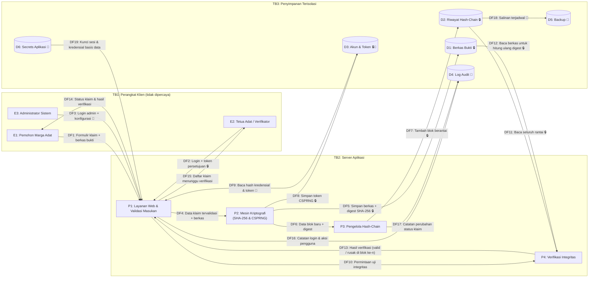

# Data Flow Diagram (DFD) & Batas Kepercayaan — TanahKita

**Produk:** TanahKita  
**Pengembang:** Yosafat Jacobus (NIM: 105224016)  
**Mata Kuliah:** Keamanan Komputasi dan Siber (CS5) — Latihan 1 → Tugas 1  
**Penanda:** `sec-0.1`  

---

## 1. Diagram Aliran Data (Level 1)

Notasi:
* `E` = entitas eksternal, `P` = proses, `D` = penyimpanan data, `DF` = aliran data.
* `TB` = batas kepercayaan (*trust boundary*).
* **🔒** = aliran atau penyimpanan yang dilindungi mekanisme kriptografi yang **sudah diterapkan**.
* **🔐** = perlindungan kriptografi yang **masih rencana** (Tugas 2/Tugas 3/Milestone 2).

---

## 2. Inventaris Elemen DFD

### A. Entitas Eksternal
| ID | Nama | Peran |
| :---: | :--- | :--- |
| **E1** | Pemohon Marga Adat | Mendaftarkan klaim tanah ulayat dan mengunggah berkas bukti. |
| **E2** | Tetua Adat / Verifikator | Memeriksa batas dan menyetujui klaim hasil musyawarah. |
| **E3** | Administrator Sistem | Memelihara server; **tidak berwenang** mengubah riwayat klaim. |

### B. Proses
| ID | Nama | Fungsi |
| :---: | :--- | :--- |
| **P1** | Layanan Web & Validasi Masukan | Menerima formulir, memvalidasi masukan, mengautentikasi pengguna, dan menampilkan hasil. |
| **P2** | Mesin Kriptografi | Menghitung SHA-256 berkas dan membangkitkan token CSPRNG. |
| **P3** | Pengelola Hash-Chain | Membuat blok baru yang menautkan `previous_hash` ke blok sebelumnya. |
| **P4** | Verifikasi Integritas | Memeriksa ulang rantai dari blok genesis dan mencocokkan digest berkas. |

### C. Penyimpanan Data
| ID | Nama | Aset | Perlindungan |
| :---: | :--- | :--- | :--- |
| **D1** | Berkas Bukti | AST-01 | 🔒 Digest SHA-256 tiap berkas |
| **D2** | Riwayat Hash-Chain | AST-02, AST-05 | 🔒 Rantai SHA-256 |
| **D3** | Akun & Token | AST-03, AST-04, AST-09 | 🔒 Token CSPRNG · 🔐 hash kata sandi `scrypt` |
| **D4** | Log Audit | AST-12 | 🔐 Log append-only berantai hash |
| **D5** | Backup | AST-11 | 🔐 Digest + enkripsi backup |
| **D6** | Secrets Aplikasi | AST-10 | 🔐 Di luar repositori, rotasi berkala |

### D. Aliran Data
| ID | Dari → Ke | Isi Data | Melintasi TB | Kripto |
| :---: | :--- | :--- | :---: | :---: |
| DF1 | E1 → P1 | Formulir klaim + berkas bukti | TB1→TB2 | 🔐 TLS |
| DF2 | E2 → P1 | Login + token persetujuan | TB1→TB2 | 🔒 token CSPRNG · 🔐 TLS |
| DF3 | E3 → P1 | Login admin + konfigurasi | TB1→TB2 | 🔐 TLS + MFA |
| DF4 | P1 → P2 | Data klaim tervalidasi + berkas | — | — |
| DF5 | P2 → D1 | Berkas + digest SHA-256 | TB2→TB3 | 🔒 |
| DF6 | P2 → P3 | Data blok baru + digest | — | 🔒 |
| DF7 | P3 → D2 | Blok riwayat berantai | TB2→TB3 | 🔒 |
| DF8 | P2 → D3 | Token CSPRNG | TB2→TB3 | 🔒 |
| DF9 | D3 → P1 | Hash kredensial & token untuk verifikasi | TB3→TB2 | 🔐 scrypt |
| DF10 | P1 → P4 | Permintaan uji integritas | — | — |
| DF11 | D2 → P4 | Seluruh rantai riwayat | TB3→TB2 | 🔒 |
| DF12 | D1 → P4 | Berkas untuk hitung ulang digest | TB3→TB2 | 🔒 |
| DF13 | P4 → P1 | Hasil verifikasi | — | — |
| DF14 | P1 → E1 | Status klaim & hasil verifikasi | TB2→TB1 | 🔐 TLS |
| DF15 | P1 → E2 | Daftar klaim menunggu verifikasi | TB2→TB1 | 🔐 TLS |
| DF16 | P1 → D4 | Catatan login & aksi pengguna | TB2→TB3 | 🔐 |
| DF17 | P3 → D4 | Catatan perubahan status klaim | TB2→TB3 | 🔐 |
| DF18 | D2 → D5 | Salinan backup terjadwal | dalam TB3 | 🔐 |
| DF19 | D6 → P1 | Kunci sesi & kredensial basis data | TB3→TB2 | 🔐 |

---

## 3. Penjelasan Tiga Batas Kepercayaan

1. **TB1 — Perangkat Klien.** Ponsel atau komputer warga, tetua adat, dan admin berada di luar kendali sistem; perangkat bisa dipinjamkan, terinfeksi malware, atau memakai Wi-Fi publik. Semua masukan dari sini dianggap tidak tepercaya dan harus divalidasi ulang di server.
2. **TB2 — Server Aplikasi.** Batas antara internet publik dan logika aplikasi. Lalu lintas yang melintas (DF1–DF3, DF14–DF15) direncanakan wajib HTTPS/TLS, dan otorisasi peran diperiksa di sini, bukan di peramban.
3. **TB3 — Penyimpanan Terisolasi.** Batas antara logika aplikasi dan data. Hanya proses tertentu yang boleh menulis ke D1–D6 dengan hak akses minimum (*least privilege*); admin (E3) tidak memiliki jalur langsung ke D2 melalui aplikasi.

> **Catatan keterbatasan:** hash-chain mendeteksi perubahan sebagian data, tetapi admin yang memiliki akses penuh ke D2 masih dapat menghitung ulang **seluruh** rantai. Karena itu kontrol lanjutan (mencatat *head hash* di luar server dan memisahkan hak admin) dijadwalkan pada Tugas 2 — lihat `risk-register.md` RSK-01.
