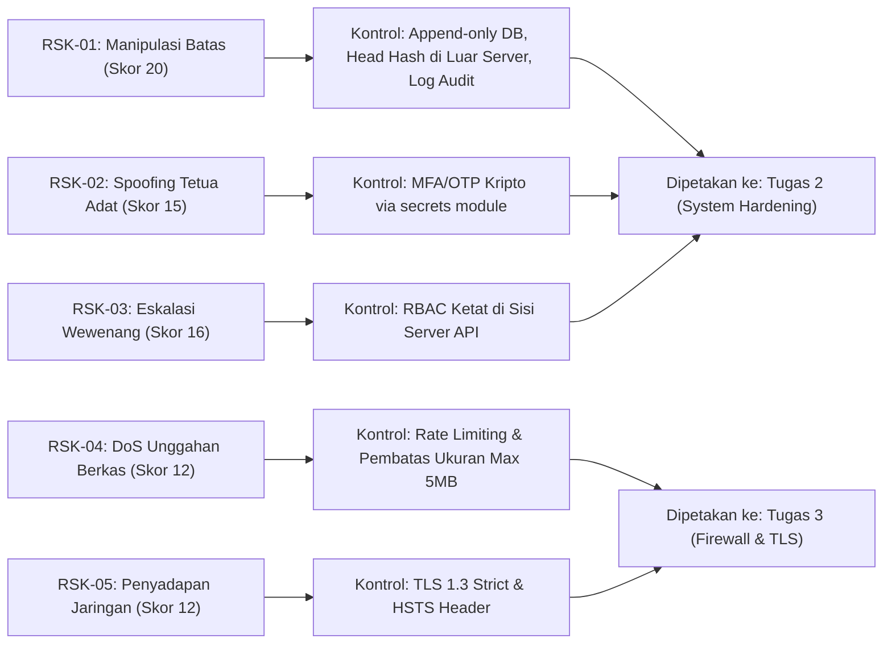

# Register Risiko dan Rencana Kontrol (Risk Register) — TanahKita

**Produk:** TanahKita  
**Pengembang:** Yosafat Jacobus (NIM: 105224016)  
**Mata Kuliah:** Keamanan Komputasi dan Siber (CS5) — Tugas 1  
**Milestone Tag:** `sec-0.1`  

---

## 1. Metodologi Penilaian Risiko

Tingkat risiko dihitung berdasarkan matriks:
$$\text{Skor Risiko} = \text{Kemungkinan (Likelihood: 1--5)} \times \text{Dampak (Impact: 1--5)}$$

* **Kemungkinan (Likelihood):** 1 (Sangat Jarang), 2 (Jarang), 3 (Mungkin), 4 (Sering), 5 (Sangat Sering/Pasti Terjadi).
* **Dampak (Impact):** 1 (Tidak Signifikan), 2 (Kecil), 3 (Sedang), 4 (Besar), 5 (Bencana/Fatal).
* **Tingkat Risiko:** 
  * $\ge 15$: **Tinggi (High)**
  * $8 - 14$: **Sedang (Medium)**
  * $\le 7$: **Rendah (Low)**

---

## 2. Lima Risiko Prioritas Berdasarkan Kondisi Produk

| ID Risiko | Ancaman Terkait | Kemungkinan (L) | Alasan Kemungkinan Berdasarkan Kondisi Produk | Dampak (I) | Alasan Dampak Berdasarkan Kondisi Produk | Skor Risiko | Tingkat Risiko |
| :---: | :---: | :---: | :--- | :---: | :--- | :---: | :---: |
| **RSK-01** | `THR-02`: Manipulasi Batas oleh Admin Nakal (*Tampering*) | **4** | Tekanan ekonomi sengketa tanah tinggi; admin sistem memegang akses langsung ke server database tanpa pengawasan harian. | **5** | Mengubah batas ulayat merugikan hak tanah komunal masyarakat adat Papua dan memicu konflik fisik antarsuku di lapangan. | **20** | **Tinggi** |
| **RSK-02** | `THR-01`: Penyamaran sebagai Tetua Adat (*Spoofing*) | **3** | Literasi digital tetua adat di pedalaman bervariasi; perangkat ponsel pintar rawan dipinjamkan atau token verifikasi dibagikan via chat lisan. | **5** | Pengesahan tanah ulayat oleh pihak palsu menghancurkan legitimasi hukum seluruh sistem TanahKita. | **15** | **Tinggi** |
| **RSK-03** | `THR-08`: Eskalasi Hak Akses Pemohon ke Verifikator (*Privilege Escalation*) | **4** | Aplikasi web tahap awal rentan terhadap kelemahan otorisasi berbasis peran (BOLA/IDOR) pada endpoint API verifikasi klaim. | **4** | Pemohon dapat memvalidasi tanah miliknya sendiri tanpa melalui musyawarah adat yang sah. | **16** | **Tinggi** |
| **RSK-04** | `THR-07`: Serangan DoS Lewat Unggahan Berkas (*Denial of Service*) | **4** | Infrastruktur server mandiri mahasiswa memiliki bandwidth dan kuota disk terbatas; formulir menerima unggahan berkas gambar/PDF. | **3** | Layanan lumpuh saat masyarakat adat sedang membutuhkan akses dokumen pembuktian saat mediasi berlangsung. | **12** | **Sedang** |
| **RSK-05** | `THR-05`: Penyadapan Kredensial di Jaringan Publik (*Information Disclosure*) | **3** | Banyak warga mengakses internet lewat Wi-Fi publik desa atau jaringan seluler terbuka tanpa enkripsi transport lapis tambahan. | **4** | Akun pendaftar diretas dan digunakan untuk mendaftarkan klaim sengketa provokatif. | **12** | **Sedang** |

---

## 3. Rencana Kontrol Penurunan Risiko dan Pemetaan Tugas

Setiap risiko prioritas dilengkapi rencana kontrol teknis yang dirancang untuk menurunkan kemungkinan (*likelihood*) atau dampak (*impact*), serta dipetakan ke target pengerjaan **Tugas 2** atau **Tugas 3**:

### Rincian Rencana Kontrol:

1. **Kontrol untuk RSK-01 (Manipulasi Batas):**
   * *Kondisi saat ini (`v0.1`):* Hash-chain (`chain.py`) sudah mendeteksi perubahan pada sebagian blok. Namun admin yang punya akses tulis penuh ke `D2` masih bisa menghitung ulang **seluruh** rantai sehingga tetap tampak valid.
   * *Tindakan Kontrol:* (a) mencabut hak `UPDATE`/`DELETE` pada tabel riwayat sehingga hanya bisa *append*; (b) mencatat *head hash* terbaru secara berkala di luar server (misal dibagikan ke tetua adat/pendamping hukum) agar rantai hasil hitung ulang ketahuan; (c) memisahkan akun admin server dari akun pengelola data; (d) log audit append-only (`D4`) untuk setiap aksi admin.
   * *Hasil:* Kemungkinan turun dari 4 menjadi 2 karena manipulasi butuh kolusi beberapa pihak dan meninggalkan jejak.
   * *Target:* **Tugas 2 (Kontrol Akses dan System Hardening)**.

2. **Kontrol untuk RSK-02 (Spoofing Tetua Adat):**
   * *Tindakan Kontrol:* Pembangkitan token verifikasi menggunakan CSPRNG (`secrets.token_hex(32)`) dengan masa kedaluwarsa 15 menit dan verifikasi ganda OTP numerik langsung ke nomor verifikator terdaftar.
   * *Hasil:* Kemungkinan penyerang menebak token menjadi $1 : 2^{256}$ (praktis mustahil).
   * *Target:* **Tugas 2 (Autentikasi & Kontrol Akses)**.

3. **Kontrol untuk RSK-03 (Eskalasi Hak Akses):**
   * *Tindakan Kontrol:* Menerapkan *Role-Based Access Control* (RBAC) ketat di level API server. Setiap permintaan aksi verifikasi memvalidasi klaim sesi JWT dan status peran dari basis data, bukan dari parameter masukan pengguna.
   * *Hasil:* Kemungkinan eskalasi hak akses turun dari 4 menjadi 1.
   * *Target:* **Tugas 2 (Kontrol Akses)**.

4. **Kontrol untuk RSK-04 (Denial of Service Berkas):**
   * *Tindakan Kontrol:* Membatasi ukuran unggahan berkas maksimal 5 MB per berkas, validasi *magic bytes* berkas (hanya PDF/JPG/PNG), dan menerapkan *rate limiting* maksimal 5 unggahan per menit per IP.
   * *Hasil:* Kemungkinan kehabisan kapasitas disk turun dari 4 menjadi 1.
   * *Target:* **Tugas 3 (Firewall, WAF, dan Segmentasi)**.

5. **Kontrol untuk RSK-05 (Penyadapan Jaringan Publik):**
   * *Tindakan Kontrol:* Menerapkan protokol TLS 1.3 wajib, penolakan koneksi HTTP murni melalui pengalihan otomatis 301 ke HTTPS, serta penyematan *header* `Strict-Transport-Security` (HSTS).
   * *Hasil:* Peluang intersepsi jaringan turun dari 3 menjadi 1.
   * *Target:* **Tugas 3 (Keamanan Jaringan dan TLS)**.
